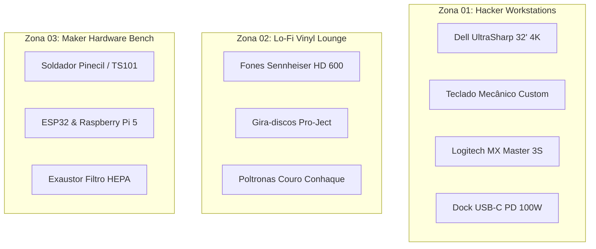

---
tags:
  - planb
  - planb/tema-03
tema: 3
---

# Tema 3: Estações de Trabalho, Hacker Rigs & Infraestrutura Maker

[[02 - Arquitetura e Espaços|← Anterior]] | [[Plan B|Índice]] | [[04 - Branding e Identidade|Próximo →]]

## Especificações das 3 Zonas de Trabalho no Piso Principal

| Zona | Designação | Especificação Técnica | Política de Acesso e Preço |
| :--- | :--- | :--- | :--- |
| **ZONA 01** | **Estações Hacker "Root Access"** | Monitores Dell UltraSharp 4K 32" Antirreflexo em braço a gás; Teclados mecânicos custom com switches Boba U4T/Gateron Oil Kings; Ratos Logitech MX Master 3S; Dock Thunderbolt 4 / USB-C 100W PD; Ethernet Gigabit RJ-45 com VLAN isolada; Cadeiras ergonómicas certificadas Herman Miller / Sihoo Doro S300. | **€ 1.50/h** (ou **Gratuito** com qualquer consumo na cafetaria). |
| **ZONA 02** | **Lo-Fi Vinyl & Reading Lounge** | Poltronas vintage em pele conhaque e mesas baixas de nogueira maciça; Auscultadores abertos de estúdio Sennheiser HD 600 em cada posto; Gira-discos Pro-Ject Debut Carbon; Biblioteca de zines de computação, manuais UNIX retro e ficção cyberpunk; Iluminação âmbar 2200K de intensidade regulável; Tomadas Schuko e portas GaN embutidas. | **Acesso Livre** a todos os clientes do cybercafé. |
| **ZONA 03** | **Maker & Hardware Bench** | Estações de soldar digitais Pinecil / TS101 e multímetros de bancada; Kits de prototipagem rápida ESP32, Raspberry Pi 5, Flipper Zero labs e breadboards; Extratores de fumo individuais com filtro de carvão ativado; Bancada com ferramentas de precisão iFixit e osciloscópios. | **€ 2.00/h** (materiais básicos de soldadura incluídos). |

## Equipamento de Marca (Referência Visual)

![[merch_teclado.png|560]]
*Teclado mecânico compacto com keycaps `PLAN B`, cabo coiled e barra em nogueira.*

![[merch_phones.png|560]]
*Auscultadores over-ear com assinatura `PLAN B` — alternativa de marca aos HD 600 do lounge.*

![[espaco_workstations.jpg|640]]
*Posto de trabalho montado: monitor 4K, teclado e iluminação focada.*
