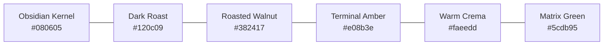

---
tags:
  - planb
  - planb/tema-04
tema: 4
---

# Tema 4: Identidade de Marca, Branding & Arte ASCII

[[03 - Workstations e Maker|← Anterior]] | [[Plan B|Índice]] | [[05 - Carta e Gastronomia|Próximo →]]

## Paleta Cromática Oficial



| Token de Cor | Hex Code | Referência Pantone | Função no Sistema Visual |
| :--- | :--- | :--- | :--- |
| **Obsidian Kernel** | `#080605` | Pantone Black 6 C | Fundo primordial, profundidade de ecrã OLED e imersão total. |
| **Dark Roast Espresso** | `#120c09` | Pantone 440 C | Superfícies secundárias, cartões, fundos de secções e estofos. |
| **Roasted Walnut** | `#382417` | Pantone 469 C | Madeira de nogueira maciça, molduras, divisórias e bordas. |
| **Terminal Amber** | `#e08b3e` | Pantone 151 C | Destaques de ação, títulos principais, botões e fósforo CRT. |
| **Warm Crema** | `#faeedd` | Pantone 7527 C | Tipografia principal, espuma de café, conforto de leitura prolongada. |
| **Muted Coffee Ash** | `#967d6a` | Pantone 7531 C | Textos secundários, comentários de código e metadados. |
| **Matrix Green Accent** | `#5cdb95` | Pantone 7488 C | Acentos funcionais de status "OK", portas abertas e sucesso de rede. |

## Tipografia Oficial

- **Código, UI & Terminal:** `JetBrains Mono` / `Fira Code` (Monospace profissional com ligaduras).
- **Display / Títulos CRT:** `VT323` (Nostalgia 8-bit / fósforo âmbar anos 80).
- **Editorial & Kraft Físico:** `Space Mono` ou `Courier Prime`.

## Aplicação da Marca

![[merch_hoodie_preto.png|420]]
![[merch_hoodie_castanho.png|420]]

*Hoodie com o ícone de terminal e wordmark `PLAN B` — variantes preto e castanho café.*

![[merch_caneca.png|420]]
![[merch_caderno_caneta.png|420]]

*Caneca em cerâmica bicolor e caderno "Unhackable Note Pad" com gravação a ouro.*

![[merch_broches.png|600]]
*Sistema de broches: `PLAN B`, `SYSTEM CONTINGENCY`, `IF ALL ELSE FAILS` e `SYSADMIN`.*

## Arte ASCII de Marca

```
 ____  _        _    _   _   ____     __  __
|  _ \| |      / \  | \ | | | __ )   / / / /
| |_) | |     / _ \ |  \| | |  _ \  / / / / 
|  __/| |___ / ___ \| |\  | | |_) |/ / / /  
|_|   |_____/_/   \_\_| \_| |____//_/ /_/   
  ____ __   ______  _____ ____   ____    _    _____ _____ 
 / ___|\ \ / / __ )| ____|  _ \ / ___|  / \  |  ___| ____|
| |     \ V /|  _ \|  _| | |_) | |     / _ \ | |_  |  _|  
| |___   | | | |_) | |___|  _ <| |___ / ___ \|  _| | |___ 
 \____|  |_| |____/|_____|_| \_\____/_/    \_\_|   |_____|
```

