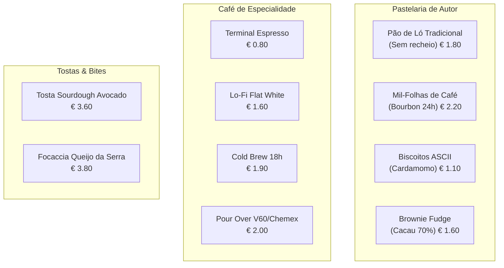

---
tags:
  - planb
  - planb/tema-05
tema: 5
---

# Tema 5: Gastronomia de Autor & Carta de Cafetaria de Especialidade

[[04 - Branding e Identidade|← Anterior]] | [[Plan B|Índice]] | [[06 - Merchandising|Próximo →]]

## Menu Completo dos 12 Itens com Fotografia e Especificação Técnica

| ID | Item | Categoria | Preço | Especificação Técnica / Método | Imagem no Catálogo |
| :---: | :--- | :---: | :---: | :--- | :--- |
| **m1** | **Pão de Ló Tradicional (Sem Recheio)** | Pastry | **€ 1.80** | Cozido a 180°C, massa pura, ovos inteiros e farinha | `PlanoB/images/especialidades/especialidade_paodelo.jpg` |
| **m2** | **Mil-Folhas de Café Especial** | Pastry | **€ 2.20** | Massa folhada laminada, infusão cold-steep 24h | `PlanoB/images/especialidades/especialidade_milfolhas.jpg` |
| **m3** | **Terminal Espresso (Single Origin)** | Coffee | **€ 0.80** | Extração 9 bar / 27s / 18g in - 36g out | `PlanoB/images/menu/menu_espresso.jpg` |
| **m4** | **Cold Brew [DAEMON] 18h** | Coffee | **€ 1.90** | Maceração a frio 18 horas, filtro triplo de papel | `PlanoB/images/menu/menu_coldbrew.jpg` |
| **m5** | **Lo-Fi Flat White (127.0.0.1)** | Coffee | **€ 1.60** | Ristretto duplo, microespuma a vapor 62°C | `PlanoB/images/menu/menu_flatwhite.jpg` |
| **m6** | **Chemex / V60 Pour Over** | Coffee | **€ 2.00** | Rácio 1:16, água a 93°C, moagem uniforme EK43S | `PlanoB/images/menu/menu_pourover.jpg` |
| **m7** | **Matcha Matrix Cerimonial** | Tea | **€ 2.40** | Grau cerimonial de Uji, batido com chasen tradicional | `PlanoB/images/menu/menu_matcha.jpg` |
| **m8** | **Earl Grey & Lavanda [ROOT]** | Tea | **€ 1.40** | Bergamota natural da Calábria, infusão 4 min | `PlanoB/images/menu/menu_earlgrey.jpg` |
| **m9** | **Biscoitos ASCII Cardamomo** | Pastry | **€ 1.10** | Manteiga, cardamomo moído, carimbo ASCII em relevo | `PlanoB/images/menu/menu_biscoitos.jpg` |
| **m10** | **Tosta Hacker Sourdough & Avocado** | Bites | **€ 3.60** | Fermentação lenta 48h, dukkah artesanal, azeite | `PlanoB/images/menu/menu_tosta.jpg` |
| **m11** | **Sandwich Focaccia & Queijo da Serra** | Bites | **€ 3.80** | Focaccia de alecrim grelhada com Queijo da Serra DOP | `PlanoB/images/menu/menu_focaccia.jpg` |
| **m12** | **Brownie Fudge Café & Nozes** | Pastry | **€ 1.60** | Chocolate 70% belga, nozes tostadas e dose de ristretto | `PlanoB/images/menu/menu_brownie.jpg` |

## Galeria da Carta

![[especialidades_doces.jpg|700]]
*As duas assinaturas: Pão de Ló sem recheio e Mil-Folhas de café, servidos com espresso.*

### Pastelaria

![[especialidade_paodelo.jpg|340]]
![[especialidade_milfolhas.jpg|340]]
![[menu_biscoitos.jpg|340]]
![[menu_brownie.jpg|340]]

### Café

![[menu_espresso.jpg|340]]
![[menu_flatwhite.jpg|340]]
![[menu_coldbrew.jpg|340]]
![[menu_pourover.jpg|340]]

### Chá

![[menu_matcha.jpg|340]]
![[menu_earlgrey.jpg|340]]

### Tostas & Bites

![[menu_tosta.jpg|340]]
![[menu_focaccia.jpg|340]]
