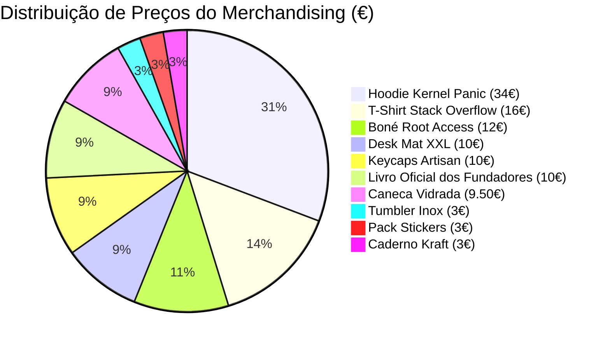

---
tags:
  - planb
  - planb/tema-06
tema: 6
---

# Tema 6: Linha Oficial de Merchandising ("Hardware & Apparel")

[[05 - Carta e Gastronomia|← Anterior]] | [[Plan B|Índice]] | [[07 - Localizações e Imóveis|Próximo →]]

## Catálogo de Artigos Oficiais

| Artigo | Material & Fabrico | Detalhe Estético | PVP |
| :--- | :--- | :--- | :---: |
| **Hoodie "Kernel Panic"** | 100% Algodão francês 450 gsm orgânico escuro | Bordado tonal na frente; costas com `curl https://planb.cafe/coffee.sh` e receita em pseudocódigo. | **€ 34.00** |
| **T-Shirt "Stack Overflow"** | Algodão cru pré-lavado 240 gsm | Tipografia âmbar com código `HTTP 418: I'm a teapot (and I need coffee)`. | **€ 16.00** |
| **Boné "Root Access"** | Sarja de algodão escuro com fivela de latão | Patch bordado `[PLAN_B]` em relevo discreto. | **€ 12.00** |
| **Desk Mat XXL "Terminal Grid"** | Microfibra rápida (900x400x4mm) + borracha natural | Blueprint PCB com atalhos de terminal e Vim gravados no canto. | **€ 10.00** |
| **Keycaps Artisan (Pack 2)** | Resina PBT bicolor castanho café e âmbar translúcido | Tecla `ESC` com relevo Pão de Ló; tecla `ENTER` com `[EXEC_BREW]`. | **€ 10.00** |
| **Livro // "Plano B: Guia Foco"** | Impressão em papel reciclado kraft encadernado | Manual prático de carreira tech, foco profundo e relato dos fundadores ex-SOC. | **€ 10.00** |
| **Caneca Cerâmica Vidrada** | Cerâmica feita ao torno em Barcelos/Caldas (350ml) | Preto mate exterior e caramelo interior com selo carimbado ASCII. | **€ 9.50** |
| **Tumbler Térmico Inox 500ml** | Aço 304 vácuo duplo com interior cerâmico | Preto mate com gravação laser; mantém quente 6h / frio 18h. | **€ 3.00** |
| **Pack Stickers Vinil (x6)** | Vinil mate impermeável à prova de UV | `sudo eat-paodelo`, `milfolhas.overflow()`, `caffeine > sleep`. | **€ 3.00** |
| **Caderno Kraft de Engenharia** | Papel pontilhado 120 gsm com fecho de fita âmbar | Capa rígida chocolate, bolso traseiro para esquemas de circuitos. | **€ 3.00** |

## Galeria de Produtos

![[merchandising_planb.jpg|700]]
*Mesa de apresentação: hoodie, caneca, embalagens kraft, stickers e desk mat.*

### Vestuário

![[merch_hoodie_preto.png|360]]
![[merch_hoodie_castanho.png|360]]

**Hoodie "Kernel Panic"** — variantes preto e castanho café.

![[merch_tshirt_1.png|360]]
![[merch_tshirt_2.png|360]]

**T-Shirt "Stack Overflow"** — frente com `HACK OR BE HACKED` e costas com caveira ASCII.

### Papelaria & Escritório

![[merch_caderno_caneta.png|360]]
![[merch_caderno_caneta_2.png|360]]

**Caderno "Unhackable Note Pad"** — capa rígida com gravação e faixa em pele.

![[merch_survival_book.png|360]]
![[merch_mousepad.png|500]]

**Livro "Plano B: Informatic Survival Manual"** e **Desk Mat XXL "Terminal Grid"** com script de arranque.

![[merch_mousepad_objetos.png|600]]
*Desk mat em contexto de uso, com teclado e rato.*

### Canecas & Hardware

![[merch_caneca.png|360]]
![[merch_teclado.png|500]]

**Caneca Cerâmica Vidrada** (preto mate / caramelo) e **teclado de marca** com keycaps `PLAN B`.

![[merch_phones.png|500]]
*Auscultadores over-ear `PLAN B` — proposta de hardware de marca.*

### Stickers & Broches

![[merch_autocolantes.png|600]]
*Pack de stickers em paleta âmbar/castanho (linha clássica).*

![[merch_broches.png|600]]
*Broches metálicos da linha clássica.*

### Linha "Haker" (Street / Graffiti)

> [!note] Variante de edição limitada
> Estética graffiti/neon sobre a identidade base — pensada para eventos, CTFs e colaborações.

![[merch_autocolantes_haker.png|600]]
*Stickers `localhost:8080` em estética glitch/street.*

![[merch_broches_haker.png|600]]
*Broches `PLAN B // OFFLINE` com caveira pixel e fita de perigo.*
