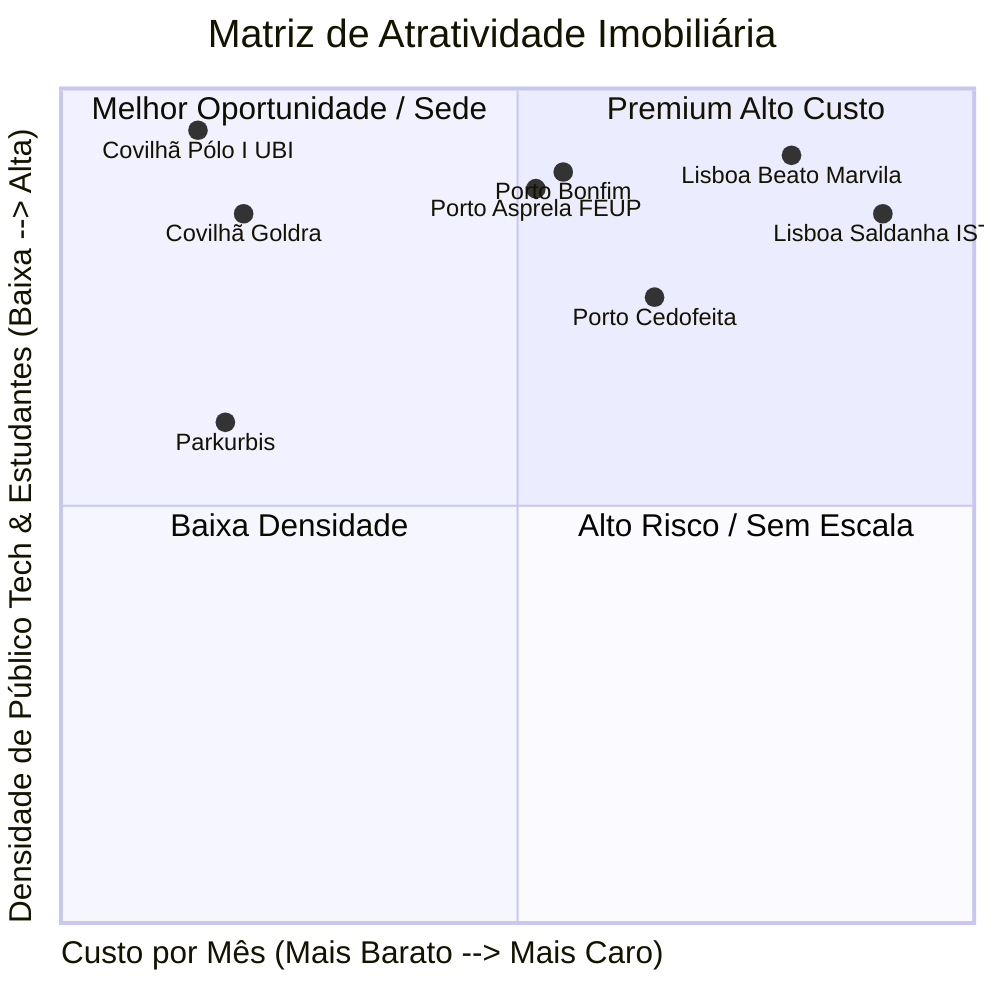

---
tags:
  - planb
  - planb/tema-07
tema: 7
---

# Tema 7: Estudo Imobiliário & Levantamento de Localizações Reais

[[06 - Merchandising|← Anterior]] | [[Plan B|Índice]] | [[08 - CapEx|Próximo →]]

## Análise Comparativa de Imóveis

| Zona / Cidade                              | Tipologia                                |    Área    |    Renda Estimada     |                                          Link Maps                                          | Perfil de Público Alvo                                                  |
| :----------------------------------------- | :--------------------------------------- | :--------: | :-------------------: | :-----------------------------------------------------------------------------------------: | :---------------------------------------------------------------------- |
| **Pólo I UBI / Marquês d'Ávila (Covilhã)** | Loja em edifício histórico / cantaria    | 140–175 m² |   **€ 650 – € 950**   |  [Maps](https://maps.google.com/?q=Rua+Marqu%C3%AAs+d%27%C3%81vila+e+Bolama+Covilh%C3%A3)   | Estudantes de Engenharia Informática UBI, docentes e investigadores.    |
| **Goldra / Av. Universidade (Covilhã)**    | Espaço amplo junto ao Elevador da Goldra | 150–190 m² |  **€ 700 – € 1.050**  | [Maps](https://maps.google.com/?q=Avenida+da+Universidade+Elevador+da+Goldra+Covilh%C3%A3)  | Comunidade universitária geral, nómadas tech da Serra da Estrela.       |
| **Parkurbis / Tortosendo (Covilhã)**       | Módulo em Parque de Ciência e Tecnologia | 160–210 m² |   **€ 600 – € 900**   |                  [Maps](https://maps.google.com/?q=Parkurbis+Covilh%C3%A3)                  | Empresas de software, startups de IA e engenharia de telecomunicações.  |
| **Bonfim / 24 de Agosto (Porto)**          | Armazém térreo de esquina com montra     | 150–180 m² | **€ 1.800 – € 2.400** |          [Maps](https://maps.google.com/?q=Rua+do+Bonfim+Campo+24+de+Agosto+Porto)          | Criativos, devs freelance, nómadas digitais internacionais.             |
| **Asprela / Paranhos (Porto)**             | Loja moderna próxima à FEUP/ISEP/UPTEC   | 160–200 m² | **€ 1.700 – € 2.300** |           [Maps](https://maps.google.com/?q=Rua+Dr.+Roberto+Frias+Paranhos+Porto)           | +30.000 estudantes universitários de engenharia e ciência.              |
| **Cedofeita / Breiner (Porto)**            | Espaço clássico com pátio interior       | 130–160 m² | **€ 2.300 – € 3.100** |                   [Maps](https://maps.google.com/?q=Rua+do+Breiner+Porto)                   | Turistas culturais, entusiastas de café de especialidade, designers.    |
| **Hub Criativo Beato / Marvila (Lisboa)**  | Galpão industrial com vigas de ferro     | 160–220 m² | **€ 2.800 – € 3.800** | [Maps](https://maps.google.com/?q=Hub+Criativo+do+Beato+Rua+da+Manuten%C3%A7%C3%A3o+Lisboa) | Startups da Web Summit, multinacionais tech, nómadas dos EUA/Nórdicos.  |
| **Saldanha / Arroios (Lisboa)**            | Rés-do-chão comercial próximo ao IST     | 130–170 m² | **€ 3.200 – € 4.400** |                 [Maps](https://maps.google.com/?q=Arroios+Saldanha+Lisboa)                  | Docentes e estudantes do Instituto Superior Técnico e consultores tech. |

> [!info] Sobre os anúncios
> Valores **pedidos** recolhidos a 24/11/2026 em portais públicos (Idealista, Imovirtual, Casa IOL, Casa Sapo, Supercasa, OLX). Não são preços de fecho e os anúncios podem ser retirados. Confirmar sempre licença de utilização, alvará e condições (cauções, fiador, trespasse).

## Anúncios de Arrendamento

| Zona                          | Anúncio / Morada                                        |      Área |                             Renda pedida |  €/m² | Fonte                                                                                                                                                                    | Observações                                                                                                                |
| :---------------------------- | :------------------------------------------------------ | --------: | ---------------------------------------: | ----: | :----------------------------------------------------------------------------------------------------------------------------------------------------------------------- | :------------------------------------------------------------------------------------------------------------------------- |
| **Covilhã — Pólo I UBI**      | Loja na Rua Marquês d'Ávila e Bolama, 41                |    100 m² |                          **€ 1.300/mês** | 13,00 | [Idealista](https://www.idealista.pt/imovel/35337055/)                                                                                                                   | Em frente à Biblioteca da UBI; 2 montras, WC adaptado, arrecadação, AC. Preferência por atividade que feche até às 21h. |
| **Covilhã — Pólo I UBI**      | Loja na Av. Frei Heitor Pinto                           |    150 m² |                         **sob consulta** |     — | [CNI](https://www.cni.com.pt/imovel-venda-arrendamento-loja-covilha-6200792)                                                                                             | Rés-do-chão, grande montra, junto à universidade; venda **ou** arrendamento. Condições: 2 rendas + caução + fiador.     |
| **Covilhã — Saúde/UBI**       | Espaço comercial junto à Faculdade de Ciências da Saúde |    140 m² |                          **€ 1.400/mês** | 10,00 | [Casa IOL](https://casa.iol.pt/alugar-loja-covilha-e-canhoso-faculdade-de-ciencias-da-saude-da-universidade-da-beira-interior-0b3ff91a-a9e6-11f0-b6a1-060000000058.html) | Novo, 2 WC, certificado A; zona de clínicas e serviços.                                                                 |
| **Covilhã — Zona Industrial** | Escritórios para serviços                               | 154,56 m² |                          **€ 1.000/mês** |  6,47 | [Imovirtual](https://www.imovirtual.com/pt/anuncio/escritorios-para-servicos-arrendamento-em-zona-industrial-covilha-ID1hfot)                                            | Rés-do-chão, estacionamento e AC; menos vocacionado para público de rua.                                                |
| **Covilhã — Centro**          | Loja na Alameda Pêro da Covilhã, 2                      |    107 m² |                          **€ 1.500/mês** | 14,02 | [Idealista](https://www.idealista.pt/imovel/35132192/)                                                                                                                   | Avenida principal; montra e boa visibilidade.                                                                              |
| **Porto — Bonfim**            | Loja na Rua do Heroísmo                                 |    150 m² |   **€ 350/mês** + trespasse **€ 32.000** |  2,33 | [Casa Sapo](https://casa.sapo.pt/lojas/porto/bonfim)                                                                                                                     | Renda muito abaixo de mercado por exigir remodelação total; trespasse a negociar. Oportunidade de risco.                   |
| **Porto — Bonfim**            | Loja na Av. de Fernão de Magalhães                      |    139 m² |                             sob consulta |     — | [Supercasa](https://supercasa.pt/arrendar-espacos_comerciais_ou_armazens/porto/bonfim)                                                                                   | Zona consolidada; comparar com a renda média de Bonfim (~10–14 €/m²).                                                   |
| **Porto — Asprela/Paranhos**  | Loja com terraço na R. Costa Cabral                     |    153 m² |                          **€ 1.500/mês** |  9,80 | [Casa IOL](https://casa.iol.pt/alugar-loja-porto-paranhos-3002fb00-864f-11f0-8add-060000000054.html)                                                                     | Duas frentes, 3 entradas, 2 WC e terraço; junto ao Hospital Conde de Ferreira.                                          |
| **Porto — Asprela/ISEP**      | Loja na Rua Conde Avranches, 411                        |    150 m² | **€ 1.800/mês** + trespasse **€ 75.000** | 12,00 | [Idealista](https://www.idealista.pt/geo/arrendar-lojas_ou_armazens/centro-de-paranhos/)                                                                                 | Três frentes, junto ao ISEP; antiga confeitaria com mezanine.                                                           |
| **Porto — Asprela/Amial**     | Loja com garagem no Amial                               |    207 m² |                          **€ 1.900/mês** |  9,18 | [Imovirtual](https://www.imovirtual.com/pt/resultados/arrendar/imoveis-comerciais/porto/porto/paranhos)                                                                  | Excelente visibilidade e estacionamento; acima da área-alvo.                                                               |
| **Porto — Cedofeita**         | Loja de 150 m²                                          |    150 m² |                          **€ 1.350/mês** |  9,00 | [Habitar Portugal](https://www.habitarportugal.pt/pt/arrendar/espacoscomerciais/porto/porto?page=1)                                                                      | Abaixo da estimativa do dossier (€ 2.300–3.100); confirmar estado e licença.                                            |
| **Lisboa — Beato**            | Espaço comercial no Beato                               |    200 m² |                          **€ 1.400/mês** |  7,00 | [Idealista](https://www.idealista.pt/arrendar-lojas_ou_armazens/lisboa/beato)                                                                                            | Rés-do-chão, área ampla; preço de armazém, não de loja premium.                                                         |
| **Lisboa — Beato**            | Loja até 150 m²                                         |   ≤150 m² |                          **€ 1.800/mês** | 19,67 | [Idealista](https://www.idealista.pt/arrendar-lojas_ou_armazens/lisboa/beato/com-tamanho-max_150)                                                                        | Zona em requalificação; verificar pé-direito e extração de fumos.                                                       |
| **Lisboa — Marvila**          | Armazém com pé-direito alto                             |    200 m² |                          **€ 1.900/mês** |  9,50 | [Supercasa](https://supercasa.pt/venda-armazem-lisboa/i2092532)                                                                                                          | Junto à Bela Vista; também está à venda por € 249.000. Sem acesso a camiões grandes.                                    |

## Anúncios de Compra

| Zona                       | Anúncio / Morada                            |           Área |                        Preço |  €/m² | Modalidadde | Fonte                                                                                                    | Observações                                                                         |
| :------------------------- | :------------------------------------------ | -------------: | ---------------------------: | ----: | ----------- | :------------------------------------------------------------------------------------------------------- | :---------------------------------------------------------------------------------- |
| **Covilhã — Centro**       | Loja no centro da cidade                    |         120 m² |                **€ 150.000** | 1.250 |             | [Kovilimob](https://www.kovilimob.pt/imovel/loja-centro-da-cidade/26185656)                              | Referência de preço para o hub inicial; verificar estado e licença.              |
| **Covilhã — UBI**          | Loja na Av. Frei Heitor Pinto               |         150 m² |                 sob consulta |     — |             | [CNI](https://www.cni.com.pt/imovel-venda-arrendamento-loja-covilha-6200792)                             | Venda ou arrendamento; localização alinhada com o Pólo I.                        |
| **Covilhã — Tortosendo**   | Loja                                        |          42 m² |                 **€ 67.500** | 1.607 |             | [Imovirtual](https://www.imovirtual.com/pt/resultados/comprar/imoveis-comerciais/castelo-branco/covilha) | Demasiado pequena para o conceito; útil como referência de €/m².                 |
| **Covilhã — Peso**         | Loja ampla                                  |         379 m² |                **€ 120.000** |   317 |             | [Mitula](https://imoveis.mitula.pt/lojas-covilha)                                                        | Área muito acima do alvo; possível para produção/armazém.                        |
| **Porto — Bonfim**         | Loja na Rua das Doze Casas                  |            n/d |                **€ 325.000** |     — |             | [Supercasa](https://supercasa.pt/comprar-espacos_comerciais_ou_armazens/porto/bonfim)                    | Zona consolidada; pedir áreas e estado de conservação.                           |
| **Porto — Bonfim**         | Loja na Rua de São Victor                   |            n/d |                **€ 249.000** |     — |             | [Supercasa](https://supercasa.pt/comprar-espacos_comerciais_ou_armazens/porto/bonfim)                    | Alternativa mais barata na mesma freguesia.                                         |
| **Porto — Bonfim**         | Loja (anúncio OLX)                          |         150 m² |                **€ 150.000** | 1.000 |             | [OLX](https://www.olx.pt/imoveis/stores/stores_sale/bonfim/q-comercial)                                  | Preço competitivo;  confirmar se é trespasse ou imóvel.                          |
| **Porto — Bonfim**         | Loja usada                                  |         177 m² | **€ 299.000** (de € 355.000) | 1.689 |             | [Casa IOL](https://casaiol.pt/comprar-lojas/porto/bonfim?lp=120000)                                      | Desconto de 15,8%;  área próxima do alvo.                                        |
| **Lisboa — Saldanha**      | Loja no Casal Ribeiro, 28                   |         174 m² |              **€ 1.280.000** | 7.356 |             | [Idealista](https://www.idealista.pt/imovel/34412869/)                                                   | R/C + piso superior, 2 montras, arrendada a pastelaria; yield anunciada de 5,5%. |
| **Lisboa — Saldanha**      | Loja na Rua Ferreira Lapa, 46 B             |         252 m² |                **€ 490.000** | 1.944 |             | [Idealista](https://www.idealista.pt/imovel/35086100/)                                                   | Construção de 2021, open space, 1 WC; excelente para cowork/café.                |
| **Lisboa — Arroios**       | Loja na Rua Cruz da Carreira                |         281 m² |                **€ 425.000** | 1.512 |             | [Casa Sapo](https://casa.sapo.pt/comprar-lojas/usado/lisboa/arroios/)                                    | Dois pisos (135 m² + 146 m²), montra ampla, possível esplanada.                     |
| **Lisboa — Arroios**       | Loja com logradouro                         | 163 m² + 54 m² |                **€ 450.000** | 2.761 |             | [Casa Sapo](https://casa.sapo.pt/comprar-lojas/usado/lisboa/arroios/)                                    | Logradouro coberto, saída de fumos; apto para restauração.                       |
| **Lisboa — Arroios**       | Loja na Rua Pascoal de Melo                 |         245 m² |              **€ 1.275.000** | 5.204 |             | [Casa Sapo](https://casa.sapo.pt/comprar-lojas/usado/lisboa/arroios/)                                    | Dois pisos, cozinha e WC; já afeta a restauração.                                |
| **Lisboa — Marvila**       | Loja de esquina na Praça Dr. Fernando Amado |         200 m² |                **€ 500.000** | 2.500 |             | [Idealista](https://www.idealista.pt/imovel/34991255/)                                                   | 175 m² úteis, 2 montras; anunciante indica rentabilidade de 6%.                  |
| **Lisboa — Marvila**       | Armazém                                     |         200 m² |                **€ 249.000** | 1.245 |             | [Supercasa](https://supercasa.pt/venda-armazem-lisboa/i2092532)                                          | Pé-direito alto; também disponível para arrendamento a € 1.900/mês.              |
| **Lisboa — Beato**         | Armazém                                     |         140 m² |                **€ 170.000** | 1.214 |             | [Idealista](https://www.idealista.pt/imovel/34573250/)                                                   | Escritório + 2 WC; metro das Olaias a 5 min.                                     |
| **Lisboa — Beato/Marvila** | Armazém na Rua Capitão Leitão               |         172 m² |                **€ 325.000** | 1.890 |             | [Idealista](https://www.idealista.pt/imovel/34646293/)                                                   | Dois pisos e dois portões; junto ao rio.                                         |
| **Lisboa — Beato**         | Loja no Beato Quarter II                    |         360 m² |              **€ 1.300.000** | 3.611 |             | [Idealista](https://www.idealista.pt/imovel/35383698/)                                                   | Nova construção (2026); acima da área-alvo, mas referência de produto premium.   |

## Leitura de Mercado

| Zona                          | Estimativa do dossier (€/mês) |      Pedidos observados (€/mês)      | Leitura                                                                                 |
| :---------------------------- | :---------------------------: | :----------------------------------: | :-------------------------------------------------------------------------------------- |
| **Covilhã — Pólo I UBI**      |         € 650 – € 950         |    € 1.300 – € 1.500 (100–140 m²)    | O mercado pede **1,5× a 2×** a estimativa; ajustar o OpEx ou negociar renda mais longa. |
| **Covilhã — Zona Industrial** |         € 600 – € 900         |           € 1.000 (154 m²)           | Alternativa realista se o conceito aceitar menos tráfego de rua.                        |
| **Porto — Bonfim**            |       € 1.800 – € 2.400       |   € 350 (com trespasse) a € 1.800    | Grande dispersão; o valor baixo exige investimento em obras.                            |
| **Porto — Asprela/Paranhos**  |       € 1.700 – € 2.300       |    € 1.500 – € 1.900 (150–207 m²)    | Estimativa conservadora; há boas oportunidades abaixo de € 2.000.                       |
| **Porto — Cedofeita**         |       € 2.300 – € 3.100       |           € 1.350 (150 m²)           | Anúncio isolado abaixo de mercado **(verificar condições e estado)**.                   |
| **Lisboa — Beato/Marvila**    |       € 2.800 – € 3.800       |      € 1.400 – € 1.900 (200 m²)      | Mercado de armazém/loja em requalificação; abaixo da estimativa.                        |
| **Lisboa — Saldanha/Arroios** |       € 3.200 – € 4.400       | € 1.800 (≤150 m²) a € 3.900 (144 m²) | Muito dependente da rua e do estado; lojas premium superam a estimativa.                |

**Preço de compra por m² (pedido):** Covilhã ≈ € 1.250; Porto/Bonfim ≈ € 1.000 – € 1.900; Lisboa/Marvila-Beato ≈ € 1.214 – € 2.500; Lisboa/Saldanha-Arroios ≈ € 1.944 – € 7.356.

### Simulação de rendibilidade (compra vs. arrendamento)

| Cenário | Investimento | Renda mensal de mercado | Yield bruta anual |
| :--- | ---: | ---: | ---: |
| Comprar loja Covilhã 120 m² | € 150.000 | € 1.300 | **10,4%** |
| Comprar loja Marvila 200 m² | € 500.000 | € 1.900 (anúncio semelhante) | **4,6%** |
| Comprar loja Saldanha 174 m² | € 1.280.000 | € 5.867 (yield anunciada 5,5%) | **5,5%** |
| Arrendar Covilhã 140 m² | € 0 (caução + 2 rendas) | € 1.400 | — |

> [!warning] Impacto no modelo financeiro
> O dossier assume € 750/mês de renda na Covilhã ([[09 - OpEx e Break-Even]]). Os anúncios junto à UBI pedem € 1.300–€ 1.500. Recomenda-se atualizar o cenário para **€ 1.200–€ 1.400** ou procurar zonas secundárias (Zona Industrial, Tortosendo) e compensar com o ticket médio.

## Pesquisas Guardadas (links vivos)

- **Covilhã:** [Idealista arrendar](https://www.idealista.pt/arrendar-lojas_ou_armazens/covilha/) · [Idealista comprar](https://www.idealista.pt/comprar-lojas_ou_armazens/covilha) · [Imovirtual arrendar](https://www.imovirtual.com/pt/resultados/arrendar/imoveis-comerciais/castelo-branco/covilha) · [Imovirtual comprar](https://www.imovirtual.com/pt/resultados/comprar/imoveis-comerciais/castelo-branco/covilha)
- **Porto — Bonfim:** [Idealista arrendar](https://www.idealista.pt/arrendar-lojas_ou_armazens/porto/bonfim/com-lojas,loja) · [Idealista comprar](https://www.idealista.pt/comprar-lojas_ou_armazens/porto/bonfim) · [Casa Sapo](https://casa.sapo.pt/lojas/porto/bonfim) · [Supercasa comprar](https://supercasa.pt/comprar-espacos_comerciais_ou_armazens/porto/bonfim)
- **Porto — Asprela/Paranhos:** [Idealista arrendar](https://www.idealista.pt/arrendar-lojas_ou_armazens/porto/paranhos/com-tamanho-max_150/) · [Imovirtual arrendar](https://www.imovirtual.com/pt/resultados/arrendar/imoveis-comerciais/porto/porto/paranhos) · [Imovirtual comprar](https://www.imovirtual.com/pt/resultados/comprar/imoveis-comerciais/porto/porto/paranhos)
- **Lisboa — Beato/Marvila:** [Idealista arrendar Beato](https://www.idealista.pt/arrendar-lojas_ou_armazens/lisboa/beato) · [Idealista comprar Marvila](https://www.idealista.pt/comprar-lojas_ou_armazens/lisboa/marvila) · [Supercasa armazéns](https://supercasa.pt/venda-armazem-lisboa/i2092532)
- **Lisboa — Saldanha/Arroios:** [Idealista comprar Arroios](https://www.idealista.pt/comprar-lojas_ou_armazens/lisboa/arroios) · [Casa Sapo Arroios](https://casa.sapo.pt/comprar-lojas/usado/lisboa/arroios/) · [Imovirtual Saldanha-Picoas](https://www.imovirtual.com/pt/resultados/comprar/imoveis-comerciais/lisboa/lisboa/arroios/saldanha--picoas)
- **Transversais:** [Casa Sapo](https://casa.sapo.pt/) · [Supercasa](https://supercasa.pt/) · [OLX imóveis](https://www.olx.pt/imoveis/) · [CustoJusto](https://www.custojusto.pt/)

## Checklist de Avaliação de um Anúncio

- [ ] **Licença de utilização** compatível com comércio/restauração (não apenas habitação).
- [ ] **Alvará / autorização** de esplanada e horário de funcionamento.
- [ ] **Extração de fumos** até à cobertura (crítico para pastelaria/cozinha).
- [ ] **Potência elétrica** disponível ≥ 34,5 kVA trifásico; quadro e calhas.
- [ ] **Fibra** disponível no edifício (operadores e velocidade simétrica).
- [ ] **Pé-direito** ≥ 3 m e possibilidade de passagem de infraestrutura.
- [ ] **Fachada/montra** com largura suficiente para sinalética e exposição.
- [ ] **Acessibilidade** (WC adaptado, entrada sem degraus).
- [ ] **Ruído e vizinhança** (limites de ruído, condomínio, horários).
- [ ] **Cauções e garantias**: 2 rendas + caução + fiador/seguro (padrão observado).
- [ ] **Trespasse**: separar valor do negócio do valor da renda e verificar dívidas.
- [ ] **IMI, condomínio e seguros** incluídos ou não no valor pedido.
- [ ] **Estado de conservação** e orçamento de obras (comparar com [[08 - CapEx]]).
- [ ] **Cláusula de cessão** e duração do contrato (5–10 anos com renovação).

