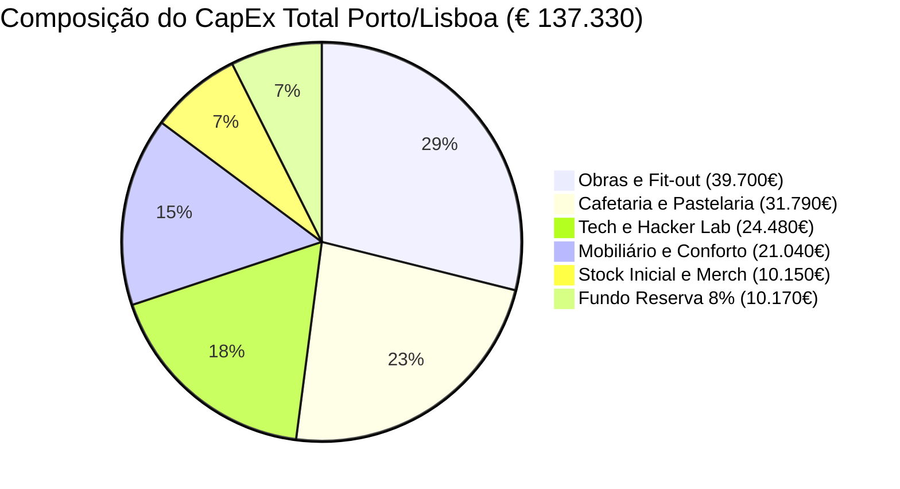

---
tags:
  - planb
  - planb/tema-08
tema: 8
---

# Tema 8: Orçamento Integral de Investimento (CapEx)

[[07 - Localizações e Imóveis|← Anterior]] | [[Plan B|Índice]] | [[09 - OpEx e Break-Even|Próximo →]]

## Discriminação Integral dos 5 Lotes de Investimento

### 1. Projetos, Licenciamento & Obras de Fit-Out (€ 39.700)

| Item | Descrição Técnica | Custo (€) |
| :--- | :--- | :---: |
| Arquitetura & Especialidades | Projetos de interiores, projeto acústico, elétrico e SCIE | € 5.500 |
| Licenciamento Camarário | Taxas municipais de restauração, vistorias sanitárias e certificação | € 2.200 |
| Demolições & Regularização | Remoção de divisórias e aplicação de piso vinílico/microcimento acústico | € 4.800 |
| Tratamento Acústico | Painéis ripados em madeira de nogueira com lã de rocha fonoabsorvente | € 6.800 |
| Eletricidade & DALI | Reforço trifásico (34.5kVA), calhas embutidas com USB-C PD, iluminação âmbar | € 8.500 |
| Climatização & AVAC | Sistema inverter multi-split conduta oculta + renovação de ar forçada | € 7.400 |
| Canalização & Sanitários | Remodelação de 2 instalações sanitárias (1 adaptada para mobilidade reduzida) | € 4.500 |

### 2. Equipamento de Cafetaria de Especialidade & Pastelaria (€ 31.790)

| Equipamento | Marca / Modelo / Função | Custo (€) |
| :--- | :--- | :---: |
| Máquina Espresso Profissional | *La Marzocco Linea PB 2 Grupos* com PID duplo e controlo volumétrico | € 11.500 |
| Moinho Espresso Principal | *Mahlkönig E65S GbW* com pesagem automática integrada | € 2.450 |
| Moinho de Filtro / Lotes | *Mahlkönig EK43S* para moagem uniforme de V60, Chemex e Cold Brew | € 2.700 |
| Tratamento de Água | Sistema de osmose reversa e remineralização *BWT Bestmax Premium* | € 1.350 |
| Forno Convector com Vapor | *Unox Bakerlux Shop.Pro Touch* para Pão de Ló e massa folhada | € 3.800 |
| Batedeira Planetária | *KitchenAid Heavy Duty 6.9L* para massas fofas e claras batidas | € 890 |
| Vitrine Refrigerada | Vitrine vidro reto temperado com ventilação suave (+4°C a +8°C) | € 2.400 |
| Frigoríficos Gastronorm | 2x Balcões refrigerados inox de bancada com gavetas | € 2.200 |
| Congelador Profissional | Congelador vertical inox 700L para reserva de insumos | € 1.100 |
| Máquina de Lavar Louça | Ciclo industrial de 90 segundos com bomba automática de doseamento | € 1.950 |
| Acessórios Barista/Doces | Chaleiras Fellow Stagg, balanças Acaia Lunar, formas de barro tradicionais | € 1.450 |

### 3. Mobiliário, Decoração & Conforto Lo-Fi (€ 21.040)

| Mobiliário / Decoração | Quantidade / Especificação | Custo (€) |
| :--- | :--- | :---: |
| Balcão Principal em Nogueira | Marcenaria por medida em nogueira e tampo em resina escura (5m) | € 5.200 |
| Sofás Couro Vintage | 2x Sofás 3 lugares estilo Chesterfield em pele genuína envelhecida | € 2.800 |
| Poltronas Individuais Veludo | 4x Poltronas ergonómicas de leitura em veludo castanho | € 1.400 |
| Mesas Baixas com Carregadores | 6x Mesas baixas em nogueira maciça com portas USB-C embutidas | € 1.500 |
| Bancadas Hacker (Long Desks) | 3x Bancadas compridas (4 postos cada) em nogueira e calha magnética | € 3.600 |
| Cadeiras Ergonómicas | 12x Cadeiras com apoio lombar dinâmico (Sihoo Doro S300 / Steelcase) | € 3.840 |
| Estantes Industriais | 2x Estantes modulares em aço preto fosco e prateleiras de madeira | € 850 |
| Iluminação Âmbar Vintage | 14 pendentes de vidro âmbar com lâmpadas Edison e 8 de mesa | € 1.250 |
| Plantas & Jardineiras | Pothos, Monstera e Ficus com autorrega para purificação interior | € 600 |

### 4. Infraestrutura Tecnológica & Hacker Lab (€ 24.480)

| Componente Tech | Especificação | Custo (€) |
| :--- | :--- | :---: |
| Rack & Gateway de Rede | *Ubiquiti UniFi Dream Machine Pro SE* (10G SFP+) + Switch 24p PoE | € 1.650 |
| Pontos de Acesso Wi-Fi 7 | 3x *UniFi U7 Pro* para 300+ conexões simultâneas de baixa latência | € 690 |
| Cablagem Cat6A 10G | 24 pontos RJ-45 certificados com tomadas blindadas | € 1.400 |
| Monitores 4K Dell | 8x *Dell UltraSharp 32" 4K (U3223QE)* com Hub USB-C 90W PD | € 6.400 |
| Braços Articulados | 8x Suportes articulados a gás em alumínio preto mate | € 640 |
| Teclados & Ratos | 6x Keychron Q1 Pro (switches lubrificados) + 6x Logitech MX Master 3S | € 1.550 |
| Cabines Acústicas Privadas | 2x Cabines pré-fabricadas insonorizadas com vidro laminado duplo | € 7.500 |
| Bancada Maker | 2x Ferros Pinecil, osciloscópio Rigol, kits ESP32/Raspberry Pi 5 | € 1.350 |
| Sistema de Som Analógico | Amplificador a válvulas, 4x Wharfedale Diamond e gira-discos Pro-Ject | € 1.850 |
| Sistema POS de Balcão | 2x iPads com suporte em alumínio, gaveta de dinheiro e impressora térmica | € 1.450 |

### 5. Stock Inicial, Merchandising & Sinalética (€ 10.150)

| Rubrica | Quantidade / Especificação | Custo (€) |
| :--- | :--- | :---: |
| Café & Ingredientes Frescos | 80 kg grão arábica especialidade, ovos biológicos, manteiga DOP, farinhas | € 2.200 |
| Produção Inicial de Merch | 40 hoodies, 60 t-shirts, 50 canecas artesanais, 30 desk mats, 300 stickers | € 3.900 |
| Embalagens Kraft Takeaway | 2.000 caixas de Pão de Ló/Mil-Folhas carimbadas, copos bio, guardanapos | € 1.650 |
| Sinalética & Néon Âmbar | Placas gravadas a laser em alumínio e letreiro exterior em néon âmbar | € 2.400 |

## Comparativo de CapEx por Cenário Geográfico

| Parâmetro | Cenário A: Covilhã (Hub Inicial UBI) | Cenário B: Porto / Lisboa (Expansão) |
| :--- | :---: | :---: |
| **Obras e Acústica** | € 18.500 | € 39.700 |
| **Cafetaria & Pastelaria** | € 16.200 | € 31.790 |
| **Tecnologia & Hacker Lab** | € 11.400 | € 24.480 |
| **Mobiliário & Conforto** | € 8.800 | € 21.040 |
| **Stock Inicial & Merch** | € 3.500 | € 10.150 |
| **Subtotal CapEx Direto** | **€ 58.400** | **€ 127.160** |
| **Fundo de Contingência (8%)** | € 4.000 | € 10.170 |
| **TOTAL GERAL DE ARRANQUE** | **€ 62.400** | **€ 137.330** |
