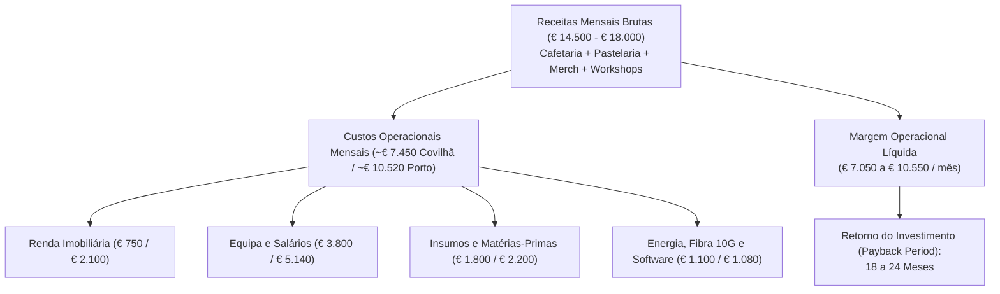

---
tags:
  - planb
  - planb/tema-09
tema: 9
---

# Tema 9: Custos Operacionais (OpEx) & Modelo Financeiro de Break-Even

[[08 - CapEx|← Anterior]] | [[Plan B|Índice]] | [[10 - Academia e Bunker|Próximo →]]

## Comparativo Mensal de Custos Fixos (OpEx)

| Rubrica de Custo | Cenário Covilhã (UBI) | Cenário Porto (Bonfim) |
| :--- | :---: | :---: |
| **Renda Comercial** | € 750 / mês | € 2.100 / mês |
| **Chefe Barista de Especialidade** | € 1.500 / mês | € 1.800 / mês |
| **Pasteleiro/a Artesanal (Pão de Ló & Folhados)** | € 1.500 / mês | € 1.740 / mês |
| **Baristas Part-time (Noites/Fim de semana)** | € 800 / mês | € 1.600 / mês |
| **Eletricidade Trifásica & Água** | € 600 / mês | € 750 / mês |
| **Fibra Ótica Dedicada Simétrica 10G** | € 180 / mês | € 180 / mês |
| **Reposição de Insumos (Café, ovos, manteiga)** | € 1.800 / mês | € 2.200 / mês |
| **Software POS, Licenças & Contabilidade** | € 320 / mês | € 350 / mês |
| **Total OpEx Mensal:** | **€ 7.450 / mês** | **€ 10.720 / mês** |

> [!warning] Renda da Covilhã subestimada
> Anúncios atuais junto ao Pólo I da UBI pedem **€ 1.300–€ 1.500/mês** (ver [[07 - Localizações e Imóveis#Anúncios de Arrendamento]]), contra os € 750 assumidos aqui. Recomenda-se recalcular o cenário com **€ 1.200–€ 1.400** ou procurar zona secundária (Tortosendo/Zona Industrial, ~€ 1.000).

## Projeção de Faturação e Ponto de Equilíbrio (Break-Even)

- **Ticket Médio:** € 2.60 a € 3.20.
- **Volume Diário de Transações:** 140 a 200 consumos/dia.
- **Linhas de Receita Adicionais:**
  - Merchandising (hoodies, canecas, desk mats): € 800 – € 1.200 / mês.
  - Workshops Maker & Red Team aos fins de semana: € 1.500 – € 2.200 / mês.
- **Break-Even Point:** Atingido com **~85 a 95 consumos/dia** (Covilhã) ou **~145 consumos/dia** (Porto).
