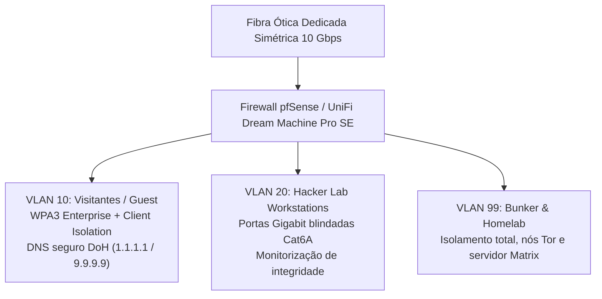

---
tags:
  - planb
  - planb/tema-11
tema: 11
---

# Tema 11: Infraestrutura de Telecomunicações, Cibersegurança & Regras de Convivência

[[10 - Academia e Bunker|← Anterior]] | [[Plan B|Índice]] | [[12 - Terminal CLI|Próximo →]]

## Matriz de Telecomunicações e Segurança de Rede

| Parâmetro | Configuração Técnica | Propósito Operacional |
| :--- | :--- | :--- |
| **Acesso WAN** | Fibra Ótica Dedicada Simétrica 10 Gbps redundante com failover 5G. | Latência inferior a 2ms, ideal para compilação remota e stream de áudio lo-fi. |
| **SSID Wi-Fi Principal** | `PLAN_B_GUEST_5GHZ` com Wi-Fi 6E/7 (UniFi U7 Pro). | Cobertura integral com suporte a mais de 300 dispositivos em simultâneo. |
| **Isolamento de Clientes** | Client Isolation ativo em nível de camada 2 (L2). | Impede que qualquer computador na rede pública consiga espiar tráfego de terceiros. |
| **Criptografia & DNS** | WPA3 Enterprise + DNS over HTTPS (DoH) com Cloudflare/Quad9. | Proteção contra interceção de tráfego, man-in-the-middle e censura de DNS. |
| **Nó Matrix & Comunidade** | Servidor descentralizado Matrix local (`#planb:matrix.org`) e canal Telegram. | Comunicação segura e encriptada ponta a ponta sem dependência de plataformas proprietárias. |
| **PGP Key Fingerprint** | `7F3B 98A2 4C10 D89E 02FA` | Assinatura oficial das comunicações confidenciais dos fundadores. |

## Regras de Convivência e Foco

1. **Chamadas de Voz e Vídeo:** Restritas obrigatoriamente às **2 cabines acústicas privadas**. Não são permitidas chamadas em altifalante no piso do cybercafé.
2. **Uso de Auscultadores:** Obrigatório em todas as estações hacker e sofás do lounge. O áudio do espaço é preenchido exclusivamente pela estação lo-fi em vinil.
3. **Hardware Hacking Responsável:** Testes de RF emissores com SDR só podem ocorrer dentro da Gaiola de Faraday blindada.
4. **Política de Mesas Limpas:** Copos e loiça devem ser devolvidos ao balcão após o consumo.
