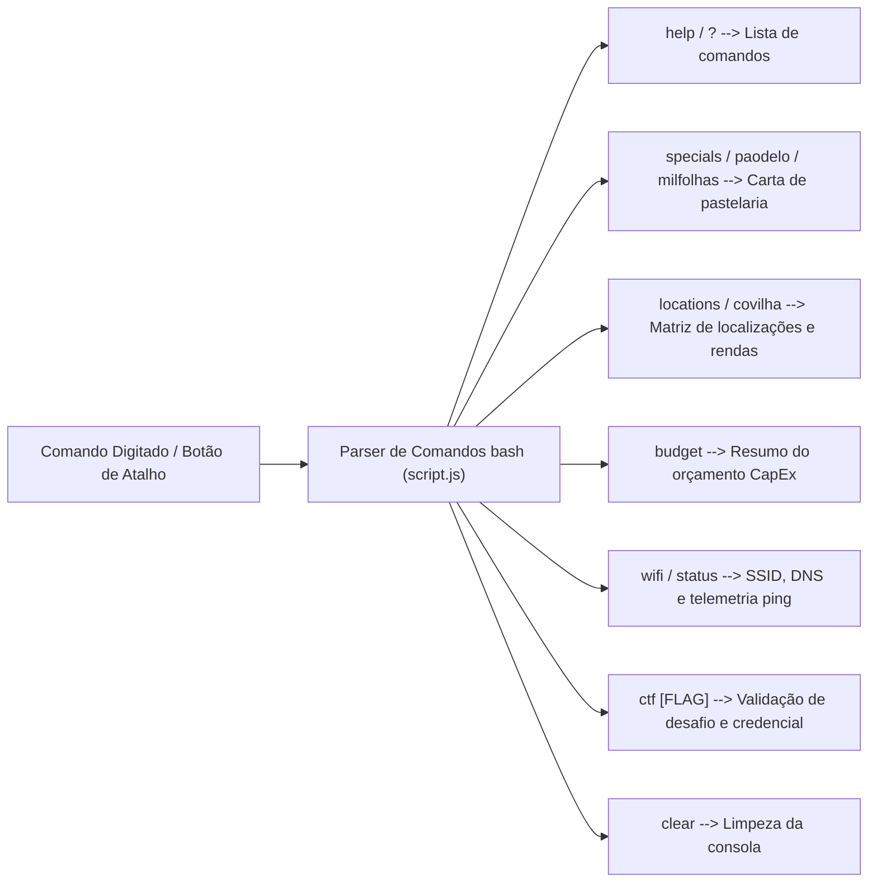

---
tags:
  - planb
  - planb/tema-12
tema: 12
---

# Tema 12: Terminal CLI Interativo, Comandos & Telemetria em Tempo Real

[[11 - Telecom e Regras|← Anterior]] | [[Plan B|Índice]] | [[13 - CTF e Credencial|Próximo →]]

O portal web integra um emulador de terminal CLI em bash (`guest@planb-cybercafe:~`) que responde a comandos funcionais e simula a telemetria do sistema:

## Dicionário de Comandos Disponíveis no Terminal

| Comando | Descrição da Resposta no Ecrã |
| :--- | :--- |
| `help` / `?` | Imprime a lista completa de comandos disponíveis e instruções de navegação. |
| `covilha` | Apresenta detalhes do Hub Principal da UBI na Covilhã (Rua Marquês d'Ávila, rendas e ligação à universidade). |
| `specials` | Exibe as duas especialidades gastronómicas de assinatura (Pão de Ló e Mil-Folhas). |
| `paodelo` | Ficha técnica e história do Pão de Ló tradicional português sem qualquer recheio (€ 1.80). |
| `milfolhas` | Ficha do Mil-Folhas artesanal de café arábica e massa folhada estaladiça (€ 2.20). |
| `locations` | Tabela formatada em texto com os 8 espaços mapeados (Covilhã, Porto e Lisboa). |
| `budget` | Sumário financeiro consolidado dos 5 lotes de CapEx (€ 137.330 Porto / € 58.400 Covilhã). |
| `merch` | Lista dos produtos oficiais de vestuário, canecas artesanais e periféricos. |
| `wifi` | Exibe as credenciais de rede, parâmetros de encriptação e o token encriptado do captive portal. |
| `ctf <FLAG>` | Submete a flag encontrada no puzzle criptográfico para verificação instantânea. |
| `clear` | Limpa o ecrã do terminal e reinicia o prompt limpo. |
