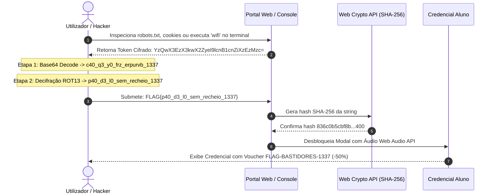

---
tags:
  - planb
  - planb/tema-13
tema: 13
---

# Tema 13: Desafio Criptográfico (CTF Captive Portal & Credencial Hacker)

[[12 - Terminal CLI|← Anterior]] | [[Plan B|Índice]] | [[14 - Catálogo Visual|Próximo →]]

Para manter a fidelidade à cultura hacker e filtrar o acesso a descontos exclusivos nos workshops dos bastidores, o portal web implementa um mini-CTF client-side estático (compatível com GitHub Pages):

