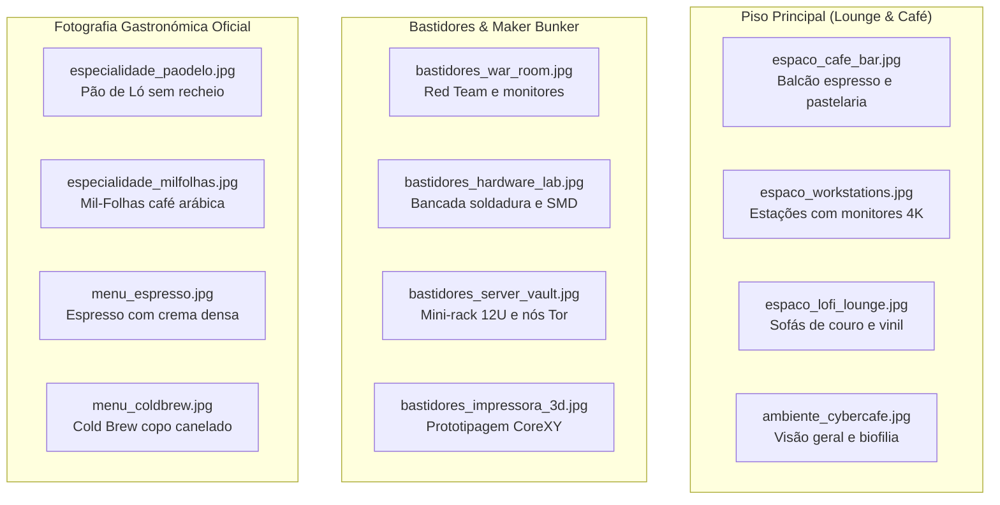

---
tags:
  - planb
  - planb/tema-14
tema: 14
---

# Tema 14: Catálogo Visual & Galeria Fotográfica do Espaço

[[13 - CTF e Credencial|← Anterior]] | [[Plan B|Índice]]

## Mapa dos Ativos

## Piso Principal

![[espaco_cafe_bar.jpg|700]]
*Balcão em nogueira e latão com máquina La Marzocco e iluminação âmbar 2200K.*

![[espaco_workstations.jpg|700]]
*Estações hacker com monitores 4K foscos, teclados Keychron Q e iluminação focada.*

![[espaco_lofi_lounge.jpg|700]]
*Canto de leitura com sofás de couro conhaque, gira-discos e fones abertos.*

![[ambiente_cybercafe.jpg|700]]
*Panorâmica da atmosfera lo-fi, paredes em tons escuros e isolamento acústico.*

## Bastidores & Maker Bunker

![[bastidores_war_room.jpg|700]]
*Bunker com betão aparente, calhas suspensas, ThinkPads e dashboards de CTF.*

![[bastidores_hardware_lab.jpg|700]]
*Bancada de eletrónica com osciloscópio Rigol, microscópio SMD e ferros de precisão.*

![[bastidores_server_vault.jpg|700]]
*Mini-rack 12U com switch 24p, cluster de nós descentralizados e graffiti stencil.*

![[bastidores_impressora_3d.jpg|700]]
*Estação de impressão 3D CoreXY fechada com bobinas de filamento técnico.*

## Gastronomia

![[especialidades_doces.jpg|700]]
*Pão de Ló sem recheio e Mil-Folhas de café — as duas assinaturas.*

![[especialidade_paodelo.jpg|340]]
![[especialidade_milfolhas.jpg|340]]
![[menu_espresso.jpg|340]]
![[menu_coldbrew.jpg|340]]

## Merchandising

![[merchandising_planb.jpg|700]]
*Linha oficial: hoodie, caneca, embalagens kraft, stickers e desk mat.*

![[merch_hoodie_preto.png|360]]
![[merch_hoodie_castanho.png|360]]
![[merch_tshirt_1.png|360]]
![[merch_tshirt_2.png|360]]
![[merch_caneca.png|360]]
![[merch_caderno_caneta.png|360]]
![[merch_caderno_caneta_2.png|360]]
![[merch_survival_book.png|360]]
![[merch_mousepad.png|500]]
![[merch_mousepad_objetos.png|500]]
![[merch_teclado.png|500]]
![[merch_phones.png|500]]
![[merch_autocolantes.png|600]]
![[merch_broches.png|600]]
![[merch_autocolantes_haker.png|600]]
![[merch_broches_haker.png|600]]

## Tabela de Ativos

| Ficheiro | Âmbito | Descrição Visual |
| :--- | :--- | :--- |
| `PlanoB/images/espaco/espaco_cafe_bar.jpg` | Piso 1 | Balcão em nogueira e latão com máquina La Marzocco e iluminação âmbar 2200K. |
| `PlanoB/images/espaco/espaco_workstations.jpg` | Piso 1 | Estações hacker com monitores 4K foscos, teclados Keychron Q e iluminação focada. |
| `PlanoB/images/espaco/espaco_lofi_lounge.jpg` | Piso 1 | Canto de leitura com sofás de couro conhaque, gira-discos e fones abertos. |
| `PlanoB/images/espaco/ambiente_cybercafe.jpg` | Piso 1 | Panorâmica da atmosfera lo-fi, paredes em tons escuros e isolamento acústico. |
| `PlanoB/images/bastidores/bastidores_war_room.jpg` | Bastidores | Bunker com betão aparente, calhas suspensas, ThinkPads e dashboards de CTF. |
| `PlanoB/images/bastidores/bastidores_hardware_lab.jpg` | Bastidores | Bancada de eletrónica com osciloscópio Rigol, microscópio SMD e ferros de precisão. |
| `PlanoB/images/bastidores/bastidores_server_vault.jpg` | Bastidores | Mini-rack 12U com switch 24p, cluster de nós descentralizados e graffiti stencil. |
| `PlanoB/images/bastidores/bastidores_impressora_3d.jpg` | Bastidores | Estação de impressão 3D CoreXY fechada com bobinas de filamento técnico. |
| `PlanoB/images/especialidades/especialidade_paodelo.jpg` | Gastronomia | Pão de Ló tradicional português (massa dourada, fofa e arejada, sem recheio). |
| `PlanoB/images/especialidades/especialidade_milfolhas.jpg` | Gastronomia | Mil-Folhas artesanal com camadas caramelizadas crocantes e creme de café Bourbon. |
| `PlanoB/images/especialidades/especialidades_doces.jpg` | Gastronomia | As duas especialidades servidas com espresso sobre mesa de nogueira. |
| `PlanoB/images/menu/menu_*.jpg` | Gastronomia | Fotografia individual dos 12 itens da carta (café, chá, pastelaria e bites). |
| `PlanoB/images/merch/merchandising_planb.jpg` | Merch | Linha de artigos oficiais (hoodie, canecas cerâmicas, embalagens e desk mats). |
| `PlanoB/images/merch/classico/` | Merch | Linha clássica em âmbar/castanho: vestuário, papelaria, canecas, stickers e broches. |
| `PlanoB/images/merch/graffiti/` | Merch | Variante street/graffiti: stickers `localhost:8080` e broches `PLAN B // OFFLINE`. |
| `Loading.mp4` | Vídeo | Vídeo cinematográfico hacker de transição para os bastidores. |
