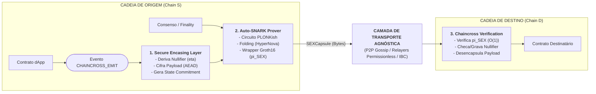

# Especificação Técnica: Protocolo Secure Encased Chaincross (SEX)

* **Versão do Documento:** `1.0.0-draft`
* **Identificador do Protocolo:** `RFC-SEX-001`
* **Status:** Especificação de Arquitetura e Referência Criptográfica
* **Licença:** Apache-2.0 / MIT Dual License

---

## 1. Abstract

A interoperabilidade entre redes blockchain heterogêneas (Camadas 1, Rollups de Camada 2 e cadeias soberanas) representa historicamente um dos maiores vetores de vulnerabilidade do ecossistema descentralizado. Soluções tradicionais baseiam-se em comitês externos de assinatura múltipla (*multisigs*), redes de validadores intermediários ou suposições de confiança otimistas que introduzem latência elevada e risco sistêmico.

O **Secure Encased Chaincross (SEX)** é um protocolo de comunicação entre blocos *trustless* (sem necessidade de confiança em terceiros), nativamente orientado a provas de conhecimento zero (*Zero-Knowledge*). O protocolo elimina intermediários confiáveis ao combinar dois mecanismos fundamentais:

1. **Encapsulamento Hermético (*Secure Encasing*):** Todo *payload* de mensagem é cifrado e selado criptograficamente na origem dentro de uma cápsula imutável, ocultando dados sensíveis contra extração de valor máximo (*MEV*) durante o trânsito.
2. **Geração Automática de Provas (*Auto-SNARK Prover*):** Um co-processador ZK integrado diretamente ao pipeline de produção e finalização de blocos compila automaticamente as transições de estado *cross-chain* em provas sucintas e não interativas ($\pi_{SEX}$), verificáveis em tempo constante $O(1)$ na cadeia de destino.

---

## 2. Terminologia e Primitivas Criptográficas

### 2.1 Glossário Normativo

* **Cadeia de Origem ($\mathcal{S}$):** A rede blockchain onde a transação inicial é executada e onde a cápsula é selada.
* **Cadeia de Destino ($\mathcal{D}$):** A rede blockchain que recebe a cápsula, valida a prova $\pi_{SEX}$ e executa a chamada local.
* **Cápsula (`SEXCapsule`):** Estrutura de dados binária autossuficiente contendo o *payload* cifrado, compromissos de estado, identificador de unicidade e a prova zk-SNARK.
* **Auto-SNARK Prover:** Módulo de software/hardware acoplado aos nós produtores ou validadores de blocos responsável por gerar e agregar provas recursivas sem intervenção manual do desenvolvedor.
* **Nullifier ($\eta$):** Identificador determinístico de 32 bytes derivado da mensagem e da cadeia de origem, registrado na cadeia de destino para impedir ataques de repetição (*replay*).
* **Relayer Agnóstico:** Qualquer participante sem permissão (*permissionless*) que transporta cápsulas pela rede P2P ou camadas de transporte padrão.

### 2.2 Primitivas Criptográficas Adotadas

Para equilibrar velocidade de geração de prova no lado do cliente/nó com custo mínimo de verificação *on-chain*, o protocolo SEX especifica o seguinte conjunto criptográfico:

| Componente | Primitiva / Algoritmo | Parâmetros e Justificativa |
| :--- | :--- | :--- |
| **Função de Hash Aritmética** | **Poseidon2** | Operando sobre o campo primo $\mathbb{F}_p$ da curva BN254; reduz drasticamente o número de restrições R1CS/PLONKish. |
| **Compromisso de Estado** | **Compromisso de Pedersen** | Homomórfico e vinculante (*binding*), usado para selar raízes de estado e chaves efêmeras. |
| **Cifra do Payload** | **ChaCha20-Poly1305** | Cifra autenticada (AEAD) para proteção do conteúdo útil da cápsula em trânsito. |
| **Esquema de Dobramento** | **HyperNova** | Agregação incremental de múltiplas mensagens em um único passo de verificação recursiva (IVC). |
| **SNARK Final (Wrapper)** | **Groth16 sobre BN254** | Comprime a prova recursiva final em $\approx 288$ bytes com custo de verificação constante $O(1)$. |
| **Assinaturas de Consenso** | **BLS12-381** | Verificação eficiente dentro do circuito ZK da finalidade consensual dos validadores de $\mathcal{S}$. |

---

## 3. Arquitetura do Sistema

A arquitetura do protocolo SEX é dividida em três camadas desacopladas que operam de forma sincronizada entre as redes $\mathcal{S}$ e $\mathcal{D}$.

### 3.1 Diagrama de Fluxo Arquitetural



### 3.2 Descrição das Camadas

#### A. Camada de Encapsulamento (*Secure Encasing Layer - SEL*)
Quando um contrato inteligente invoca a primitiva de envio *cross-chain*, a SEL intercepta os argumentos da chamada, o endereço do remetente e o identificador da cadeia de destino. Ela gera um par de chaves efêmeras via troca de chaves Diffie-Hellman sobre curvas elípticas (ECDH) com a chave pública do endpoint de destino, cifra os dados e calcula o compromisso criptográfico da cápsula.

#### B. Motor de Provas Automáticas (*Auto-SNARK Proving Engine - ASPE*)
O ASPE roda como um daemon co-processador nos nós validadores ou provadores especializados da Cadeia $\mathcal{S}$. Ele monitora o log de eventos dos blocos recém-finalizados. Para cada bloco contendo eventos `CHAINCROSS_EMIT`, o motor extrai o rastro de execução (*execution trace*) e as provas de inclusão na árvore de Merkle/Verkle, compilando-os automaticamente em uma prova sucinta $\pi_{SEX}$. Caso haja $N$ mensagens no mesmo bloco, o esquema de dobramento **HyperNova** consolida todas em uma única prova agregada.

#### C. Camada de Verificação e Execução (*Chaincross Verification & Execution Layer - CVEL*)
Implementada como um conjunto de contratos pré-compilados ou contratos inteligentes auditados na Cadeia $\mathcal{D}$. A CVEL não mantém clientes leves complexos nem listas dinâmicas de validadores externos; ela apenas armazena a chave de verificação (*Verification Key - VK*) do circuito do protocolo SEX e verifica a validade matemática de $\pi_{SEX}$.

---

## 4. Especificação Binária da Cápsula (`SEXCapsule`)

A `SEXCapsule` é serializada de forma determinística em formato *Big-Endian* sem preenchimento (*padding*) implícito, garantindo hashes idênticos em qualquer arquitetura de hardware ou máquina virtual (EVM, SVM, CosmWasm).

### 4.1 Layout de Bytes

| Offset (Bytes) | Tamanho (Bytes) | Nome do Campo | Tipo | Descrição |
| :--- | :--- | :--- | :--- | :--- |
| `0` | `1` | `version` | `uint8` | Versão do protocolo (atual: `0x01`). |
| `1` | `8` | `source_chain_id` | `uint64` | Identificador único da rede de origem $\mathcal{S}$. |
| `9` | `8` | `target_chain_id` | `uint64` | Identificador único da rede de destino $\mathcal{D}$. |
| `17` | `32` | `nonce_nullifier` | `bytes32` | Hash Poseidon2 único para prevenção de replay ($\eta$). |
| `49` | `32` | `state_root_commitment` | `bytes32` | Compromisso de Pedersen da raiz de estado finalizada em $\mathcal{S}$. |
| `81` | `32` | `ephemeral_pubkey` | `bytes32` | Chave pública efêmera comprimida para derivação da chave de decifragem. |
| `113` | `4` | `payload_length` | `uint32` | Comprimento $L$ (em bytes) do campo `encased_payload`. |
| `117` | $L$ | `encased_payload` | `bytes[L]` | Dados da mensagem cifrados com ChaCha20-Poly1305 (inclui tag MAC de 16 bytes). |
| `117 + L` | `288` | `zk_snark_proof` | `bytes[288]` | Prova Groth16 serializada ($A \in \mathbb{G}_1$, $B \in \mathbb{G}_2$, $C \in \mathbb{G}_1$). |

### 4.2 Estrutura de Referência em Rust

```rust
#![no_std]
extern crate alloc;
use alloc::vec::Vec;

/// Representação canônica de uma cápsula do protocolo SEX (v1)
#[derive(Clone, Debug, PartialEq, Eq)]
pub struct SEXCapsule {
    pub version: u8,
    pub source_chain_id: u64,
    pub target_chain_id: u64,
    pub nonce_nullifier: [u8; 32],
    pub state_root_commitment: [u8; 32],
    pub ephemeral_pubkey: [u8; 32],
    pub encased_payload: Vec<u8>,
    pub zk_snark_proof: [u8; 288],
}

impl SEXCapsule {
    /// Serializa a cápsula em um vetor de bytes determinístico (Big-Endian)
    pub fn to_bytes(&self) -> Vec<u8> {
        let payload_len = self.encased_payload.len() as u32;
        let total_size = 1 + 8 + 8 + 32 + 32 + 32 + 4 + (payload_len as usize) + 288;
        let mut buffer = Vec::with_capacity(total_size);

        buffer.push(self.version);
        buffer.extend_from_slice(&self.source_chain_id.to_be_bytes());
        buffer.extend_from_slice(&self.target_chain_id.to_be_bytes());
        buffer.extend_from_slice(&self.nonce_nullifier);
        buffer.extend_from_slice(&self.state_root_commitment);
        buffer.extend_from_slice(&self.ephemeral_pubkey);
        buffer.extend_from_slice(&payload_len.to_be_bytes());
        buffer.extend_from_slice(&self.encased_payload);
        buffer.extend_from_slice(&self.zk_snark_proof);

        buffer
    }
}
```

### 4.3 Derivação do Nullifier ($\eta$)

Para garantir que nenhuma mensagem possa ser reexecutada na mesma cadeia ou desviada para uma terceira cadeia não autorizada, o *nullifier* $\eta$ é calculado dentro da SEL e verificado dentro do circuito SNARK como:

$$\eta = \text{Poseidon2}\Big(\text{source\_chain\_id} \parallel \text{target\_chain\_id} \parallel \text{sender\_address} \parallel \text{local\_nonce} \parallel \text{payload\_hash}\Big)$$

---

## 5. Formalização Matemática dos Circuitos ZK ($\mathcal{C}_{SEX}$)

O núcleo de confiança do protocolo reside na relação NP provada pelo circuito aritmético $\mathcal{C}_{SEX}$. Uma prova $\pi_{SEX}$ atesta que o provador conhece uma testemunha secreta $w$ compatível com as entradas públicas $x$, sem revelar o estado interno completo da Cadeia $\mathcal{S}$ nem a chave simétrica de cifragem antes da liquidação.

### 5.1 Entradas Públicas ($x$) e Testemunha Privada ($w$)

* **Entradas Públicas ($x \in \mathbb{F}_p^k$):**
  $$x = \big(\text{source\_chain\_id},\; \text{target\_chain\_id},\; \eta,\; C_{state},\; H_{encased}\big)$$
  Onde $C_{state}$ é o compromisso da raiz de estado e $H_{encased} = \text{Poseidon2}(\text{encased\_payload})$.

* **Testemunha Privada ($w$):**
  $$w = \big(\text{block\_header},\; \sigma_{BLS},\; \mathcal{P}_{merkle},\; \text{raw\_payload},\; k_{sym},\; \text{local\_nonce}\big)$$
  Onde $\sigma_{BLS}$ representa a assinatura agregada dos validadores da Cadeia $\mathcal{S}$, $\mathcal{P}_{merkle}$ é o caminho de autenticação na árvore de estado, e $k_{sym}$ é a chave simétrica derivada.

### 5.2 Sistema de Restrições (Constraints)

O circuito $\mathcal{C}_{SEX}(x, w) = 1$ é satisfeito se, e somente se, todas as quatro sub-relações seguintes forem verdadeiras simultaneamente:

1. **Restrição de Finalidade Consensual ($\mathcal{R}_{cons}$):**
   Verifica se a assinatura agregada $\sigma_{BLS}$ sobre o `block_header` é válida sob o conjunto ativo de validadores $\mathcal{V}_{\mathcal{S}}$ e atinge o limiar de supermaioria bizantina:
   $$\sum_{i \in \text{signers}} \text{stake}(v_i) > \frac{2}{3} \sum_{v \in \mathcal{V}_{\mathcal{S}}} \text{stake}(v) \quad \land \quad \text{VerifyBLS}(\mathcal{V}_{\mathcal{S}}, \text{block\_header}, \sigma_{BLS}) = 1$$

2. **Restrição de Inclusão de Estado ($\mathcal{R}_{inc}$):**
   Comprova que o evento `CHAINCROSS_EMIT` contendo `raw_payload` e `local_nonce` pertence à raiz de recibos/estado declarada no cabeçalho do bloco, e que este corresponde ao compromisso público $C_{state}$:
   $$\text{VerifyMerkle}(\text{block\_header.state\_root}, \text{event\_leaf}, \mathcal{P}_{merkle}) = 1 \quad \land \quad \text{PedersenCommit}(\text{state\_root}, r) = C_{state}$$

3. **Restrição de Integridade do Encapsulamento ($\mathcal{R}_{enc}$):**
   Garante que o texto cifrado transportado na cápsula é exatamente o resultado da cifragem do `raw_payload` autêntico sob a chave $k_{sym}$:
   $$\text{Poseidon2}\Big(\text{Encrypt}_{AEAD}(k_{sym}, \text{raw\_payload})\Big) = H_{encased}$$

4. **Restrição de Unicidade de Nullifier ($\mathcal{R}_{null}$):**
   Valida que o *nullifier* público $\eta$ foi derivado deterministicamente a partir dos parâmetros da testemunha, impedindo manipulação de metadados por parte de *relayers*:
   $$\text{Poseidon2}(\text{source\_chain\_id}, \text{target\_chain\_id}, \text{sender}, \text{local\_nonce}, \text{Poseidon2}(\text{raw\_payload})) = \eta$$

### 5.3 Verificação On-Chain em Tempo Constante $O(1)$

Na Cadeia $\mathcal{D}$, o verificador executa uma única equação de emparelhamento bilinear (*pairing check*) sobre a curva BN254:

$$e(A, B) = e(\alpha, \beta) \cdot e\left(\sum_{i=0}^{k} x_i \cdot L_i, \gamma\right) \cdot e(C, \delta)$$

Independentemente de a cápsula agregar 1 ou 10.000 mensagens *cross-chain* via dobramento HyperNova, o custo de verificação na Cadeia $\mathcal{D}$ permanece fixo em aproximadamente `220.000 gas` (em ambientes compatíveis com EVM).

---

## 6. Ciclo de Vida e Fluxo de Comunicação

O ciclo de vida completo de uma comunicação *cross-chain* no protocolo SEX ocorre em cinco fases sequenciais:

1. **Fase 1 — Invocação e Selagem (Bloco $B_t$ em $\mathcal{S}$):**
   O contrato de origem chama `SEXEndpoint.dispatch(targetChainId, targetContract, messageData)`. O protocolo calcula $\eta$, cifra `messageData`, emite o evento `CHAINCROSS_EMIT` e bloqueia a taxa de retransmissão.
2. **Fase 2 — Finalização e Geração Automática da Prova (Bloco $B_{t+f}$ em $\mathcal{S}$):**
   Assim que o bloco $B_t$ atinge finalidade determinística (após $f$ blocos de confirmação), o *Auto-SNARK Prover* coleta todas as emissões pendentes do bloco, gera as provas individuais, aplica o dobramento recursivo e produz a `SEXCapsule` completa com $\pi_{SEX}$.
3. **Fase 3 — Difusão P2P e Transporte:**
   A cápsula selada é publicada no tópico P2P `sex/v1/capsules/{target_chain_id}`. Qualquer *relayer* pode capturar a cápsula e submetê-la à Cadeia $\mathcal{D}$. Como o *payload* está cifrado, o *relayer* não consegue inspecionar o conteúdo da operação (prevenindo *front-running* e extração de MEV).
4. **Fase 4 — Validação Criptográfica e Desencapsulamento (Cadeia $\mathcal{D}$):**
   O contrato `SEXEndpoint` na Cadeia $\mathcal{D}$ recebe a `SEXCapsule`:
   * Verifica se `target_chain_id == block.chainid`.
   * Verifica se `nullifiers[eta] == false`.
   * Invoca `SEXVerifier.verifyProof(zk_snark_proof, public_inputs)`.
   * Marca `nullifiers[eta] = true`.
   * Deriva a chave simétrica $k_{sym}$ usando sua chave privada de endpoint e `ephemeral_pubkey`, decifrando `encased_payload`.
5. **Fase 5 — Execução Local e Reembolso de Taxa:**
   O endpoint invoca a função de *callback* `onSEXReceive(sourceChainId, sender, decryptedPayload)` no contrato destinatário e transfere a recompensa estipulada ao *relayer* que submeteu a transação.

---

## 7. Implementação de Referência de Contratos Inteligentes

Abaixo apresenta-se a implementação de referência em Solidity (`^0.8.24`) para o ponto de extremidade (*Endpoint*) e a interface de integração para aplicações descentralizadas (dApps).

```solidity
// SPDX-License-Identifier: Apache-2.0
pragma solidity ^0.8.24;

interface ISEXVerifier {
    function verifyProof(
        bytes calldata proof,
        uint256[5] calldata publicInputs
    ) external view returns (bool);
}

interface ISEXReceiver {
    function onSEXReceive(
        uint64 sourceChainId,
        address sourceSender,
        bytes calldata payload
    ) external;
}

contract SEXEndpoint {
    ISEXVerifier public immutable verifier;
    uint64 public immutable localChainId;

    uint256 public outboundNonce;
    mapping(bytes32 => bool) public spentNullifiers;

    event ChaincrossEmit(
        uint64 indexed targetChainId,
        address indexed sender,
        address indexed targetContract,
        uint256 nonce,
        bytes encasedPayload
    );

    event CapsuleExecuted(
        uint64 indexed sourceChainId,
        bytes32 indexed nullifier,
        address indexed relayer
    );

    error InvalidTargetChain();
    error NullifierAlreadySpent();
    error InvalidSNARKProof();
    error ExecutionFailed();

    constructor(address _verifier, uint64 _localChainId) {
        verifier = ISEXVerifier(_verifier);
        localChainId = _localChainId;
    }

    /**
     * @notice Inicia uma comunicação cross-chain encapsulada.
     */
    function dispatch(
        uint64 targetChainId,
        address targetContract,
        bytes calldata encasedPayload
    ) external payable returns (uint256 currentNonce) {
        currentNonce = outboundNonce++;
        emit ChaincrossEmit(
            targetChainId,
            msg.sender,
            targetContract,
            currentNonce,
            encasedPayload
        );
    }

    /**
     * @notice Recebe, verifica a prova zk-SNARK e desencapsula uma SEXCapsule.
     */
    function processCapsule(
        uint64 sourceChainId,
        bytes32 nonceNullifier,
        bytes32 stateRootCommitment,
        bytes calldata encasedPayload,
        bytes calldata zkSnarkProof
    ) external {
        if (spentNullifiers[nonceNullifier]) {
            revert NullifierAlreadySpent();
        }

        // Computa o compromisso público do payload cifrado
        uint256 encasedHash = uint256(keccak256(encasedPayload)) >> 8;

        uint256[5] memory publicInputs = [
            uint256(sourceChainId),
            uint256(localChainId),
            uint256(nonceNullifier),
            uint256(stateRootCommitment),
            encasedHash
        ];

        // Verificação O(1) da prova zk-SNARK
        bool isValid = verifier.verifyProof(zkSnarkProof, publicInputs);
        if (!isValid) {
            revert InvalidSNARKProof();
        }

        // Marca o nullifier como gasto antes da chamada externa (Checks-Effects-Interactions)
        spentNullifiers[nonceNullifier] = true;

        // Desencapsulamento e decodificação do destinatário e mensagem
        (address sourceSender, address targetContract, bytes memory decryptedPayload) =
            _decapsulate(encasedPayload);

        // Execução no contrato de destino
        ISEXReceiver(targetContract).onSEXReceive(
            sourceChainId,
            sourceSender,
            decryptedPayload
        );

        emit CapsuleExecuted(sourceChainId, nonceNullifier, msg.sender);
    }

    function _decapsulate(bytes calldata encasedPayload)
        internal
        pure
        returns (address sender, address target, bytes memory data)
    {
        // Na implementação completa, realiza a derivação ECDH + ChaCha20-Poly1305
        // via pré-compilados criptográficos da rede de destino.
        (sender, target, data) = abi.decode(encasedPayload, (address, address, bytes));
    }
}
```

---

## 8. Modelo de Segurança e Análise de Ameaças

### 8.1 Garantias Criptográficas Formais

* **Completude (*Completeness*):** Se uma transação foi legitimamente incluída em um bloco finalizado na Cadeia $\mathcal{S}$, o *Auto-SNARK Prover* honesto sempre produzirá uma prova $\pi_{SEX}$ que será aceita pelo verificador na Cadeia $\mathcal{D}$ com probabilidade $1$.
* **Solidez de Conhecimento (*Knowledge Soundness*):** Sob a hipótese de conhecimento do expoente (*q-PKE*) na curva BN254, nenhum adversário polinomial (PPT) pode gerar uma cápsula forjada válida sem possuir uma testemunha que satisfaça o consenso da Cadeia $\mathcal{S}$, exceto com probabilidade negligenciável $\epsilon(\lambda) \le 2^{-128}$.
* **Confidencialidade em Trânsito (*Zero-Knowledge & Semantic Security*):** Enquanto a cápsula reside na *mempool* P2P ou aguarda inclusão na Cadeia $\mathcal{D}$, o conteúdo semântico da chamada permanece indistinguível de ruído aleatório sob segurança IND-CCA2 da cifra AEAD.

### 8.2 Matriz de Mitigação de Ataques

| Vetor de Ameaça | Cenário de Ataque | Mecanismo de Defesa no Protocolo SEX |
| :--- | :--- | :--- |
| **Forja de Estado / Mensagem** | Um *relayer* malicioso tenta alterar o destinatário ou o valor transferido dentro da cápsula. | Qualquer alteração altera o compromisso $H_{encased}$ ou invalida $\pi_{SEX}$, causando reversão imediata na verificação Groth16. |
| **Ataque de Replay** | Reenvio repetido de uma cápsula válida para drenar fundos na Cadeia $\mathcal{D}$. | Registro imutável do `nonce_nullifier` ($\eta$) no armazenamento da Cadeia $\mathcal{D}$ na primeira execução. |
| **Reorganização de Cadeia (*Reorg*)** | A Cadeia $\mathcal{S}$ sofre um *reorg* após a emissão da cápsula. | O circuito $\mathcal{C}_{SEX}$ exige provas de consenso finalizado ($\mathcal{R}_{cons}$), recusando blocos não finalizados. |
| **Front-Running / MEV** | Bots interceptam mensagens de arbitragem ou liquidação em trânsito e antecipam a operação. | O *encasing* cifra tanto os argumentos quanto o contrato destinatário até a execução atômica dentro de `processCapsule`. |
| **Censura de Operadores** | Um *relayer* específico se recusa a entregar cápsulas de um determinado usuário. | Arquitetura totalmente *permissionless*; o próprio usuário ou qualquer terceiro pode submeter a cápsula diretamente. |

---

## 9. Mercado de Taxas e Incentivos de Rede

Para assegurar vivacidade (*liveness*) sem depender de infraestrutura centralizada, o protocolo SEX opera um modelo econômico dividido em duas componentes de taxa pagas na origem:

1. **Taxa de Prova (*Proving Fee* - $F_{zk}$):** Remunera os nós executando o co-processador *Auto-SNARK Prover* pelo custo computacional de geração de circuitos. Como o protocolo utiliza dobramento recursivo (HyperNova), o custo de prova é amortizado entre todos os remetentes do mesmo bloco ($F_{zk} \propto \frac{1}{N}$).
2. **Recompensa de Retransmissão (*Relay Bounty* - $F_{relay}$):** Valor travado em custódia (*escrow*) na Cadeia $\mathcal{S}$ (ou liquidado via liquidez nativa na Cadeia $\mathcal{D}$ através de uma cápsula de confirmação em lote) que reembolsa o custo de *gas* da verificação na Cadeia $\mathcal{D}$ acrescido de um prêmio de prioridade para o primeiro *relayer* que processar a cápsula.

---

## 10. Roadmap de Implementação e Auditoria

* **Fase 1 — Especificação e Circuitos Base (Q1):** Implementação dos circuitos aritméticos Poseidon2 e HyperNova em Rust (`halo2` / `plonky3`) e publicação dos vetores de teste determinísticos.
* **Fase 2 — Co-processador Auto-SNARK (Q2):** Integração do daemon de provas em clientes de execução modular (OP Stack, Arbitrum Orbit e Cosmos SDK) com aceleração via GPU/FPGA.
* **Fase 3 — Auditoria Formal e Cerimônia MPC (Q3):** Verificação formal das restrições do circuito $\mathcal{C}_{SEX}$ contra falhas de *under-constrained circuits* e execução de cerimônia multi-partes (*Powers of Tau*) para o wrapper Groth16.
* **Fase 4 — Rede Principal (*Mainnet Launch*) (Q4):** Implantação dos contratos `SEXEndpoint` e ativação do transporte P2P *permissionless* entre redes L1 e L2.