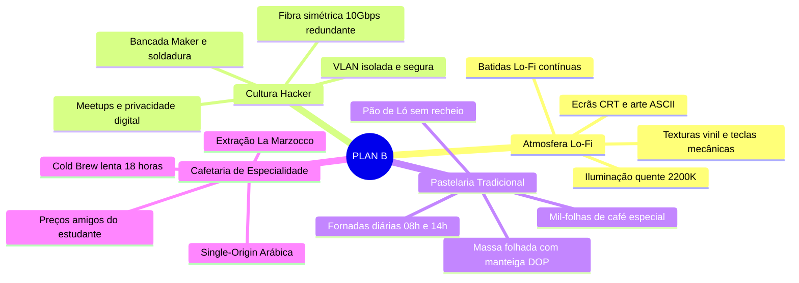

---
tags:
  - planb
  - planb/tema-01
tema: 1
---

# Tema 1: Conceito, Filosofia & Pilares Fundamentais

[[Plan B|← Índice]] | [[02 - Arquitetura e Espaços|Próximo →]]

O **Plan B** é um cybercafé de terceira geração concebido para fundir a atmosfera acolhedora e analógica dos cibercafés dos anos 90/2000 com o rigor contemporâneo do café de especialidade, o foco produtivo da cultura hacker/open-source e a pastelaria tradicional portuguesa.

![[PlanoB/images/espaco/ambiente_cybercafe.jpg|700]]
*Visão geral do espaço: madeira escura, iluminação âmbar e estações de trabalho ao fundo.*

## Pilares Estruturais

| Pilar | Descrição Operacional | Implementação no Espaço |
| :--- | :--- | :--- |
| **Atmosfera Lo-Fi & Terminal** | Redução do ruído visual e sonoro para estado de fluxo mental (*deep work*). | Lâmpadas de filamento âmbar 2200K, paleta obsidiana/café torrado, acústica controlada (45–50 dB) com música lo-fi vinilada. |
| **Cultura Hacker & Geek** | Espaço aberto para entusiastas de hardware, programadores e especialistas de segurança. | 12 estações com monitores 4K, teclados mecânicos Keychron Q, portas USB-C PD 100W e bancada com Pinecil/Raspberry Pi. |
| **Pastelaria Pura de Autor** | Preservação da pureza gastronómica portuguesa aliada à doçaria de conforto. | Pão de Ló estritamente tradicional (sem recheio, gema cozida por inteiro) e Mil-Folhas de café de infusão a frio. |
| **Acessibilidade Académica** | Preços justos calibrados para polos universitários (UBI Covilhã, Porto, Lisboa). | Espresso de especialidade a € 0.80, menus combinados a € 2.60–€ 3.20. |
