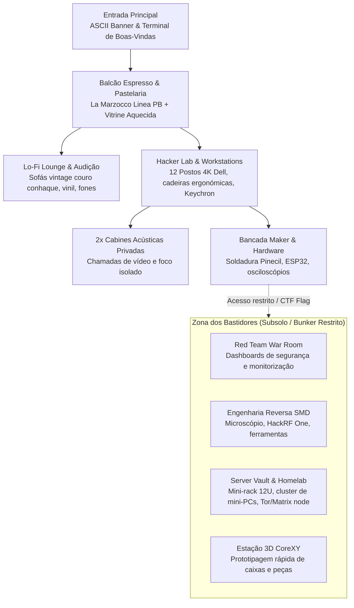

---
tags:
  - planb
  - planb/tema-02
tema: 2
---

# Tema 2: Arquitetura & Distribuição de Espaços (Piso Principal & Bastidores)

[[01 - Conceito e Pilares|← Anterior]] | [[Plan B|Índice]] | [[03 - Workstations e Maker|Próximo →]]

O espaço físico divide-se em duas grandes zonas complementares: o **Piso Principal Aberto** (cafetaria, lounge e estações públicas) e a **Zona Técnica / Bastidores** (bunker maker, sala de segurança e homelab).

## Zoneamento e Áreas Úteis (150 m²)

| Zona | Área Útil | Lotação | Equipamento & Acabamentos |
| :--- | :---: | :---: | :--- |
| **Balcão & Pastelaria** | 40 m² | 4 staff | Balcão em nogueira e latão, forno convector vapor Unox, máquina La Marzocco Linea PB. |
| **Lo-Fi Lounge** | 45 m² | 16 lugares | Sofás Chesterfield couro conhaque, gira-discos Pro-Ject, fones Sennheiser abertos. |
| **Hacker Workstations** | 45 m² | 12 lugares | Bancadas longas de nogueira maciça, 8x monitores 4K Dell 32", 12x cadeiras ergonómicas. |
| **Cabines Acústicas** | 6 m² | 2 pessoas | Vidro duplo laminado acústico, ventilação ativa silenciosa, iluminação de vídeo. |
| **Bancada Maker** | 4 m² | 2 postos | Exaustor de fumos HEPA, estações digitais Pinecil, kits Raspberry Pi 5 e ESP32. |
| **Armazém & Sanitários** | 10 m² | Circulação | 2 WC (1 adaptado a mobilidade reduzida), calhas técnicas e armazenamento de insumos. |

## Referências Visuais do Piso Principal

![[PlanoB/images/espaco/espaco_cafe_bar.jpg|640]]
*Balcão espresso & pastelaria — nogueira, latão e iluminação âmbar.*

![[PlanoB/images/espaco/espaco_workstations.jpg|640]]
*Hacker workstations — bancada corrida, monitores 4K e teclados mecânicos.*

![[PlanoB/images/espaco/espaco_lofi_lounge.jpg|640]]
*Lo-Fi lounge — sofás de couro conhaque, vinil e leitura.*

> [!info] Bastidores
> As imagens do bunker técnico estão em [[10 - Academia e Bunker#Referências Visuais do Bunker]].
