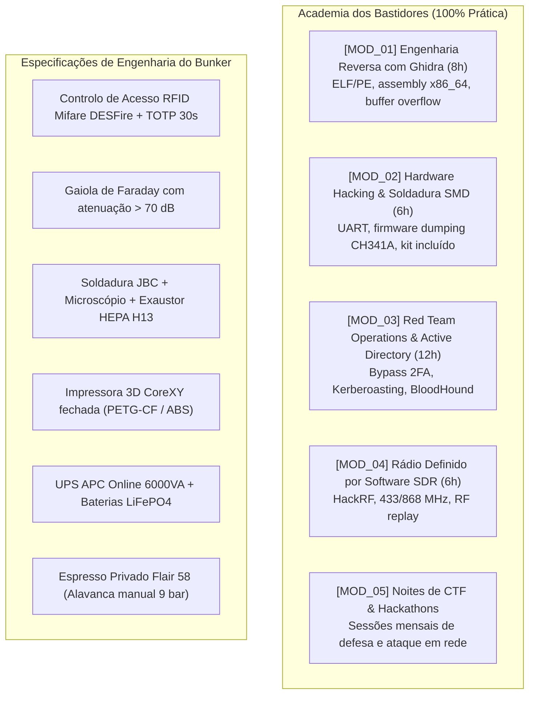

---
tags:
  - planb
  - planb/tema-10
tema: 10
---

# Tema 10: Academia Hacker, Formações Especializadas & Especificações do Bunker

[[09 - OpEx e Break-Even|← Anterior]] | [[Plan B|Índice]] | [[11 - Telecom e Regras|Próximo →]]

## Módulos Oficiais da Academia Prática dos Fundadores

| Código | Módulo / Formação | Carga Horária | Conteúdo Programático & Requisitos | Lotação Máxima |
| :---: | :--- | :---: | :--- | :---: |
| **MOD_01** | **Engenharia Reversa com Ghidra: Desmontar Binários do Zero** | 8h (Fim de semana) | Análise de ficheiros ELF/PE em C/C++, assembly x86_64 e ARM, identificação de buffer overflows e reconstrução de fluxo sem código fonte. | 8 participantes |
| **MOD_02** | **Hardware Hacking Prático: Soldadura SMD, UART e Firmware Dump** | 6h | Ligação física via pinos UART a routers/IoT, shell root, dumping de chips SPI flash com programador CH341A e análise SquashFS. Kit de hardware incluído para levar. | 6 participantes |
| **MOD_03** | **Red Team Operations: Evasão de EDR e Active Directory** | 12h (2 Dias) | Simulação real de intrusão corporativa: OSINT avançado, bypass de MFA, exploração de Active Directory (Kerberoasting, BloodHound) e movimentação lateral. | 4 participantes / equipa |
| **MOD_04** | **Rádio Definido por Software (SDR) & Análise de Sinais RF** | 6h | RTL-SDR e HackRF One na banda ISM (433/868 MHz), captura e descodificação de telemática e comandos sem fios. Requer portátil Linux. | 8 participantes |
| **MOD_05** | **Noites de CTF, Hackathons & Tertúlias de Criptografia** | 4h (Noturno) | Encontros mensais de resolução colaborativa de máquinas "Capture The Flag", análise de novos exploits e partilha de conhecimento livre. | 16 participantes |

## Especificações de Engenharia do Bunker (Subsolo Técnico)

| Subsistema | Equipamento / Especificação | Função Operacional no Espaço |
| :--- | :--- | :--- |
| **Controlo de Acesso** | Leitor RFID 13.56 MHz (Mifare DESFire EV3) + Teclado mecânico TOTP rotativo a cada 30s. | Garante entrada restrita a fundadores e alunos credenciados. |
| **Gaiola de Faraday** | Caixa blindada RF com atenuação de blindagem superior a 70 dB de 100 kHz a 6 GHz. | Permite testes e emissão controlada de rádio sem vazar para a via pública. |
| **Bancada de Soldadura** | Estações JBC de alta precisão, microscópio estéreo contínuo e exaustor HEPA H13. | Soldadura e retrabalho seguro de micro-BGA, QFN e pistas microscópicas. |
| **Prototipagem 3D** | Impressora 3D CoreXY fechada com câmara aquecida e bicos de aço endurecido (Carbon Fiber PETG/ABS). | Fabrico rápido de carcaças, gabaritos de teste e ferramentas personalizadas. |
| **Energia Ininterrupta** | UPS APC Smart-UPS Online trifásica de 6000 VA ligada a banco de baterias LiFePO4. | Mantém servidores, impressoras 3D e estações de soldar operacionais em cortes de energia. |
| **Espresso do Bunker** | Máquina manual de alavanca Flair 58 com manómetro e moinho cónico de 71mm. | Extração personalizada com pré-infusão longa de 15 segundos para as madrugadas de CTF. |

## Referências Visuais do Bunker

![[PlanoB/images/bastidores/bastidores_war_room.jpg|640]]
*Red Team War Room — betão aparente, calhas suspensas e dashboards de CTF.*

![[PlanoB/images/bastidores/bastidores_hardware_lab.jpg|640]]
*Bancada de eletrónica — osciloscópio, microscópio SMD e ferramentas de precisão.*

![[PlanoB/images/bastidores/bastidores_server_vault.jpg|640]]
*Server Vault & Homelab — mini-rack 12U, switch 24p e nós descentralizados.*

![[PlanoB/images/bastidores/bastidores_impressora_3d.jpg|640]]
*Estação de impressão 3D CoreXY com filamento técnico.*
