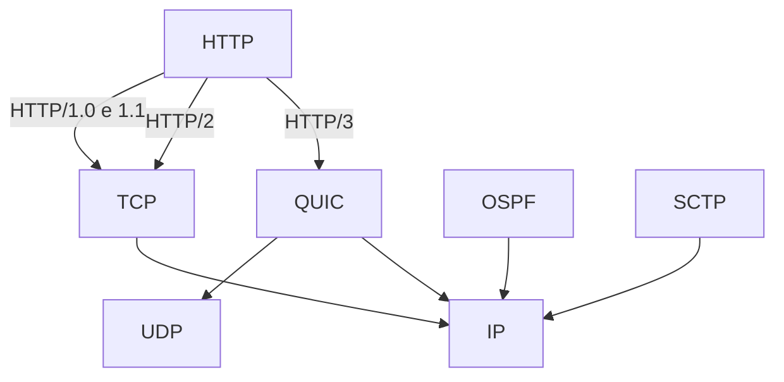

Notas organizadas da disciplina de **Redes** do Mestrado em Engenharia Informática (UBI).

## Fundamentos

- [[Pilha TCP-IP]] — o modelo em camadas e o papel de cada uma
- [[Camada de Transporte]] — fiabilidade, ACK/NACK, checksum, timeout, TCP vs UDP
- [[Camada de Ligação]]

## Protocolos de aplicação e transporte

- [[HTTP]] — HTTP/1.0 → 1.1 → 2 → 3 e o *head-of-line blocking*
- [[QUIC]] — transporte sobre UDP, fluxos independentes, 0-RTT
- [[SCTP]] — *multi-homing* e *multi-streaming*
- [[OSPF]] — roteamento dinâmico por estado de link

- Protocol IEEE 802.15.4z
- 6LoWPAN

- [[CFDP]] — transferência fiável de ficheiros em ambientes espaciais
- [[LTP]] — transporte para redes de atraso/disrupção
- [[Proximity-1 Space Link Protocol]] — enlace de proximidade espacial
- [[BPv7]] — Bundle Protocol v7 (DTN)
- [[DCCP]] — transporte com controlo de congestão para datagramas
- [[LISP]] — separação locator/ID
- [[TSCH]] — time-slotted channel hopping (IEEE 802.15.4)
- [[CoAP]] — aplicação leve para IoT sobre UDP
- [[maxsec]] — segurança máxima em enlaces restritos
- [[MQQT]] — pub/sub leve para telemetria
- [[MPLS]] — comutação por etiquetas
- [[RPL]] — roteamento para LLN
- [[GER]] — (a detalhar)
- [[LoRaWAN]] — rede de longo alcance para IoT
- [[RPKI-RTR]] — validação de origem BGP via RPKI <---- !!!!!
- [[NFC]] — comunicação sem fios a 13,56 MHz, ~4 cm, pagamentos e *pairing*

- PCSB Protocolo de comunicacao sobre "Basicamente"
WppP2P

## Tecnologias de proximidade

## Avaliação e trabalhos

- [[Trabalhos e Avaliação]] — avisos para o teste e enunciados dos trabalhos
- [[Trabalho de pesquisa (aula pratica)]]
- [[Notas de aula (originais)]] — registo em bruto das aulas
- 

## Mapa rápido

## Ideias-chave

- A **fiabilidade** é responsabilidade da **camada de transporte**.
- O **head-of-line blocking** nasce no HTTP/1.0, passa para o TCP no HTTP/2 e é resolvido no HTTP/3 com o [[QUIC]].
- **0 RTT ≠ 0 latência**: significa apenas menos latência (retoma de ligação anterior).
- **TCP** usa ordem comum e identifica a ligação pelo IP; **QUIC** usa ordem por fluxo e um *connection ID*, sobrevivendo à mudança de rede.
- O **NFC** é uma tecnologia de proximidade (13,56 MHz, ~4 cm), não um protocolo da pilha TCP/IP: serve de ponte para pagamentos, acessos e emparelhamento.

encapsolamento na frequencia
o que faz o seguemento?
o que é o seguemento?

ethernet
- CSMACA
- CSMACD

qual e a tecnologia central de uma LAN?
r: switching

Datacenter networks
SDN
correlacao SDN em datacenter network
tecnologia central do multipath (switch)

## Índice por tags
Notas desta disciplina usam `#redes`; subtemas: `#transporte`, `#http`, `#quic`, `#sctp`, `#routing`, `#nfc`, `#avaliação`.
