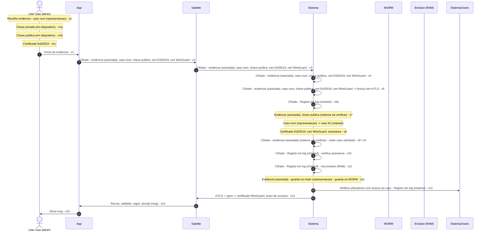
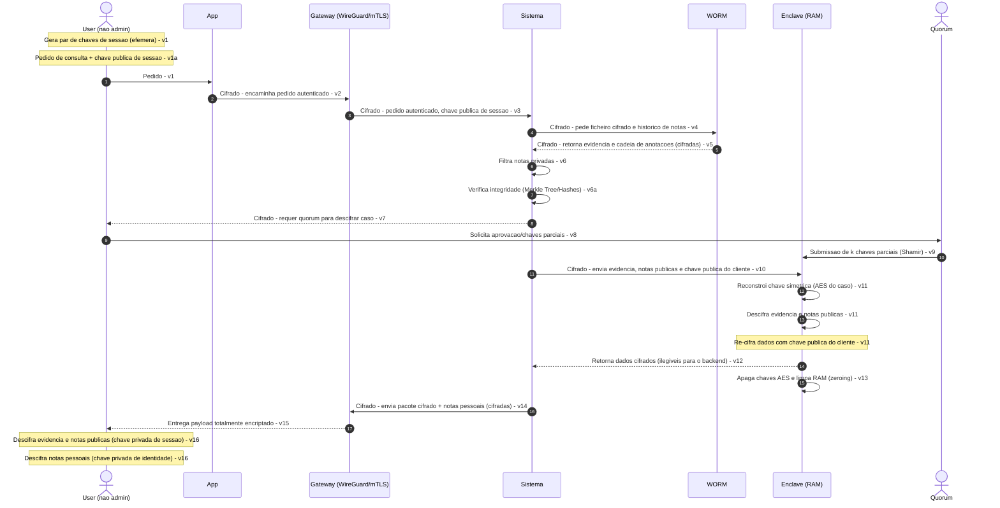

Esta pagina dedica se a analise de vetores de ataque do projeto [[Bat (couf couf) Evidence A Wayne]]

## Revisão da arquitetura e fluxo de dados

### Fluxo 1 — Registo de Evidencias

### Fluxo 2 — Pedido de Evidencias

O pedido de consulta viaja num **envelope efémero de uso único**: par X25519 novo por pedido, `request_id`, nonce de 128 bits, timestamp e TTL curto, com o *transcript* assinado em [[Ed25519]]. O túnel autentica o membro; o envelope garante *forward secrecy* e impede *replay* ou substituição da chave de resposta. Detalhe completo em [[Bat (couf couf) Evidence A Wayne#Pedidos Efémeros (Ephemeral Request Envelope)]].

## Vetores de Ataque e Mitigação

### Fluxo 1 — Registo de Evidências

| Vetor | Descrição                                                                             | Porque é vetor de ataque                                                                            | Mitigação                                                                                              |
| ----- | ------------------------------------------------------------------------------------- | --------------------------------------------------------------------------------------------------- | ------------------------------------------------------------------------------------------------------ |
| v1    | Recolha no dispositivo (evidência, caso num, chave privada/publica, cert [[Ed25519]]) | Dispositivo de campo comprometido pode expor chave privada ou alterar evidência antes da assinatura | Chaves em TPM/Secure Enclave (RNS10);  assinatura imediata no momento da apreensão; hashing SHA-256 |
| v1a   | Chave privada no dispositivo                                                          | Exfiltração da chave privada permite impersonação e não-repúdio falso                               | TPM 2.0/Secure Enclave, não exportável                                                                 |
| v1b   | Chave pública no dispositivo                                                          | Substituição da chave pública pode quebrar verificação                                              | Certificado [[Ed25519]] emitido pela Root CA ([[X.509]]/PKI)                                           |
| v1c   | Certificado [[Ed25519]] no dispositivo                                                | Certificado roubado/clonado                                                                         | Validação contra CRL em tempo real; validade curta                                                     |
| v2    | App → Satélite (cifrado)                                                              | Interceptação/MitM no link satélite; degradação de performance (PEP)                                | [[WireGuard]] (ChaCha20-Poly1305);  MTU/MSS tuning; keepalive                                       |
| v3    | Satélite → Sistema                                                                    | Comprometimento do satélite ou gateway                                                              | [[mTLS]] com certificados [[X.509]];  validação de certificado                                      |
| v4    | Sistema interno (1.ª passagem)                                                        | Movimento lateral interno; acesso não autorizado                                                    | [[mTLS]] entre serviços; menor privilégio                                                              |
| v5    | Sistema interno (troca para [[mTLS]])                                                 | Downgrade de algoritmo ou troca maliciosa de certificado                                            | Lista de algoritmos permitidos;  verificador rejeita fora da lista                                  |
| v6    | Registo em log (chained) + verificação                                                | Falsificação de logs ou quebra da cadeia                                                            | Hash-chaining (prev_hash); assinatura [[Ed25519]]; WORM                                                |
| v6a   | Registo em log chained                                                                | Reescrita de logs de auditoria                                                                      | Blockchain sidechain imutável (T_AUDIT_BLOCK)                                                          |
| v7    | Sistema verifica assinatura                                                           | Bypass da verificação ou aceitação de algoritmo fraco                                               | Verificação obrigatória;  lista de algoritmos permitidos                                            |
| v8    | Chain caso solicitado                                                                 | Acesso a caso sem autorização                                                                       | Controlo de acesso por caso;  hierarquia de acesso                                                  |
| v9    | Chain caso solicitado (sub-passo)                                                     | Enumeração de casos ou IDOR                                                                         | Autorização por caso; auditoria global                                                                 |
| v10   | Verificação de assinatura                                                             | Aceitação de assinatura forjada                                                                     | Verificação [[Ed25519]] contra certificado válido                                                      |
| v11   | Criação de enclave (RAM) + guarda WORM                                                | Exfiltração da chave AES da RAM; corrupção do WORM                                                  | Zeroization (RNS04); WORM append-only (RNS05)                                                          |
| v12   | Notificação a utilizadores                                                            | Fuga de informação sobre quem tem acesso                                                            | Notificação apenas a utilizadores autorizados; log chained                                             |
| v13   | Sistema → Satélite ([[mTLS]], gera cert [[WireGuard]])                                | Emissão de certificado a entidade não autorizada                                                    | Root CA (Alfred, HSM offline);  CRL                                                                 |
| v14   | Satélite → App (receive, validate, decrypt)                                           | Payload malicioso entregue ao cliente                                                               | Validação no cliente; decriptação apenas com chave privada                                             |
| v15   | App → User (show msg)                                                                 | Exibição de dados não verificados; phishing de UI                                                   | Verificação de integridade antes de apresentar                                                         |

### Fluxo 2 — Pedido de Evidências

| Vetor | Descrição                                                       | Porque é vetor de ataque                           | Mitigação                                                        |
| ----- | --------------------------------------------------------------- | -------------------------------------------------- | ---------------------------------------------------------------- |
| v1    | Geração de par de chaves de sessão efémero                      | Chaves de sessão fracas, reutilizadas ou correlacionáveis | Um par X25519 por pedido, só em RAM; zeroing após descifragem (RNS04/RNS13) |
| v1a   | Pedido + chave pública de sessão                                | Substituição da chave pública de sessão (*key substitution*) pelo backend ou MitM | Assinatura [[Ed25519]] do *transcript* (`request_id`, caso, nonce, timestamp, pk_efémera); lido dentro do túnel [[WireGuard]]/[[mTLS]] |
| v1b   | Nonce + timestamp + TTL do envelope                             | Replay de um pedido capturado para obter nova resposta | Nonce de 128 bits com cache de *hash* até ao TTL; janela de relógio ±60 s; *fail-closed* |
| v2    | App → Gateway                                                   | Interceptação no link de campo                     | [[WireGuard]] (ChaCha20-Poly1305)                                |
| v3    | Gateway → Sistema                                               | Acesso não autorizado ao backend                   | [[mTLS]];  autenticação prévia                                |
| v4    | Sistema → WORM (pedido)                                         | Acesso indevido ao WORM                            | Backend como único intermediário;  WORM cego                  |
| v5    | WORM → Sistema (resposta cifrada)                               | Exfiltração do binário cifrado                     | Binário ilegível sem EK;  EK só no enclave                    |
| v6    | Filtragem de notas privadas                                     | Fuga de notas privadas a utilizador não autorizado | Filtragem no backend antes da entrega                            |
| v6a   | Verificação de integridade ([[Árvore de Merkle Clássica (Dense) | Aceitação de evidência adulterada                  | Verificação Merkle/Hashes obrigatória                            |
| v7    | Sistema → User (requer quórum)                                  | Bypass do quórum; acesso sem autorização           | Quórum obrigatório para decifração (k=3)                         |
| v8    | User → Quórum (solicita chaves)                                 | Solicitação fraudulenta de frações                 | Autenticação do solicitante;  auditoria                       |
| v9    | Quórum → Enclave (submissão Shamir)                             | Injeção de frações falsas                          | Validação das frações;  enclave isolado                       |
| v10   | Sistema → Enclave (envia evidência + chave pública cliente)     | Injeção de dados maliciosos no enclave             | Enclave recebe apenas dados necessários;  backend não decifra |
| v11   | Reconstituição + decifração + re-cifragem no enclave            | Exfiltração da EK ou dos dados em claro da RAM     | Zeroization (RNS04);  E2EE contra o backend                   |
| v12   | Enclave → Sistema (dados cifrados)                              | Interceptação do pacote cifrado                    | Cifrado com chave pública do cliente;  ilegível para backend  |
| v13   | Zeroization no enclave                                          | Falha na limpeza da RAM                            | Memory wipe forçado (RNS04); verificação                      |
| v14   | Sistema → Gateway (pacote cifrado + notas pessoais)             | Fuga de notas pessoais                             | Notas pessoais cifradas com chave privada de identidade          |
| v15   | Gateway → User (entrega)                                        | Interceptação no último salto                      | [[WireGuard]];  payload já cifrado E2EE                       |
| v16   | Descifração no cliente                                          | Comprometimento do cliente; chave privada exposta  | Chave privada em TPM/Secure Enclave; zeroization local           |
