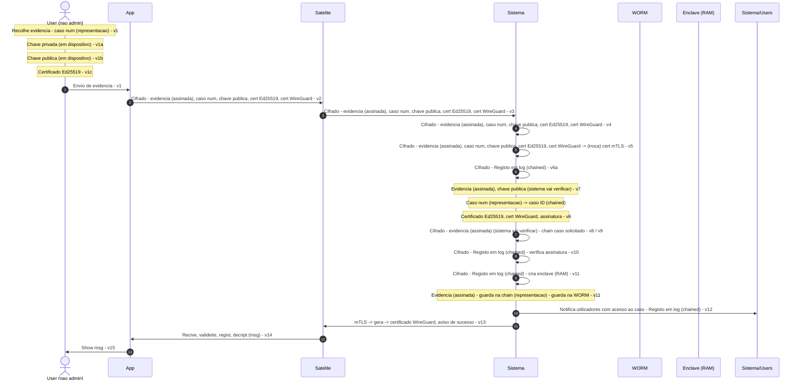
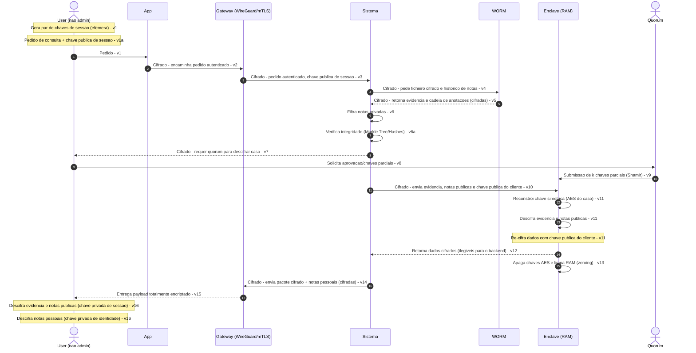
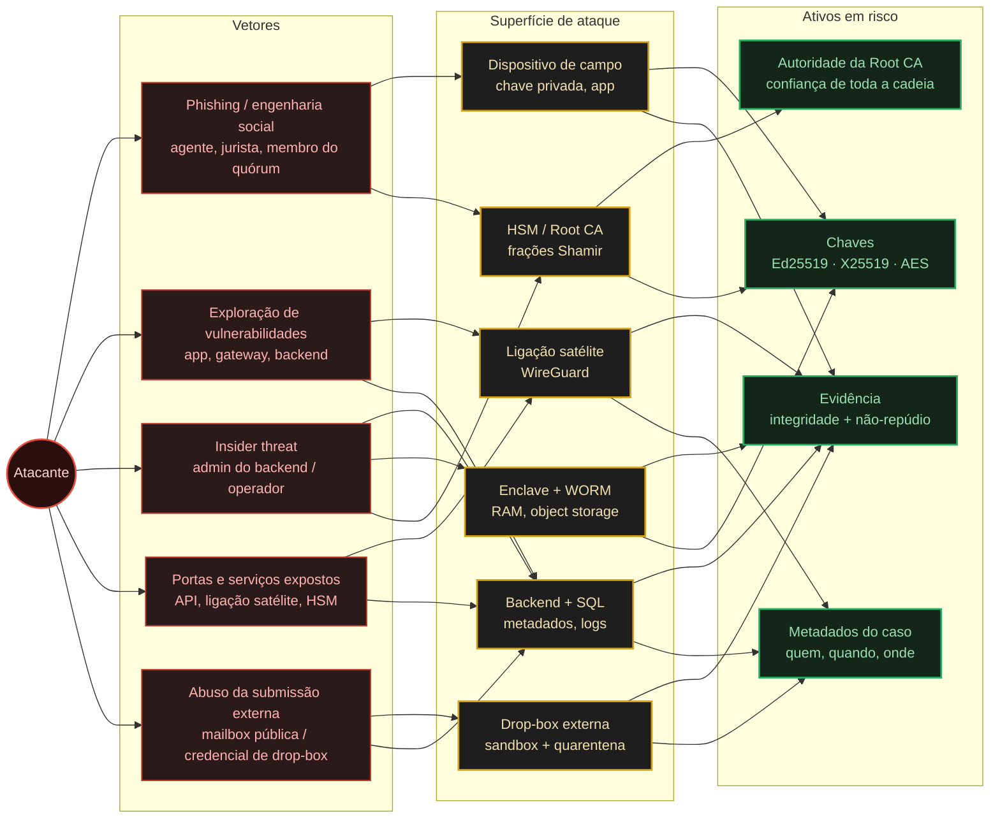
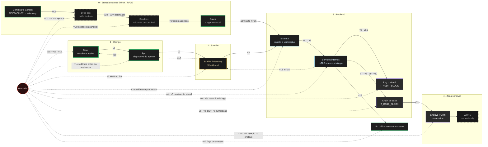
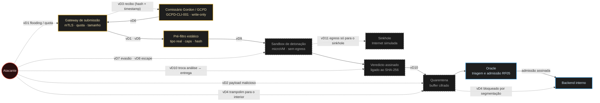
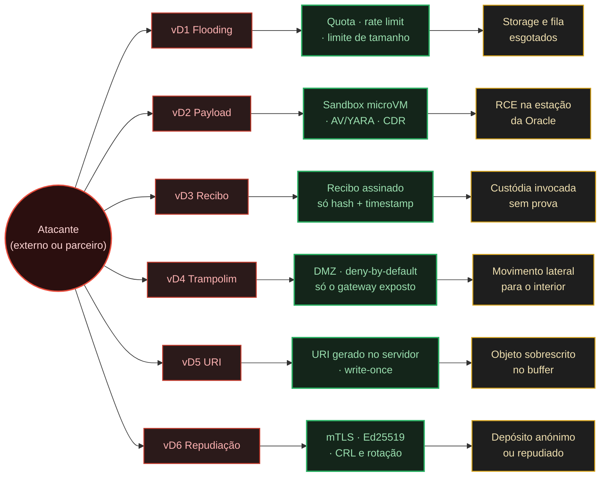
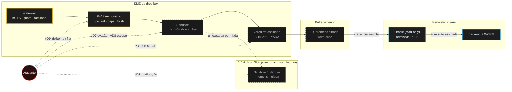
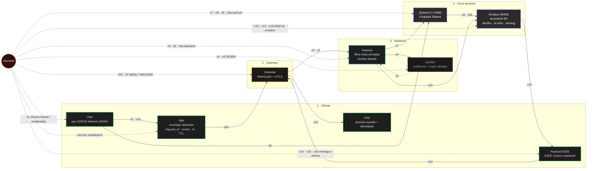

Esta pagina dedica se a analise de vetores de ataque do projeto [[Bat (couf couf) Evidence A Wayne]]

## Revisão da arquitetura e fluxo de dados

### Fluxo 1 - Registo de Evidencias

### Fluxo 2 - Pedido de Evidencias

O pedido de consulta viaja num **envelope efémero de uso único**: par X25519 novo por pedido, `request_id`, nonce de 128 bits, timestamp e TTL curto, com o *transcript* assinado em [[Ed25519]]. O túnel autentica o membro; o envelope garante *forward secrecy* e impede *replay* ou substituição da chave de resposta. Detalhe completo em [[Bat (couf couf) Evidence A Wayne#Pedidos Efémeros (Ephemeral Request Envelope)]].

## Superfície de ataque (visão geral)

## Vetores de Ataque e Mitigação

### Fluxo 1 — Registo de Evidências

| Vetor | Descrição                                                                             | Porque é vetor de ataque                                                                                                     | Mitigação                                                                                                                                                                                       |
| ----- | ------------------------------------------------------------------------------------- | ---------------------------------------------------------------------------------------------------------------------------- | ----------------------------------------------------------------------------------------------------------------------------------------------------------------------------------------------- |
| v1    | Recolha no dispositivo (evidência, caso num, chave privada/publica, cert [[Ed25519]]) | Dispositivo de campo comprometido pode expor chave privada ou alterar evidência antes da assinatura                          | Chaves em TPM/Secure Enclave (RNS10);  assinatura imediata no momento da apreensão; hashing SHA-256                                                                                          |
| v1a   | Chave privada no dispositivo                                                          | Exfiltração da chave privada permite impersonação e não-repúdio falso                                                        | TPM 2.0/Secure Enclave, não exportável                                                                                                                                                          |
| v1b   | Chave pública no dispositivo                                                          | Substituição da chave pública pode quebrar verificação                                                                       | Certificado [[Ed25519]] emitido pela Root CA ([[X.509]]/PKI)                                                                                                                                    |
| v1c   | Certificado [[Ed25519]] no dispositivo                                                | Certificado roubado/clonado                                                                                                  | Validação contra CRL em tempo real; validade curta                                                                                                                                              |
| v1d   | Chave pública do caso (`PK_case`) nos metadados do caso                               | Substituição de `PK_case` faz com que os depósitos seguintes sejam envolvidos para o atacante, que passa a poder decifrá-los | `PK_case` comprometida no Bloco 0 (`SHA-256(PK_case ‖ case_id)`); o cliente compara o valor recebido com o do Genesis; alteração exige quebrar o encadeamento de hashes e a assinatura do bloco |
| v2    | App → Satélite (cifrado)                                                              | Interceptação/MitM no link satélite; degradação de performance (PEP)                                                         | [[WireGuard]] (ChaCha20-Poly1305);  MTU/MSS tuning; keepalive                                                                                                                                |
| v3    | Satélite → Sistema                                                                    | Comprometimento do satélite ou gateway                                                                                       | [[mTLS]] com certificados [[X.509]];  validação de certificado                                                                                                                               |
| v4    | Sistema interno (1.ª passagem)                                                        | Movimento lateral interno; acesso não autorizado                                                                             | [[mTLS]] entre serviços; menor privilégio                                                                                                                                                       |
| v5    | Sistema interno (troca para [[mTLS]])                                                 | Downgrade de algoritmo ou troca maliciosa de certificado                                                                     | Lista de algoritmos permitidos;  verificador rejeita fora da lista                                                                                                                           |
| v6    | Registo em log (chained) + verificação                                                | Falsificação de logs ou quebra da cadeia                                                                                     | Hash-chaining (prev_hash); assinatura [[Ed25519]]; WORM                                                                                                                                         |
| v6a   | Registo em log chained                                                                | Reescrita de logs de auditoria                                                                                               | Blockchain sidechain imutável (T_AUDIT_BLOCK)                                                                                                                                                   |
| v7    | Sistema verifica assinatura                                                           | Bypass da verificação ou aceitação de algoritmo fraco                                                                        | Verificação obrigatória;  lista de algoritmos permitidos                                                                                                                                     |
| v8    | Chain caso solicitado                                                                 | Acesso a caso sem autorização                                                                                                | Controlo de acesso por caso;  hierarquia de acesso                                                                                                                                           |
| v9    | Chain caso solicitado (sub-passo)                                                     | Enumeração de casos ou IDOR                                                                                                  | Autorização por caso; auditoria global                                                                                                                                                          |
| v10   | Verificação de assinatura                                                             | Aceitação de assinatura forjada                                                                                              | Verificação [[Ed25519]] contra certificado válido                                                                                                                                               |
| v11   | Criação de enclave (RAM) + guarda WORM                                                | Exfiltração de `SK_case` ou da DEK da RAM; corrupção do WORM                                                                 | Zeroization (RNS04); reconstituição só em RAM, sem swap nem core dump; WORM append-only (RNS05)                                                                                                 |
| v12   | Notificação a utilizadores                                                            | Fuga de informação sobre quem tem acesso                                                                                     | Notificação apenas a utilizadores autorizados; log chained                                                                                                                                      |
| v13   | Sistema → Satélite ([[mTLS]], gera cert [[WireGuard]])                                | Emissão de certificado a entidade não autorizada                                                                             | Root CA (Alfred, HSM offline);  CRL                                                                                                                                                          |
| v14   | Satélite → App (receive, validate, decrypt)                                           | Payload malicioso entregue ao cliente                                                                                        | Validação no cliente; decriptação apenas com chave privada                                                                                                                                      |
| v15   | App → User (show msg)                                                                 | Exibição de dados não verificados; phishing de UI                                                                            | Verificação de integridade antes de apresentar                                                                                                                                                  |

### Fluxo 2 — Pedido de Evidências

| Vetor | Descrição                                                       | Porque é vetor de ataque                                                          | Mitigação                                                                                                                                 |
| ----- | --------------------------------------------------------------- | --------------------------------------------------------------------------------- | ----------------------------------------------------------------------------------------------------------------------------------------- |
| v1    | Geração de par de chaves de sessão efémero                      | Chaves de sessão fracas, reutilizadas ou correlacionáveis                         | Um par X25519 por pedido, só em RAM; zeroing após descifragem (RNS04/RNS13)                                                            |
| v1a   | Pedido + chave pública de sessão                                | Substituição da chave pública de sessão (*key substitution*) pelo backend ou MitM | Assinatura [[Ed25519]] do *transcript* (`request_id`, caso, nonce, timestamp, pk_efémera); lido dentro do túnel [[WireGuard]]/[[mTLS]] |
| v1b   | Nonce + timestamp + TTL do envelope                             | Replay de um pedido capturado para obter nova resposta                            | Nonce de 128 bits com cache de *hash* até ao TTL; janela de relógio ±60 s; *fail-closed*                                               |
| v2    | App → Gateway                                                   | Interceptação no link de campo                                                    | [[WireGuard]] (ChaCha20-Poly1305)                                                                                                         |
| v3    | Gateway → Sistema                                               | Acesso não autorizado ao backend                                                  | [[mTLS]];  autenticação prévia                                                                                                         |
| v4    | Sistema → WORM (pedido)                                         | Acesso indevido ao WORM                                                           | Backend como único intermediário;  WORM cego                                                                                           |
| v5    | WORM → Sistema (resposta cifrada)                               | Exfiltração do binário cifrado                                                    | Binário ilegível sem a DEK;  DEK só existe envolta para `PK_case`                                                                     |
| v6    | Filtragem de notas privadas                                     | Fuga de notas privadas a utilizador não autorizado                                | Filtragem no backend antes da entrega                                                                                                     |
| v6a   | Verificação de integridade ([[Árvore de Merkle Clássica (Dense)]]) | Aceitação de evidência adulterada                                                 | Verificação Merkle/Hashes obrigatória                                                                                                     |
| v7    | Sistema → User (requer quórum)                                  | Bypass do quórum; acesso sem autorização                                          | Quórum obrigatório para decifração (k=3: 2 do Alfred + 1 membro, ou 3 membros)                                                            |
| v8    | User → Quórum (solicita chaves)                                 | Solicitação fraudulenta de frações                                                | Autenticação do solicitante;  auditoria                                                                                                |
| v9    | Quórum → Enclave (submissão Shamir)                             | Injeção de frações falsas                                                         | Validação das frações;  frações do Alfred libertadas apenas pelo HSM;  enclave isolado                                              |
| v9a   | Frações do Alfred no HSM (2 frações)                            | Compromisso do HSM + 1 membro reduz o limiar efetivo a 2 pessoas                  | Duplo controlo físico no HSM;  libertação apenas com ordem de caso assinada;  auditoria do QUORUM_INIT                              |
| v10   | Sistema → Enclave (envia evidência + chave pública cliente)     | Injeção de dados maliciosos no enclave                                            | Enclave recebe apenas dados necessários;  backend não decifra                                                                          |
| v11   | Reconstituição + decifração + re-cifragem no enclave            | Exfiltração de `SK_case` ou dos dados em claro da RAM                             | Zeroization (RNS04);  reconstituição apenas em RAM do enclave; backend nunca vê o texto simples                                        |
| v12   | Enclave → Sistema (dados cifrados)                              | Interceptação do pacote cifrado                                                   | Cifrado com chave pública do cliente;  ilegível para backend                                                                           |
| v13   | Zeroization no enclave                                          | Falha na limpeza da RAM                                                           | Memory wipe forçado (RNS04); verificação                                                                                               |
| v14   | Sistema → Gateway (pacote cifrado + notas pessoais)             | Fuga de notas pessoais                                                            | Notas pessoais decifradas com chave privada de identidade                                                                                 |
| v15   | Gateway → User (entrega)                                        | Interceptação no último salto                                                     | [[WireGuard]];  payload já cifrado E2EE                                                                                                |
| v16   | Descifração no cliente                                          | Comprometimento do cliente; chave privada exposta                                 | Chave privada em TPM/Secure Enclave; zeroization local                                                                                    |

### Drop-box externa (GCPD) — vetores vD1–vD6

| Vetor | Descrição                                                       | Porque é vetor de ataque                                                                                             | Mitigação                                                                                                                              |
| ----- | --------------------------------------------------------------- | -------------------------------------------------------------------------------------------------------------------- | -------------------------------------------------------------------------------------------------------------------------------------- |
| vD1   | Submissão em massa / *flooding* da mailbox pública              | Esgota *storage* e a fila de triagem da Oracle (DoS lógico), escondendo um depósito legítimo                         | Quota por identidade e por caso; *rate limit* no gateway; limite de tamanho; recusa *fail-closed* acima do limite; alerta na auditoria |
| vD2   | *Payload* malicioso (executável, macro, *zip bomb*, *polyglot*) | A Oracle abre o artefacto numa estação com acesso ao interior → RCE ou *phishing* ao analista                        | Buffer isolado sem ligação à BD central; AV/CDR na entrada; triagem em VM descartável; nunca abrir no *host*                           |
| vD3   | Abuso do recibo (hash + timestamp)                              | O recibo prova que **algo** foi depositado, não que o conteúdo é autêntico; pode ser invocado como prova de custódia | Recibo assinado cobre apenas hash e timestamp; não atesta veracidade; verificação em [[Árvore de Merkle Clássica (Dense)]]             |
| vD4   | Quarentena como trampolim para o interior                       | Se a quarentena partilhar rede ou serviços com o backend, o atacante move-se lateralmente ([[Movimento Lateral]])    | DMZ dedicada; *firewall deny-by-default*; apenas o gateway de quarentena alcançável                                                    |
| vD5   | URI forjado / *path traversal* no depósito                      | Escrita fora do prefixo do caso ou sobrescrita de objeto no buffer                                                   | URI gerado pelo servidor; validação canónica; prefixo por caso; escrita *write-once*                                                   |
| vD6   | Repudiação do depósito ou credencial partilhada                 | Sem autenticação forte do remetente, o depósito é anónimo; a credencial institucional pode ser reutilizada           | *Leaf* [[Ed25519]] `GCPD-CLI-001` (6 meses) + [[mTLS]] no gateway externo; assinatura do manifesto; CRL e rotação                      |

### Sandbox de detonação — vetores vD7–vD11

| Vetor | Descrição                                                                                                                                           | Porque é vetor de ataque                                                   | Mitigação                                                                                                                                                                                                               |
| ----- | --------------------------------------------------------------------------------------------------------------------------------------------------- | -------------------------------------------------------------------------- | ----------------------------------------------------------------------------------------------------------------------------------------------------------------------------------------------------------------------- |
| vD7   | **Evasão da sandbox** — *malware* que dorme mais que a janela de análise, deteta artefactos de VM, exige interação, ou vem em arquivo cifrado/opaco | Produz um veredicto `limpo` falso e a prova segue para admissão            | Estático (tipo real, entropia, YARA) + dinâmico; atraso e *jitter*; janela alargada para amostras suspeitas; arquivos cifrados ficam `inconclusivo` até a Oracle fornecer a palavra-passe; CDR quando a prova o permite |
| vD8   | **Escape da sandbox** — *exploit* do hipervisor ou do kernel, montagens partilhadas, canal lateral                                                  | Comprometer o host de análise e, a partir dele, a rede de quarentena       | MicroVM com kernel próprio e imagem imutável; sem credenciais nem chaves dentro da VM; VLAN de análise sem rotas; host dedicado; hipervisor atualizado; VM destruída a cada amostra (RNS23)                             |
| vD9   | **DoS do pipeline** — *zip bomb*, ficheiro enorme, detonação longa, fila cheia                                                                      | Atrasa todos os depósitos e, num caso urgente, faz perder prova            | Caps *antes* da detonação (tamanho, profundidade, rácio de compressão); *timeout* rígido; fila limitada com *backpressure*; recibo emitido independentemente do veredicto (RF22/RNS24)                                  |
| vD10  | **TOCTOU análise ↔ entrega** — o objeto detonado não é o objeto guardado (re-upload, *dedupe* por nome, substituição no buffer)                     | Entra no perímetro uma prova que nunca foi analisada                       | Hash calculado no gateway; a mesma cópia é selada; veredicto indexado por `SHA-256`; re-hash no momento em que a Oracle abre; escrita *write-once*                                                                      |
| vD11  | **Fuga da prova para fora** — *egress* da sandbox, envio para multi-scanner *online*, telemetria                                                    | Quebra a confidencialidade e a cadeia de custódia sem deixar rasto interno | *Egress* `deny-by-default`; só o *sinkhole* local; motores e regras locais; proibição técnica e contratual de upload externo; registo de todo o tráfego da VLAN                                                         |
### Defesa na drop-box
Para além da sandbox, o próprio ponto de entrada tem de estar endurecido. Cada controlo fecha um vetor concreto:

| Controlo | Fecha |
| --- | --- |
| Identidade **por pessoa** no GCPD, certificado de 6 meses, CRL em tempo real | vD6 — deixa de haver credencial institucional partilhada |
| Quota por identidade e por caso, *rate limit*, limite de tamanho, lista de tipos | vD1, vD9 |
| Hash e recibo emitidos no gateway, ligados ao objeto efetivamente guardado | vD3, vD10 |
| URI gerado pelo servidor, *write-once*, sem listagem de objetos | vD5 |
| Buffer cifrado em repouso, com chave do serviço de quarentena e rotação | vD2, vD4 |
| Montagem `noexec,nosuid,nodev` no buffer; nada é executado fora da sandbox | vD2 |
| Auditoria das submissões **recusadas**, não só das aceites | vD1, vD5 |
| Relógio fidedigno (±60 s, RNS16) em recibos e veredictos | vD3 |
| Leitura da Oracle apenas *read-only*, com DLP e registo de cada acesso | vD4, vD10 |
| *Fail-closed* na admissão, mas depósito continua aceite e com recibo | vD9 (disponibilidade sem perder custódia) |

## Diagramas de ataque

> [!info] Como ler
> - **Vermelho tracejado** = movimento do atacante; a etiqueta indica o vetor (`vN` da tabela acima, `vD*` da secção da drop-box).
> - **Setas cheias** = fluxo legítimo do sistema; seta tracejada cinzenta com "(bloqueado)" = tentativa travada pela segmentação.
> - **Verde** = ativo ou controlo que fecha o vetor; **azul** = backend; **amarelo** = transporte; **roxo** = zona sensível (ledger, enclave); **cinzento tracejado** = armazenamento cego.

### Fluxo 1 — Registo de evidências

### Drop-box externa (GCPD)

A drop-box é o único caminho de entrada para quem está fora da VPN: o GCPD deposita às cegas (`GCPD-CLI-001`, write-only), o artefacto é pré-filtrado e detonado numa sandbox, e só depois é gravado num buffer exterior cifrado, sem ligação à BD central, até a Oracle o admitir (RF04, RF05, RF21). É por isso uma superfície de ataque própria — não é o `v3` do satélite nem o `v1` do terreno, embora a rastreabilidade em [[Intregavel 4]] a agregue a `v3`/`TC-RNS18-01`.

**Vista de fluxo** — o caminho legítimo e os pontos onde o atacante entra:

**Árvore de ataque** — cada linha é *vetor → controlo → impacto se o controlo falhar*. O atacante nunca chega ao backend: o pior caso tem de ser parado dentro da DMZ.

**Leitura:** a drop-box fecha a **confidencialidade** por construção (write-only, sem leitura e sem ligação à BD), por isso os vetores que restam atacam outros três eixos — **disponibilidade** (vD1), **integridade do host de triagem** (vD2, vD5) e **valor probatório** (vD3, vD6), com a **contenção** (vD4) como condição para que nenhum deles escale ao backend.

### Sandbox de detonação

A sandbox resolve o buraco do `vD2`: em vez de a Oracle abrir o ficheiro, o ficheiro é **detonado** primeiro e só entra no buffer depois de existir veredicto. Duas regras de desenho que não se podem perder:

- **O veredicto é indexado pelo `SHA-256` do objeto armazenado**, não pelo nome nem por um upload paralelo — senão há TOCTOU (`vD10`).
- **"Sem deteção" ≠ "seguro".** A sandbox só produz três estados: `malicioso`, `limpo` e `inconclusivo`. `inconclusivo` bloqueia admissão tal como `malicioso`; a decisão final continua a ser humana (RF05).

### Fluxo 2 — Pedido de evidências

## Rastreabilidade para os testes ([[Intregavel 4]])

Cada vetor tem um caso de teste associado no plano de testes. A tabela seguinte é o índice rápido; o detalhe do procedimento e do critério de aceitação está em [[Intregavel 4#10. Testes adversariais e mapeamento aos vetores]].

| Vetor    | Caso(s) de teste                                                   |
| -------- | ------------------------------------------------------------------ |
| v1, v1a  | TC-RNS10-01                                                        |
| v1b      | TC-RF11-01, TC-RNS13-01                                            |
| v1c      | TC-RF18-01                                                         |
| v1d      | TC-RF17-01, TC-RF17-02                                             |
| v2       | TC-RNS01-01, TC-RNS22-01                                           |
| v3       | TC-RNS12-01, TC-RNS18-01                                           |
| v4, v5   | TC-RNS14-01, TC-RNS14-02                                           |
| v6, v6a  | TC-RF12-01, TC-RF12-02, TC-RNS20-01                                |
| v7       | TC-RF09-01, TC-Q-04, TC-Q-05                                       |
| v8, v9   | TC-RF11-02, TC-Q-06, TC-Q-09                                       |
| v10      | TC-RNS08-01                                                        |
| v11      | TC-RNS02-01, TC-RNS21-01                                           |
| v12, v14 | TC-RF15-01, TC-RF16-01                                             |
| v13      | TC-RNS15-01, TC-RF10-01                                            |
| v15, v16 | TC-RF20-01, TC-RNS04-01                                            |
| vD1, vD5 | TC-RF04-01 (sem caso dedicado para quota/URI — sugerir TC-RF04-02) |
| vD2, vD3 | TC-RF05-01; recibo em TC-RF20-01                                   |
| vD4      | TC-RNS18-01 (é o sentido de "v3" na matriz do Intregavel 4)        |
| vD6      | TC-RF04-01, TC-RF18-01                                             |
| vD7      | TC-RF21-02 (evasão); TC-RF21-03 (arquivo cifrado → inconclusivo)   |
| vD8      | TC-RNS23-01 (escape/isolamento)                                    |
| vD9      | TC-RNS24-01 (quota, fila, *backpressure*)                          |
| vD10     | TC-RF21-01 (veredicto ligado ao SHA-256), TC-RF21-03               |
| vD11     | TC-RNS23-02 (*egress* bloqueado)                                   |

> [!note] Numeração
> Os vetores `vD*` são próprios da drop-box e não colidem com `v1`–`v16`, para não partir a matriz de rastreabilidade já congelada. No [[Intregavel 4]] aparecem agregados a **v3** (RF04, RF05, RNS18); se preferires, renumero-os para `v3a`–`v3f` e atualizo as duas notas.

> [!warning] Leitura rápida
> No **Fluxo 1** o elo fraco é o **campo**: a evidência existe em claro no dispositivo antes da assinatura (v1) e a chave privada vive lá (v1a). No **Fluxo 2** o elo fraco é o **envelope**: quem controla o backend ou o gateway pode tentar substituir a chave efémera (v1a) ou fazer replay (v1b) — daí a assinatura [[Ed25519]] do *transcript* e o nonce com cache até ao TTL. Em ambos os fluxos o enclave é o único ponto que vê o texto simples e a `SK_case` reconstruída (v11), e o HSM é o único ponto que liberta as frações do Alfred (v9a). A **drop-box** acrescenta um terceiro elo: fechada a leitura (write-only), o risco desloca-se para o abuso do canal — *flooding* (vD1), *payload* malicioso (vD2) e quarentena usada como trampolim (vD4). Com a **sandbox**, o risco volta a mudar de sítio: já não é a Oracle que abre o ficheiro, mas a própria análise que pode ser enganada (vD7), explorada (vD8), saturada (vD9), desalinhada do objeto guardado (vD10) ou usada para exfiltrar a prova (vD11).

