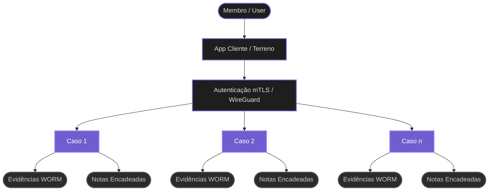
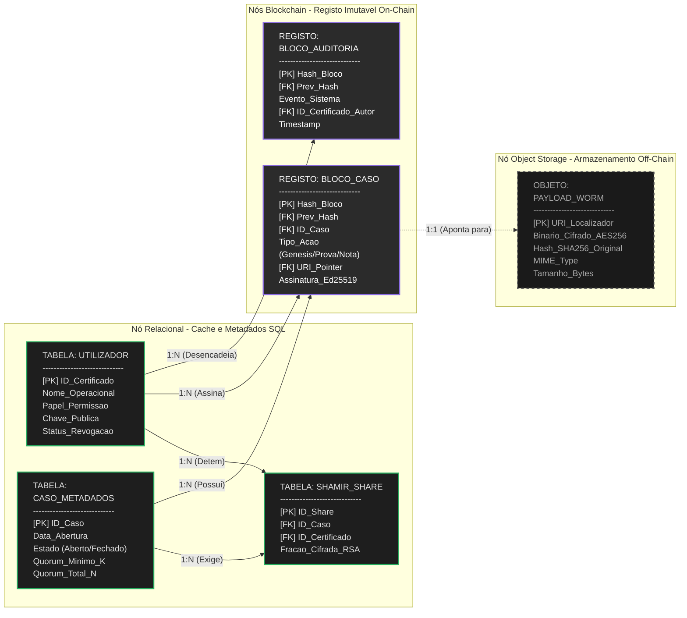
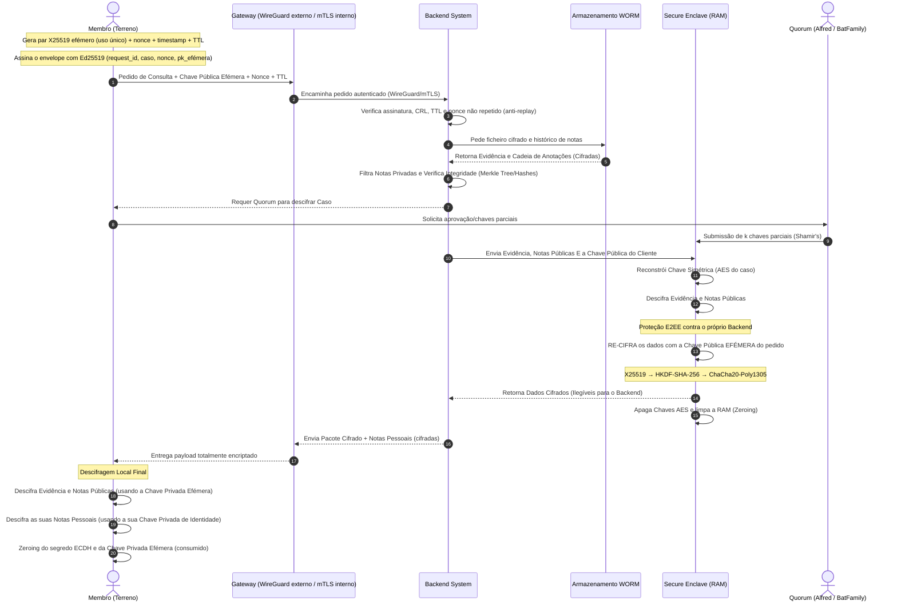
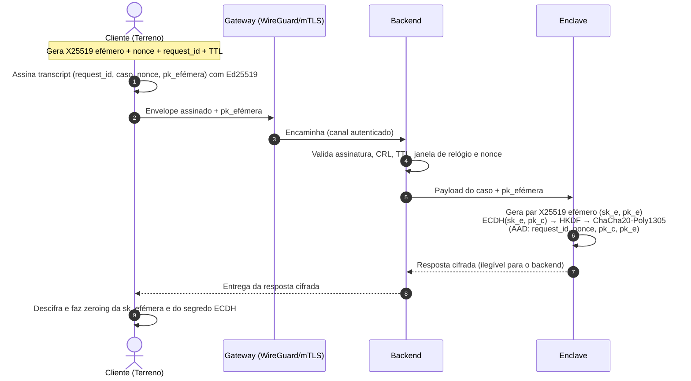
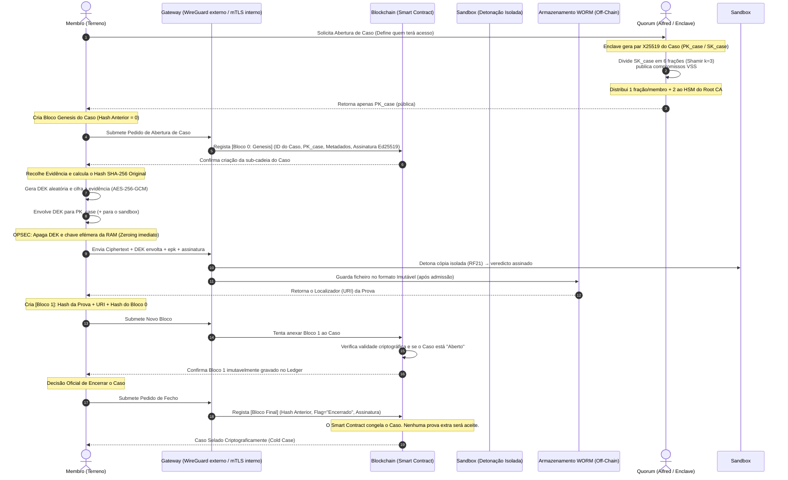
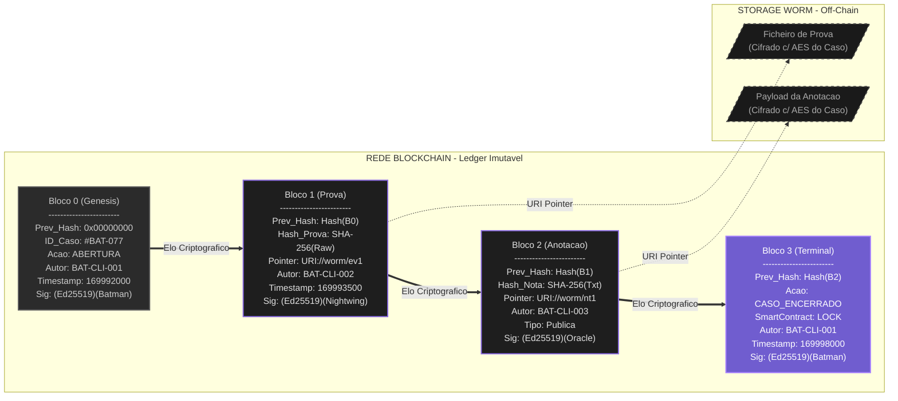
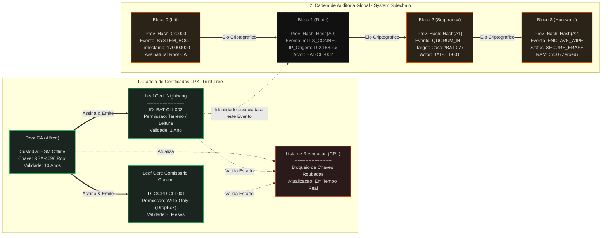
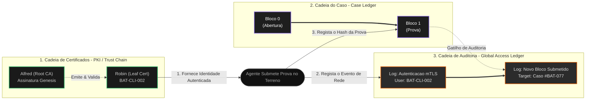

Industries pretende desenvolver um sistema de catalogação e gestão de provas forenses, entendidas como evidências relacionadas com crimes, que permita garantir a sua rastreabilidade e integridade. Em particular, o sistema deverá recorrer a mecanismos como a assinatura digital e manter o registo da identidade do utilizador responsável pelo depósito de cada prova. A plataforma deverá disponibilizar mecanismos de autenticação segura, embora o número de utilizadores esperado para o sistema seja relativamente reduzido e esteja limitado aos membros da Bat(couf couf)Family. Deverá também garantir requisitos de confidencialidade, integridade e autenticidade das comunicações, uma vez que as provas poderão ser depositadas enquanto os utilizadores se encontram no terreno, a realizar investigações e a combater atividades criminosas. Adicionalmente, deverá ser disponibilizado um mecanismo que permita armazenar uma evidência de um artefacto forense digital de forma que o seu conteúdo apenas possa ser acedido quando se reunir um subconjunto predefinido dos membros da família, constituído por um número específico de elementos. As provas ou evidências armazenadas no sistema poderão ser consultadas e deverão permitir a adição de anotações, mas a evidência original nunca poderá ser alterada. Qualquer informação acrescentada posteriormente deverá ser mantida separadamente da evidência original, preservando integralmente o seu conteúdo e permitindo manter o respetivo histórico e rastreabilidade. As evidências originais serão sempre representadas por ficheiros ou registos estruturados, devendo o sistema garantir a sua preservação e a possibilidade de verificar, a qualquer momento, a sua autenticidade e integridade.
**Intregaveis:**
(i) a detailed technical description of the proposed system
[[Intregavel 1]]
(ii) the identification and analysis of the functional and security requirements, including the characterization of the threat model and its associated attack scenarios
[[Intregavel 2]]
(iii) the mapping of the security technologies, controls, and protocols to be adopted, together with a clear justification for their selection
[[Intregavel 3]]
(iv) the definition of the tests required to validate compliance with the established requirements, with particular emphasis on security requirements 
[[Intregavel 4]]
(v) the main prompts used in the course of the project, together with the corresponding outputs/results and the associated discussion and analysis
[[Intregavel 5]]
# Engenharia de Software
## Descricao do Sistema
O sistema de armazenamento de provas forenses Bat(couf couf)Evidence foi concebido para assegurar a cadeia de custódia ininterrupta e a integridade absoluta de evidências digitais recolhidas no terreno.

NOTAS:
- O **Ed25519** é determinístico, com chaves de 32 bytes e assinaturas de 64 bytes.
- O **RSA-PSS** é probabilístico, com chaves e assinaturas muito maiores.
- Ambos garantem **autoria e não-repúdio**; por isso o Ed25519 é a escolha por omissão para provas e blocos.
- O RSA é preferido onde já existe infraestrutura [[X.509]] ou se exige uma raiz de confiança conservadora.

[[Personas]]
[[Cenarios]]
[[Requesitos]]

## Perfil Criptográfico
O sistema fixa um perfil único, para que "Ed25519 ou RSA" nunca signifique "qualquer um":

| Elemento                              | Algoritmo                                                                  | Justificação                                                   |
| ------------------------------------- | -------------------------------------------------------------------------- | -------------------------------------------------------------- |
| Root CA (Alfred, HSM offline)         | [[RSA]]-4096 com assinaturas RSA-PSS                                       | Vida longa (10 anos), compatibilidade PKI, custo irrelevante   |
| Certificados de folha dos membros     | [[Ed25519]]                                                                | Handshakes frequentes, chaves de 32 bytes                      |
| Certificados de parceiros externos    | [[Ed25519]] por omissão; [[RSA\|RSA-PSS]] ≥ 3072 se o parceiro o exigir | Interoperabilidade institucional                               |
| Assinatura de provas, notas e blocos  | [[Ed25519]]                                                                | Muitas assinaturas, ledger compacto, dispositivos de campo     |
| Chaves de sessão dos pedidos efémeros | [[X25519]] (ECDH efémero, um par por pedido)                               | *Forward secrecy*, chaves de 32 bytes, custo mínimo no terreno |
| Derivação do envelope de resposta     | **HKDF-SHA-256** → ChaCha20-Poly1305                                       | Separação de chaves por pedido, sem reutilização de nonce      |
| Verificação                           | Lista de algoritmos permitidos                                             | Impede negociação para baixo (*downgrade*)                     |

**Regra:** o Ed25519 é o algoritmo por omissão. O RSA-PSS não é uma alternativa livre  (é aceite apenas na raiz de confiança e em certificados emitidos para parceiros que o exijam, e o verificador rejeita qualquer algoritmo fora da lista.)

## Arquitetura
### Visão Macro do Sistema
O diagrama seguinte mostra a estrutura geral: o membro entra pela app cliente (potencialmente no terreno), autentica-se e só depois chega aos casos. Cada caso é uma unidade autónoma que agrega as suas próprias evidências e as suas próprias notas.

- **Membro / User → App Cliente:** o ponto de entrada do utilizador, que tanto pode estar no posto central como em campo.
- **App Cliente → Autenticação [[WireGuard]] (externo) / [[mTLS]] (interno):** operações de terreno (envio de provas) usam túnel WireGuard; comunicações internas entre serviços usam mTLS com certificados X.509. Nenhum acesso a casos acontece antes da autenticação; a app é apenas a interface, a barreira de segurança está neste passo.
- **Autenticação → Caso 1 … Caso n:** depois de autenticado, o utilizador é encaminhado para os casos a que tem acesso, e não para um repositório indiferenciado.
- **Cada Caso → Evidências WORM + Notas Encadeadas:** dentro de cada caso existem sempre dois ramos distintos, a evidência original, guardada em WORM, e as notas, que são encadeadas. Esta separação é o que permite anotar sem alguma vez alterar a prova.

- **Casos partilham provas (*cross reference*):** uma mesma evidência pode ser referenciada por mais do que um caso, sem duplicação nem perda de rastreabilidade.

# Hierarquia de acesso

A hierarquia segue o princípio do **menor privilégio**: a raiz de confiança emite identidades e detém frações de quórum (sem depositar provas), os membros da Bat-Family operam sobre os casos que lhes estão atribuídos e os parceiros externos ficam confinados a uma drop-box write-only. Nenhum nível tem permissão para alterar ou eliminar uma evidência já selada em WORM.

**Legenda:** **W** = criar/escrever · **R** = ler/consultar · **D** = eliminar/revogar · **—** = sem permissão · **\*** = apenas na área de quarentena

| Nível                      | Identidade                                   | Certificado                            | Certificados (PKI/CRL) | Evidências (WORM)                                     | Notas / Pareceres             | Quórum (Shamir k=3, n=6)                                | Âmbito e restrições                                                               |
| -------------------------- | -------------------------------------------- | -------------------------------------- | ---------------------- | ----------------------------------------------------- | ----------------------------- | ------------------------------------------------------- | --------------------------------------------------------------------------------- |
| **Root (CA)**              | Alfred Pennyworth (HUM-ALFRED-00)         | Root CA [[RSA]]-4096 (HSM offline)  | **W R D**              | **W R D** +                                           | R                             | Detém 2 frações ($x_5$, $x_6$); inicia a sessão no HSM | Único emissor da PKI;  Não deposita provas;  Contribui para o quórum com as suas 2 frações          |
| **User (Líder)**           | Bruce Wayne (BATMAN-01 / BAT-CLI-001)     | Leaf [[Ed25519]]                       | R                      | **W R**                                               | **W R**                       | Convoca a sessão; detém a fração $x_1$                  | Acesso a todos os casos que abrir;  Não pode apagar provas                     |
| **User (Terreno)**         | Dick Grayson (NIGHTWING-01 / BAT-CLI-002) | Leaf [[Ed25519]]                       | R                      | **W R**                                               | **W R** (próprias)            | Detém a fração $x_2$                                    | Apenas casos atribuídos;  Depósito e assinatura na origem                      |
| **User (Terreno/Forense)** | Tim Drake (ROBIN-01 / BAT-CLI-004)        | Leaf [[Ed25519]]                       | R                      | **W R**                                               | **W R** (próprias)            | Detém a fração $x_4$                                    | Clonagem forense, hashing e manifesto antes da submissão                          |
| **User (Analista)**        | Barbara Gordon (ORACLE-01 / BAT-CLI-003)  | Leaf [[Ed25519]]                       | R                      | **R** + triagem da quarentena (sem apagar o original) | **W R** (pareceres assinados) | Detém a fração $x_3$                                    | Valida recibos e a árvore de Merkle;  Admite provas externas na base interna   |
| **Extern (Parceiro)**      | James Gordon (GCPD-01 / GCPD-CLI-001)     | Leaf [[Ed25519]] (validade 6 meses) | —                      | **W\***                                               | —                             | —                                                       | Submissão cega;  Recebe recibo (hash + timestamp);  Sem leitura do conteúdo |
| **Extern (Instituição)**   | GCPD (mailbox institucional)              | Credencial de drop-box                 | —                      | **W\***                                               | —                             | —                                                       | Fora da VPN e sem ligação à BD central;  Buffer exterior isolado               |

O `D` do Alfred aplica-se à gestão do repositório (purga de objetos em quarentena e revogação de certificados), nunca a provas já seladas: a política WORM (RNS05) revoga irreversivelmente a escrita e a eliminação após o fecho da gravação.

**Regras transversais:**
- **Herança unidirecional:** Root → Users → Extern. Nenhum nível herda permissões do nível inferior e um externo nunca alcança o repositório principal.
- **Evidência imutável:** não existe `UPDATE`/`DELETE` sobre provas depositadas; correções fazem-se por **notas encadeadas** (nova entrada assinada), não por alteração do original.
- **Quórum obrigatório:** a leitura de provas classificadas exige $k=3$ frações das $n=6$; menos de 3 não dá qualquer vantagem computacional sobre o segredo (RNS11). Como o Root CA detém 2 frações, o limiar pode ser atingido por **Alfred + 1 membro** ou por **3 membros** sem o Alfred.
- **Segregação de funções:** quem deposita (Batman/Nightwing/Robin) não é quem valida e anota (Oracle); quem emite identidades (Alfred) não deposita provas nem inicia consultas por sua conta, mas contribui para o quórum com as suas 2 frações.
- **Rastreabilidade:** todas as operações `C/R/D` geram um bloco na cadeia de auditoria global, assinado pelo certificado do autor.

# Diagrama de Casos de Uso do Sistema Inteiro

Este diagrama mapeia quem faz o quê no sistema, delimitando claramente a fronteira do **BatEvidence**, os Atores (as Personas que definimos) de fora, e as ações (Use Cases) no interior, incluindo as dependências entre elas (como um caso de uso que obriga à execução de outro).

```mermaid
flowchart TB
    %% Definicao de Cores (Obsidian Dark Theme)
    classDef actorNode fill:#1e1e1e,stroke:#8b6ce3,stroke-width:2px,color:#e0e0e0
    classDef useCase fill:#2b2b2b,stroke:#705dcf,stroke-width:2px,color:#ffffff
    classDef systemBoundary fill:none,stroke:#555555,stroke-width:2px,stroke-dasharray: 5 5

    %% Atores (Agrupados por papel)
    GCPD(["Comissario Gordon<br/>(Drop-Box Externo)"]):::actorNode
    
    NW(["Dick Grayson<br/>(Nightwing)"]):::actorNode
    TD(["Tim Drake<br/>(Robin)"]):::actorNode
    
    BW(["Bruce Wayne<br/>(Batman)"]):::actorNode
    BG(["Barbara Gordon<br/>(Oracle)"]):::actorNode
    
    AL(["Alfred Pennyworth<br/>(Root CA / HSM)"]):::actorNode

    %% Fronteira do Sistema BatEvidence
    subgraph System [BAT-EVIDENCE: GESTAO E CADEIA DE CUSTODIA]
        direction TB
        
        %% Cenário 1 e 4: Entradas e Recibos
        UC_Drop(["Submissao Cega p/ Quarentena (Write-Only)"]):::useCase
        UC_Deposit(["Clonagem, Hashing e Deposito Assinado"]):::useCase
        UC_Recibo(["Emissao de Recibo (Timestamp + Hash)"]):::useCase
        
        %% Cenário 3 e 4: Validação, Triagem e Anotação
        UC_Triage(["Triagem de Provas em Quarentena"]):::useCase
        UC_Validate(["Validacao de Recibos e Merkle Tree"]):::useCase
        UC_Consult(["Consulta de Evidencias"]):::useCase
        UC_Annotate(["Adicao de Pareceres/Anotacoes Encadeadas"]):::useCase
        
        %% Cenário 2: Quórum e Desbloqueio (Shamir)
        UC_Convoc(["Convocacao de Sessao de Quorum"]):::useCase
        UC_SubmitKey(["Entrega de Fracao de Segredo (Shamir)"]):::useCase
        UC_HSM(["Inicializacao de Sessao HSM (Desbloqueio)"]):::useCase
        
        %% Base de Confiança
        UC_PKI(["Gestao da PKI, CRL e Certificados"]):::useCase
        
        %% Relacionamentos de Inclusão e Extensão (Regras de Negócio)
        UC_Drop -. "<< include >>" .-> UC_Recibo
        UC_Deposit -. "<< include >>" .-> UC_Recibo
        
        UC_Consult -. "<< include >>" .-> UC_Validate
        UC_Annotate -. "<< extend >>" .-> UC_Consult
        
        UC_Convoc -. "<< include >>" .-> UC_SubmitKey
        UC_HSM -. "<< include >>" .-> UC_SubmitKey
    end
    class System systemBoundary

    %% Conexoes dos Atores as Acoes (Baseado no Texto)
    
    %% Gordon (Apenas Drop-box)
    GCPD --- UC_Drop
    
    %% Operadores de Terreno
    NW --- UC_Deposit
    NW --- UC_SubmitKey
    
    TD --- UC_Deposit
    TD --- UC_SubmitKey
    
    %% Bruce (Líder)
    BW --- UC_Deposit
    BW --- UC_Convoc
    BW --- UC_SubmitKey
    BW --- UC_Consult
    
    %% Barbara (Analista)
    BG --- UC_Triage
    BG --- UC_Validate
    BG --- UC_Consult
    BG --- UC_Annotate
    BG --- UC_SubmitKey
    
    %% Alfred (Raiz de Confiança)
    AL --- UC_HSM
    AL --- UC_SubmitKey
    AL --- UC_PKI
```

## Base de Dados Distribuída e Híbrida

**Nó Relacional (Backend / Verde Escuro):**
	Esta base de dados (que poderia ser MariaDB, como no teu projeto QuantumTalk, ou PostgreSQL) serve apenas para **velocidade e gestão de acessos**. Ela não guarda provas. Guarda a identidade dos utilizadores (`T_USER`), os metadados rápidos dos casos (`T_CASE`) e, crucialmente, as partes do segredo de Shamir (`T_SHAMIR`) cifradas com a chave pública de cada detetive, à espera de serem requisitadas para o Quórum. As **2 frações do Alfred** não ficam nesta tabela: residem no HSM offline.
    
**Nós Blockchain (Ledger / Roxo):**
	É aqui que reside a **verdade jurídica**. Estas tabelas não permitem comandos `UPDATE` nem `DELETE`. Apenas aceitam `INSERT` se o `Prev_Hash` bater certo com o último bloco. Separámos em duas tabelas físicas de blocos: uma para rastrear o caso (`T_CASE_BLOCK`) e outra para rastrear os logs do sistema (`T_AUDIT_BLOCK`).
    
**Nó Object Storage (WORM / Cinzento Tracejado):** 
	Como as Blockchains não suportam ficheiros pesados, este nó funciona como um contentor de dados cegos (ex: AWS S3 com _Object Lock_ ativado ou um servidor NAS dedicado). A chave primária aqui é o `URI_Localizador`, que é injetado diretamente no Bloco do Caso. O WORM não sabe a que caso pertence o ficheiro; ele apenas entrega o binário encriptado quando alguém lhe apresenta o URI correto.

## Acesso Seguro a Evidências e Notas

Este diagrama de sequência mostra o caminho completo de uma consulta, desde o pedido no terreno até à descifragem final no cliente. Pode ler-se em quatro fases: **pedido autenticado**, **recuperação e verificação**, **quórum e enclave** e **entrega e descifragem local**.

1. **Pedido autenticado (User → VPN → Backend):** o utilizador gera um par de chaves de sessão efémero **de uso único** (X25519, privada apenas em RAM) e constrói o envelope do pedido: `request_id`, nonce, timestamp, TTL curto, ID do caso e chave pública efémera. O envelope é assinado com [[Ed25519]] antes de sair do dispositivo, para que a chave efémera fique ligada à identidade autenticada e não possa ser substituída no caminho. O gateway [[WireGuard]]/[[mTLS]] encaminha o pedido já autenticado para o backend (ver [[#Pedidos Efémeros (Ephemeral Request Envelope)]]).
2. **Recuperação e verificação (Backend ↔ WORM):** o backend pede ao armazenamento o ficheiro cifrado e o histórico de notas, recebendo a evidência e a cadeia de anotações ainda cifradas. Antes de qualquer entrega, filtra as notas privadas e verifica a integridade recorrendo à [árvore de Merkle](obsidian://open?vault=Uni&file=blockchein%2F%C3%81rvore%20de%20Merkle%20Cl%C3%A1ssica%20(Dense)) e aos hashes.
3. **Quórum e Enclave (Backend ↔ Quorum ↔ Enclave):** o backend responde ao utilizador que é necessário quórum para decifrar o caso; o utilizador solicita aprovação ao quórum e o quórum submete as $k$ frações (Shamir) ao Secure Enclave. O backend envia então ao enclave a evidência, as notas públicas e a chave pública efémera do pedido. Já dentro do enclave, as frações são validadas contra os compromissos VSS, `SK_case` é reconstruída, as DEKs são desenvueltas, a evidência e as notas públicas são decifradas, os dados são **re-cifrados para a chave pública efémera** (o enclave gera o seu próprio par para o ECDH) e só depois devolvidos ao backend, que os recebe ilegíveis. `SK_case` e as DEKs são zeroizadas no fim. É esta a proteção ponta-a-enclave contra o próprio backend.
4. **Limpeza, entrega e descifragem (Enclave → Backend → VPN → User):** o enclave apaga as chaves AES e limpa a RAM (*zeroing*); o backend envia o pacote cifrado e as notas pessoais (também cifradas) ao gateway, que entrega o payload ao utilizador. Só no cliente, e apenas no fim, se descifra a evidência e as notas públicas com a **chave privada efémera do pedido**, e as notas pessoais com a chave privada de identidade. Imediatamente a seguir, a chave efémera e o segredo ECDH são apagados da RAM e o envelope é dado como consumido.

## Pedidos Efémeros (*Ephemeral Request Envelope*)

Um **pedido efémero** é um envelope de consulta que existe para exatamente uma operação: nasce quando o utilizador pede uma prova, vive o tempo de uma resposta e é destruído logo a seguir. Em vez de o cliente reutilizar uma chave de sessão ao longo do dia, cada pedido transporta um par de chaves novo. Isto aplica-se a todo o caminho de leitura (evidências e notas); o depósito usa apenas a chave **pública** do caso (`PK_case`) para envolver a DEK, mas pode viajar no mesmo tipo de envelope. Formalizado como **RNS13** em [[Requesitos]].

**Ciclo de vida**

| #   | Passo                      | O que acontece                                                                                                                                                                                                  |
| --- | -------------------------- | --------------------------------------------------------------------------------------------------------------------------------------------------------------------------------------------------------------- |
| 1   | **Geração local**          | O cliente gera um par **X25519** novo (a privada nunca sai da RAM), um `request_id` (UUIDv7), um nonce de 128 bits, um timestamp e um TTL curto (ex.: 120 s).                                                   |
| 2   | **Assinatura do envelope** | [[Ed25519]] sobre o *transcript hash*: `request_id ‖ caso ‖ nonce ‖ timestamp ‖ pk_efémera`. Sem esta assinatura, o backend poderia substituir a chave pública efémera (*key substitution*) e ler a resposta.   |
| 3   | **Transporte**             | O envelope viaja dentro do túnel [[WireGuard]]/[[mTLS]] já autenticado. O envelope é a camada **E2EE**; o túnel é a camada de **autenticação e sigilo de rede** — não se substituem.                            |
| 4   | **Validação no backend**   | Assinatura, estado do certificado na CRL, TTL não expirado, janela de relógio (ex.: ±60 s) e nonce ainda não visto. O servidor guarda apenas `request_id` e o *hash* do nonce até o TTL expirar.                |
| 5   | **Resposta**               | O enclave gera o seu próprio par efémero, faz ECDH com a chave pública do cliente e deriva a chave do envelope: `X25519 → HKDF-SHA-256 → ChaCha20-Poly1305`. O backend transporta bytes que não consegue abrir. |
| 6   | **Consumo e destruição**   | O cliente descifra, faz *zeroing* da chave privada efémera e do segredo ECDH, e considera o envelope consumido. O `request_id` fica na auditoria; o material de chave não.                                      |

**Garantias**

- **Forward secrecy:** comprometer a chave de identidade do membro mais tarde não decifra consultas antigas, porque o segredo de cada resposta nasceu e morreu com o envelope.
- **Raio de explosão mínimo:** um par comprometido afeta **um** pedido, não a sessão inteira nem os restantes casos.
- **Anti-replay:** o nonce + TTL + `request_id` impedem que um pedido capturado seja reenviado para obter uma segunda resposta.
- **Anti-correlação:** chaves diferentes por pedido impedem que o backend (ou um observador do WORM) ligue consultas sucessivas pelo mesmo material de chave.
- **Zero-knowledge coerente:** o backend continua a ser um "carteiro cego"; o pedido efémero é o que torna essa promessa verificável no caminho de leitura.

**Regras de implementação**

- Nunca reutilizar um par entre pedidos, entre casos ou após uma falha: um erro obriga a **gerar um envelope novo**, nunca a repetir o anterior.
- A chave privada efémera nunca é escrita em disco, log, crash dump ou telemetria; vive num buffer de RAM que é limpo (RNS04).
- Um envelope = no máximo uma resposta. Um segundo pacote com o mesmo `request_id` é rejeitado, mesmo que o nonce ainda esteja dentro do TTL.
- TTL curto e *fail-closed*: envelope expirado, relógio fora da janela ou nonce repetido resultam em rejeição, não em modo degradado.
- O servidor não guarda chaves efémeras: guarda somente `request_id`, *hash* do nonce e o resultado da validação, para auditoria.

**O que os pedidos efémeros *não* resolvem**

- **Autenticação:** não substituem [[mTLS]]/[[WireGuard]] nem o certificado [[Ed25519]]; dizem apenas *para onde* cifrar a resposta, não *quem* pediu.
- **Anonimato:** a identidade continua autenticada no túnel e assinada no envelope; o objetivo é confidencialidade e não-ligação criptográfica, não ocultação do autor.
- **Cliente comprometido:** se o terminal estiver tomado no momento da consulta, a chave efémera está em RAM e pode ser lida; a mitigação é o TPM/Secure Enclave (RNS10), não o envelope.
- **Disponibilidade:** um ataque de negação de serviço ao endpoint de pedidos não é travado pelo envelope; pertence ao perímetro de rede.

## Criação de Caso e Depósito de Prova (Blockchain Off-Chain Anchoring)

Este diagrama mostra o ciclo de vida completo de um caso, do pedido da chave à sua selagem final. Divide-se em quatro fases, numeradas no próprio diagrama: **abertura e chaves**, **preparação e depósito off-chain**, **ancoragem on-chain** e **encerramento**.
1. **Fase 1 — Geração de chaves e abertura do caso:** o utilizador solicita a abertura de um caso e define quem terá acesso. **Dentro do enclave** é gerado um par de chaves X25519 do caso: a privada (`SK_case`) é dividida em $n=6$ frações de Shamir ($k=3$) e distribuída pelos membros autorizados (1 por membro + 2 no HSM do Root CA); a pública (`PK_case`) é devolvida ao utilizador e comprometida no Bloco Genesis. O utilizador cria então o Bloco Genesis (hash anterior = 0) e submete o pedido de abertura; o ledger regista o Bloco 0 com ID do caso, metadados, `PK_case` e assinatura ([[Ed25519]]), e confirma a criação da sub-cadeia do caso. O depositante **nunca** recebe `SK_case`.
2. **Fase 2 — Preparação e depósito da prova (off-chain):** o utilizador recolhe a evidência, calcula o hash SHA-256 do texto simples e assina-o. Gera uma **DEK** aleatória, cifra a evidência com AES-256-GCM e **envolve a DEK para `PK_case`** (ECDH efémero → HKDF-SHA-256 → ChaCha20-Poly1305); apaga a DEK e a chave efémera da RAM (*zeroing*) — a chave do caso nunca esteve no terminal. Para permitir a detonação no sandbox (RF21) sem expor `SK_case`, a DEK é também envolta para a chave pública efémera do sandbox (`wrapped_dek_sandbox`), destruída no fim da análise. O payload (ciphertext + DEK envolta + `epk` + nonce) segue para o storage através do gateway dentro do mesmo tipo de **envelope efémero** usado nas consultas (par X25519 por operação, nonce, TTL e *transcript* assinado; ver [[#Pedidos Efémeros (Ephemeral Request Envelope)]]). O servidor verifica a assinatura e ancora **dois** hashes: `SHA-256(ciphertext)` (calculado pelo servidor, verificável) e `SHA-256(plaintext)` (declarado e assinado pelo cliente); a coerência entre eles só é demonstrável na leitura, quando o enclave decifra e recalcula o hash. O utilizador recebe um recibo assinado, independente do veredicto do sandbox (RF22).
3. **Fase 3 — Ancoragem na blockchain (on-chain):** o utilizador cria o Bloco 1 com o hash da prova, o URI e o hash do Bloco 0, e submete-o. O ledger verifica a validade criptográfica e se o caso continua "Aberto", confirmando depois a gravação imutável do Bloco 1.
4. **Fase 4 — Encerramento do caso (bloco terminal):** perante a decisão oficial de encerrar, o utilizador submete o pedido de fecho e o ledger regista o Bloco Final com hash anterior, a flag "Encerrado" e assinatura. O smart contract congela o caso: nenhuma prova extra é aceite e o caso fica selado criptograficamente (*cold case*).

## Modelo de Chaves do Caso (PK_case / DEK / SK_case)

O caso não tem uma "chave AES do caso". Tem um **par de chaves de envoltório X25519** e uma **DEK por prova**. Isto permite que o depósito só precise da chave **pública** e que a chave privada nunca exista inteira fora do enclave.

| Material | Onde vive | Como está protegido | Tempo de vida |
|---|---|---|---|
| `PK_case` (pública) | Metadados do caso + Bloco 0 (Genesis), hash-encadeado | Não precisa de sigilo; a autenticidade é dada pela assinatura do Genesis e pelo compromisso `SHA-256(PK_case ‖ case_id)` | Perpétuo |
| `DEK` (32 B, por prova) | **Nunca em claro.** Só como `wrapped_dek` no payload do bloco do caso | Envolvida para `PK_case` (ECDH efémero → HKDF-SHA-256 → ChaCha20-Poly1305), com `epk` e nonce | Até à leitura; depois zeroizada |
| Ciphertext da prova | WORM, imutável | AES-256-GCM com a DEK; AAD com `case_id`, hash do bloco anterior e URI | Perpétuo |
| `SK_case` (privada) | **Não é armazenada.** Só existe como 6 frações de Shamir | Cada fração cifrada para o detentor (X25519 do respetivo certificado) + compromissos VSS públicos | Frações: perpétuas; chave: volátil |
| 2 frações do Root CA (Alfred) | HSM, seladas, nunca exportadas | Libertação apenas em sessão de quórum com duplo controlo (RNS15) | Perpétuo |
| `SK_case` reconstruída | Apenas RAM do enclave | `mlock`, sem swap, sem *core dump*; zeroização imediata após uso (RNS04) | Segundos, por leitura |

Regras que daí decorrem:

- **Geração:** o par é gerado **dentro do enclave** na abertura do caso; `SK_case` é dividida no enclave e o material original é zeroizado antes de a resposta sair. Nem o utilizador nem o backend veem a chave privada.
- **Depósito sem quórum:** como só é precisa `PK_case`, o agente no terreno deposita sem esperar por 3 pessoas. É esta propriedade que torna o modelo operacional.
- **Leitura com quórum:** as frações são enviadas pelos detentores **ao enclave** (nunca ao requerente); o enclave valida-as contra os compromissos VSS, reconstrói `SK_case`, desenvole a DEK, decifra, re-cifra para a chave efémera do requerente e zeroiza tudo (RNS04, RNS13).
- **Sandbox:** para detonar sem `SK_case`, a DEK é também envolta para a chave pública efémera do sandbox; essa cópia é destruída no fim da análise. O sandbox vê o texto simples — é a mesma fronteira de confiança do enclave, não uma fronteira nova.
- **Rotação:** gera-se novo par, o enclave desenvole cada DEK com a `SK_case` antiga (exige quórum) e re-envolve para a nova `PK_case`; ancora-se um bloco `ROTACAO_CHAVE`. O ciphertext no WORM **não** é reescrito (WORM é imutável) e os blocos antigos ficam inúteis porque a chave antiga é destruída.
- **Sem escrow:** não existe cópia de recuperação de `SK_case`. A perda de 4 ou mais frações torna o caso definitivamente ilegível — é *crypto-shredding* por desenho, e deve ser dito assim na defesa, não como falha.
- **Autenticidade da pública:** o cliente que vai depositar tem de comparar a `PK_case` que recebe com o compromisso publicado no Genesis (e verificar a assinatura do bloco). Sem isto, uma substituição de `PK_case` nos metadados faz com que os depósitos seguintes sejam envolvidos para o atacante (vetor `v1d` em [[Ataques e Vetores]]).

## Esquema de Blockchain

O esquema seguinte representa a estrutura física do registo: o que fica **on-chain** (apenas metadados e hashes) e o que fica **off-chain** (o conteúdo pesado, no WORM). O ledger nunca guarda a prova em si, apenas a prova *de* que ela existe e quem a depositou.

- **Bloco 0 (Genesis):** abre a sub-cadeia do caso. Tem `Prev_Hash` a zero, o ID do caso (#BAT-077), a ação ABERTURA, o autor (BAT-CLI-001) e a assinatura ([[Ed25519]]) do Batman.
- **Bloco 1 (Prova):** regista o hash SHA-256 da prova bruta, o pointer `URI://worm/ev1` e o autor BAT-CLI-002 (Nightwing), assinado por ([[Ed25519]]).
- **Bloco 2 (Anotação):** regista o hash da nota, o pointer `URI://worm/nt1`, o autor BAT-CLI-003 (Oracle) e o tipo "Pública", assinado por ([[Ed25519]]).
- **Bloco 3 (Terminal):** fecha o caso com a ação CASO_ENCERRADO e a instrução SmartContract: LOCK, novamente assinado pelo Batman.
- **Elos criptográficos:** cada bloco contém o hash do anterior, pelo que alterar um bloco invalida todos os seguintes.
- **Off-chain (WORM):** o ficheiro de prova e o payload da anotação estão cifrados com a AES do caso; o ledger apenas aponta para eles através do URI.

## A Cadeia de Certificados (PKI / Certificate Chain)

- **O que é:** É a "Chain of Trust" (Cadeia de Confiança). Como usas [[X.509]] e [[mTLS]] para a comunicação, o [[Ed25519]] nas assinaturas das folhas e o [[RSA]]-4096 na raiz, tem de existir uma hierarquia que prove que a chave do Nightwing pertence mesmo ao Nightwing.
- **Como funciona:** O Alfred (Root CA) assina digitalmente os certificados de toda a equipa. Se a chave do Nightwing for comprometida, o Alfred revoga-a na CRL (Certificate Revocation List). Esta cadeia não guarda provas, guarda **Identidades**.

## A Cadeia de Auditoria Global (Global Audit Sidechain)

- **O que é:** O ledger que desenhámos antes era um _Smart Contract_ específico para **um caso** (ex: BAT-077). Mas e se o Charada tentar fazer login no sistema 50 vezes? E se um quórum falhar porque a Oracle inseriu a chave parcial errada? Isso não pertence ao caso, pertence ao sistema.
- **Como funciona:** É uma Blockchain de sistema (Sidechain) focada exclusivamente em acessos (Access Logs). Regista logins, tentativas de reconstrução de segredo no _Secure Enclave_, emissão de novas chaves e acessos ao WORM. Cada **pedido efémero** gera um evento `REQUEST_ENVELOPE` com o `request_id`, o *hash* do nonce, o `case_id`, o resultado da validação (aceite/rejeitado por TTL, CRL ou replay) e a identidade do autor — nunca a chave privada efémera nem o segredo ECDH.

### Diagrama: PKI e Cadeia de Auditoria Global

O diagrama junta as duas cadeias que não pertencem a nenhum caso em particular. O subgrafo de cima responde a "quem é quem"; o de baixo responde a "o que aconteceu". Uma folha de certificado só é aceite se a CRL a não marcar como revogada, e cada evento registado na sidechain de auditoria aponta para a identidade que o praticou.

**1. Cadeia de Certificados — PKI Trust Tree**

- **Root CA (Alfred):** a raiz da confiança, com custódia em HSM offline, chave [[RSA]]-4096 Root e validade de 10 anos. É o único nó que emite certificados.
- **Lista de Revogação (CRL):** bloqueia chaves roubadas e é atualizada em tempo real; é consultada para validar o estado de cada certificado.
- **Leaf Cert: Nightwing:** ID BAT-CLI-002, permissão de terreno/leitura, validade de 1 ano.
- **Leaf Cert: Comissário Gordon:** ID GCPD-CLI-001, permissão write-only (drop-box), validade de 6 meses.Bloco 3 (Hardware)
- **Arestas "Assina & Emite":** ligam a Root CA às duas folhas, mostrando a hierarquia de emissão.
- **Arestas "Atualiza" / "Valida Estado":** ligam a Root CA à CRL e cada folha à CRL, mostrando que a revogação é verificada em ambos os sentidos.

**2. Cadeia de Auditoria Global — System Sidechain**

- **Bloco 0 (Init):** arranque do sistema (`SYSTEM_BOOT`), com `Prev_Hash` a zero e assinatura da Root CA.
- **Bloco 1 (Rede):** ligação [[mTLS]] (`mTLS_CONNECT`), com IP de origem e ator BAT-CLI-002.
- **Bloco 2 (Segurança):** início de quórum (`QUORUM_INIT`), com alvo no caso  BAT-077 e ator BAT-CLI-001.
- **Bloco 3 (Hardware):** limpeza do enclave (`ENCLAVE_WIPE`), com `SECURE_ERASE` e RAM a zeros.
- **Elos Criptográficos:** cada bloco contém o hash do anterior, tal como no ledger de um caso.
- **Relação cruzada:** a folha de certificado do Nightwing aponta para o Bloco 1, associando a identidade ao evento de rede que ela própria gerou.

## As 3 Cadeias Interagem num Único Depósito de Prova

Este é o diagrama que junta tudo: em vez de olhar para cada cadeia isoladamente, mostra o que acontece quando o Nightwing deposita uma prova no terreno, e como esse único ato toca nas três cadeias ao mesmo tempo. As etiquetas numeradas nas arestas indicam a ordem dos acontecimentos.

- **Cadeia 1 — PKI / Trust Chain:** Alfred (Root CA) emite e valida o certificado de Robin. É esta cadeia que fornece a identidade autenticada.
- **Cadeia 2 — Case Ledger:** a sub-cadeia do caso, com o Bloco 0 (abertura) e o Bloco 1 (prova), ligados pelo elo criptográfico.
- **Cadeia 3 — Global Access Ledger:** os logs do sistema, com a autenticação [[mTLS]] e o registo do novo bloco submetido.
- **Passo 1 — Fornece Identidade Autenticada:** o certificado (folha) valida o agente perante a ação de submissão.
- **Passo 2 — Regista o Evento de Rede:** a submissão gera um log de autenticação na cadeia de auditoria.o
- **Passo 3 — Regista o Hash da Prova:** a prova entra na cadeia do caso, no Bloco 1.
- **Gatilho de Auditoria:** o novo bloco do caso provoca, por sua vez, um novo registo na cadeia de auditoria, o que fecha o ciclo entre as três cadeias.

## Notas de Coerência

Decisões de coerência aplicadas ao projeto (ver também [[Requesitos]]):

- **Assinatura de provas/notas/blocos**: exclusivamente [[Ed25519]] (RNS08). RSA-PSS reservado à Root CA e a certificados de parceiros externos que o exijam.
- **Pedidos efémeros**: o par X25519 é gerado **por pedido** e destruído após a descifragem; a chave pública efémera é assinada com [[Ed25519]] dentro do *transcript* do pedido, para impedir substituição pelo backend. O túnel [[WireGuard]]/[[mTLS]] autentica, o envelope efémero confidencializa — são camadas distintas e ambas obrigatórias.
- **Frações de Shamir ($k=3, n=6$)**: o Root CA (Alfred, HSM offline) detém **2 frações** ($x_5$, $x_6$) e os quatro membros detêm 1 cada. O limiar de 3 é atingido por **Alfred + 1 membro** ou por **3 membros** sem o Alfred; Alfred não deposita provas nem inicia consultas, e as suas frações residem no HSM. O modelo assume explicitamente que o compromisso do HSM **mais** um membro quebra a confidencialidade, pelo que o HSM exige duplo controlo e auditoria.
- **Cross-referencing (RF03)**: uma evidência partilhada entre casos é referenciada por ponteiros lógicos (URI WORM) em cada sub-cadeia de caso, sem duplicação do ficheiro físico.
- **Admissão da quarentena (RF05/RNS12)**: buffer exterior acessível apenas por gateway de quarentena separado, ao qual Oracle autentica com credencial de leitura restrita; após validação, o ficheiro é ancorado no perímetro interno.
- **Sandbox de detonação (RF21/RF22/RNS23)**: entre o gateway de submissão e o buffer, o artefacto passa por pré-filtro estático e detonação em microVM descartável, com *egress* limitado a um *sinkhole* local; o veredicto (`malicioso`/`limpo`/`inconclusivo`) é assinado e indexado pelo `SHA-256` dos bytes armazenados, condiciona a admissão mas não o recibo, e nunca é obtido por envio da prova a serviços externos.

# Arquitetura Fisica
Conteudo fora do sistema, a arquitetura de seguranca da aplicacao não é relevante para ataques fisicos

- cominicacao a escala mundial:
	- Acesso a rede é feito atraves de satelite (da Wayne Enterprises)
- 3 servidores:
	- o principal (Running)
	- backup (hot backup)
	- Full backup (cold backup)
- firewall fisicas
	- situadas entre o router de acessos ao sistemas
	- Configuracoes de acesso combinadas com os acessos internos

- **WireGuard vs. arquiteturas de satélite:** o WireGuard é compatível e recomendado como VPN por omissão para links satélite, mas o desempenho depende do tipo de órbita. Em LEO (ex.: Starlink, 30–70 ms RTT) funciona quase como rede móvel. Em GEO (600–800 ms RTT) continua a ser a melhor opção face ao OpenVPN, mas a aceleração TCP do PEP satélite não enxerga o fluxo TCP encapsulado em UDP, pelo que o TCP dentro do túnel pode perder ~1/30 da performance; mitigar com MTU 1280–1360, MSS 1200–1300, BBR v2, buffers grandes e keepalive 20–30s. Em satélites L-band (ex.: Iridium Certus) as VPNs não são recomendadas — testes mostraram perda de pacotes e outages de ~2 min com WireGuard TCP; considerar VPN otimizada do provedor. Recomendação técnica (VIVERIS/CNES): usar WireGuard com PEP na posição B (não A) para evitar "TCP-in-TCP".

