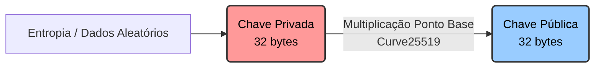
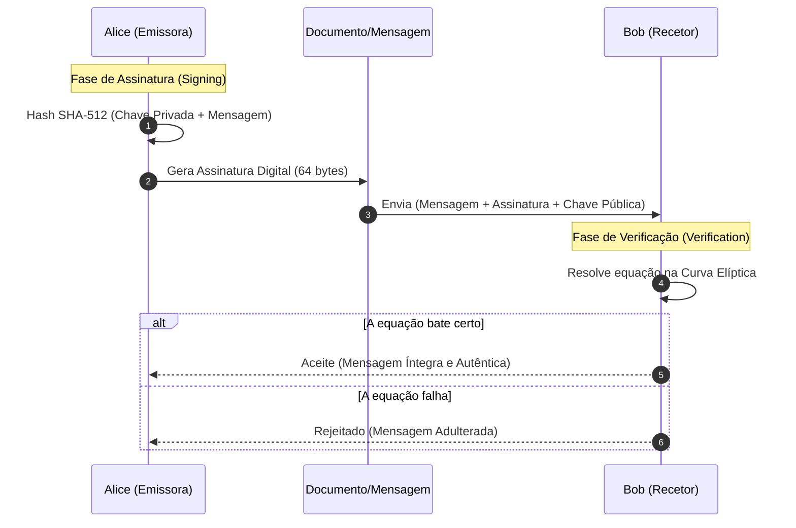

> [!info] Definição
> O **Ed25519** é um algoritmo de criptografia de chave pública da família da **Criptografia de Curva Elíptica (ECC)**, desenhado para criar assinaturas digitais rápidas, compactas e altamente seguras. Foi criado por Daniel J. Bernstein e baseia-se na curva matemática _Curve25519_ usando o esquema _EdDSA_.

## Como Funciona?

O Ed25519 baseia-se na dificuldade de resolver o problema do logaritmo discreto em curvas elípticas. O ciclo de vida divide-se em 3 fases principais:

### 1. Geração de Chaves

A geração de chaves é um processo unidirecional. É matematicamente inexequível reverter a chave pública para descobrir a privada.

### 2. Assinatura e Verificação

> [!warning] A Vantagem Determinística Ao contrário do antigo ECDSA, o Ed25519 é **determinístico**. Assinar a mesma mensagem com a mesma chave gera _sempre_ a mesma assinatura. Isto elimina o risco de expor a chave privada devido a geradores de números aleatórios com falhas (o erro que comprometeu a PS3 no passado).

## Comparativo e Vantagens

| **Característica**         | **Detalhe**                                                                    |
| -------------------------- | ------------------------------------------------------------------------------ |
| **Tamanho Reduzido**       | Chaves públicas de 32 bytes e assinaturas de 64 bytes (muito menores que RSA). |
| **Velocidade**             | Operações matemáticas extremamente rápidas a assinar e verificar.              |
| **Segurança Side-Channel** | Imune a ataques de _timing_ (o código corre em tempo constante).               |
| **Tolerância a Falhas**    | Não depende de entropia (aleatoriedade) no momento de assinar.                 |

## Casos de Uso (Exemplos Práticos)

- **SSH:** Padrão moderno recomendado para chaves de acesso (`ssh-keygen -t ed25519`).
- **VPNs:** Usado no núcleo do protocolo **[[WireGuard]]**.
- **Git:** Assinatura segura de _commits_.
- **Criptomoedas / Blockchain:** Assinatura rápida de milhares de transações por segundo.
- **Autenticação:** Hardware keys (FIDO2 / YubiKey).

## No [[Bat (couf couf) Evidence A Wayne]]

- **Algoritmo por omissão:** assina as provas, as notas encadeadas e os blocos do ledger (Blocos 0–2 no exemplo).
- **Certificados de folha:** é o algoritmo das chaves dos membros (Nightwing, Oracle, Robin), emitidas pela Root CA.
- **Relação com a raiz:** a Root CA do Alfred usa `RSA-4096`, mas pode assinar certificados cujo titular tem chave Ed25519 — são algoritmos independentes.
- **[[WireGuard]]:** a mesma família de curvas (_Curve25519_) está na base do túnel, segundo a nota [[WireGuard]].

_Referências Relacionadas:_ [[Criptografia de Curva Elíptica (ECC)]], [[RSA]], [[WireGuard]], [[Bat (couf couf) Evidence A Wayne]]