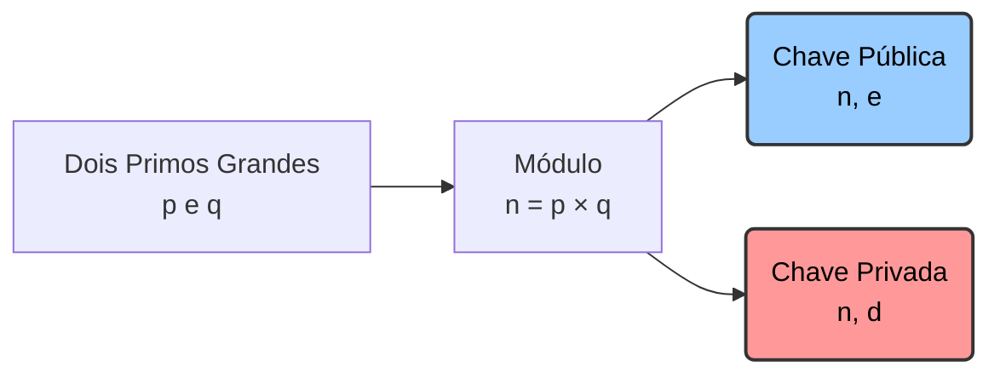
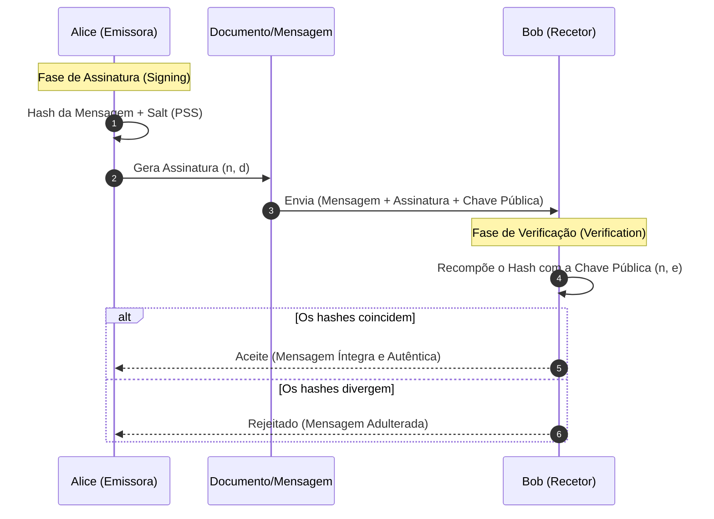

> [!info] Definição
> O **RSA** (Rivest–Shamir–Adleman) é um algoritmo de criptografia de chave pública baseado na dificuldade de **fatorizar o produto de dois números primos grandes**. É usado tanto para cifra como para **assinaturas digitais**. O **RSA-PSS** é o esquema de assinatura com preenchimento probabilístico, e **RSA-4096** designa o tamanho do módulo (4096 bits).

## Como Funciona?
O RSA assenta numa relação assimétrica: multiplicar dois primos é trivial, mas descobrir os primos a partir do produto é computacionalmente inviável com tamanho suficiente. O ciclo de vida divide-se em 3 fases principais.
### 1. Geração de Chaves
Escolhem-se dois primos grandes $p$ e $q$; o módulo é $n = p \times q$. A chave pública é o par $(n, e)$ e a chave privada é $(n, d)$, em que $d$ é o inverso de $e$ módulo $\varphi(n)$.

### 2. Assinatura e Verificação (RSA-PSS)
O **PSS** (_Probabilistic Signature Scheme_) acrescenta um _salt_ aleatório antes do hashing. O RSA-PSS é **probabilístico**: assinar duas vezes a mesma mensagem produz assinaturas diferentes, ambas válidas.

### 3. Tamanhos de Chave

| Chave | Módulo | Assinatura | Nota |
|---|---|---|---|
| RSA-2048 | 2048 bits | 256 bytes | Mínimo legado ainda aceitável |
| RSA-4096 | 4096 bits | 512 bytes | Usado na raiz de confiança do BatEvidence |

## No [[Bat (couf couf) Evidence A Wayne]]

- **Root CA (Alfred):** é o único ponto onde o RSA é usado por omissão — chave `RSA-4096` em HSM offline, com validade de 10 anos.
- **Certificados de parceiros externos:** `RSA-PSS ≥ 3072` apenas quando o parceiro institucional (ex.: GCPD) não suporta [[Ed25519]].
- **Assinaturas de provas, notas e blocos:** não usam RSA; são `Ed25519`. O RSA-PSS não é uma alternativa livre, está limitado pela política descrita no Perfil Criptográfico do documento.

## Comparativo e Vantagens

| **Característica**  | **Detalhe**                                                                            |
| ------------------- | -------------------------------------------------------------------------------------- |
| **Compatibilidade** | Amplamente suportado em TLS, [[X.509]], SSH e bibliotecas antigas.                         |
| **Chaves Maiores**  | Permite módulos de 2048 a 4096 bits, com margem de segurança conservadora.             |
| **Custo**           | Operações mais lentas e assinaturas muito maiores do que no Ed25519.                   |
| **Preenchimento**   | O RSA-PSS é obrigatório na prática moderna; o antigo PKCS#1 v1.5 é considerado frágil. |
## Casos de Uso (Exemplos Práticos)

- **TLS / HTTPS:** certificados e handshakes clássicos.
- **[[X.509]] / PKI:** certificados de raiz e de entidades emissoras.
- **Assinatura de documentos:** PDF, software e correio eletrónico (S/MIME).
- **Compatibilidade legada:** sistemas que ainda não suportam Ed25519.

_Referências Relacionadas:_ [[Ed25519]], [[WireGuard]], [[mTLS]], [[X.509]], [[Criptografia de Curva Elíptica (ECC)]], [[Bat (couf couf) Evidence A Wayne]]
