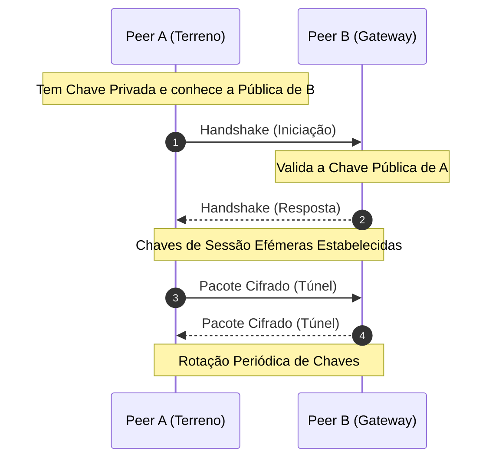
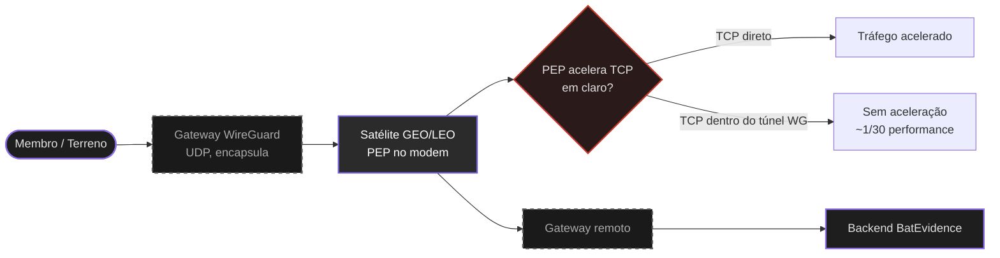
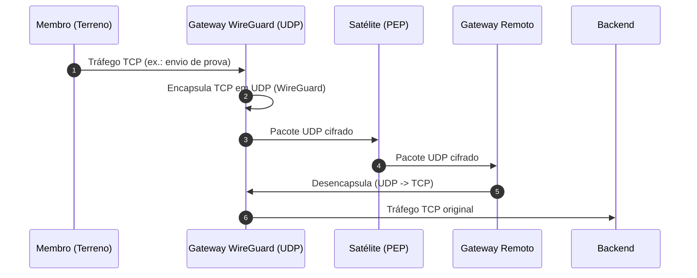

> [!info] Definição
> O **WireGuard** é um protocolo de **VPN (Virtual Private Network)** moderno, leve e de alto desempenho. Corre sobre **UDP** e assenta em criptografia de curva elíptica da família _Curve25519_, com o objetivo de ser simples de configurar, rápido e fácil de auditar.

## Como Funciona?

O WireGuard liga dois pares (_peers_) através de um túnel cifrado. Cada peer tem um par de chaves (pública/privada) e o handshake estabelece chaves de sessão efémeras, renovadas periodicamente.

### 1. Handshake e Chaves

Cada peer tem um par de chaves Curve25519. O handshake troca material efémero e autentica os pares pelas chaves públicas, sem certificados nem autoridades externas. As chaves de sessão rodam ao longo do tempo, limitando o impacto de um compromisso.

### 2. Transporte

Depois do handshake, os pacotes são cifrados com **ChaCha20-Poly1305** e o protocolo usa **BLAKE2s** para hashing e derivação de chaves. Como corre sobre UDP, evita o overhead do TCP e funciona bem em redes instáveis.

### 3. Configuração

A configuração reduz-se a interfaces e pares: chave privada local, chave pública do par remoto e os IPs/rotas permitidos. Não há negociação extensa de algoritmos — o conjunto criptográfico é fixo, o que simplifica a auditoria.

## Comparativo e Vantagens

|   |   |
|---|---|
|**Característica**|**Detalhe**|
|**Simplicidade**|Cerca de 4 000 linhas de código; conjunto criptográfico fixo.|
|**Desempenho**|Muito rápido, com implementação no kernel Linux.|
|**Roaming**|Mantém a sessão quando o cliente muda de rede ou de IP.|
|**Criptografia Moderna**|Curve25519, ChaCha20-Poly1305 e BLAKE2s.|

## Relação com o Ed25519 e o [[mTLS]]

- A nota [[Ed25519]] indica que o algoritmo é **usado no núcleo do WireGuard** — ambos vêm da mesma família de curvas (_Curve25519_).
- O **WireGuard** protege o **túnel de rede** (camada de transporte/VPN).
- O **[[mTLS]]** autentica mutuamente as partes com **certificados [[X.509]]** ao nível da aplicação.
- No BatEvidence aparecem juntos como `WireGuard/mTLS` (ver [[mTLS]]) porque cobrem camadas diferentes do mesmo canal.

## Ligações no [[Bat (couf couf) Evidence A Wayne]]

- **Arquitetura:** o diagrama macro tem o nó `Autenticação mTLS / WireGuard`, entre a app cliente e os casos ([[mTLS]]).
- **Acesso Seguro a Evidências e Notas:** o `Gateway (WireGuard/mTLS)` recebe o pedido de consulta e encaminha-o já autenticado para o backend ([[mTLS]]).
- **Comunicações Seguras de Campo:** é o mecanismo que mantém o canal protegido quando os agentes depositam provas a partir do terreno, com rede instável.
## WireGuard sobre Satélite
Três órbitas, três comportamentos:

| Órbita | Exemplo          | RTT típico  | Comportamento do WireGuard                                                      |
| ------ | ---------------- | ----------- | ------------------------------------------------------------------------------- |
| LEO    | Starlink         | 30–70 ms    | Quase qualidade móvel;  MTU 1360–1420; FEC mínimo                            |
| GEO    | VSAT tradicional | 600–800 ms  | Funciona, mas TCP dentro do túnel perde aceleração do PEP;  tuning agressivo |
| L-band | Iridium Certus   | 650–1900 ms | VPNs não recomendadas; perda/outages significativos;  usar VPN do provedor   |
**Problema do PEP (Performance Enhancing Proxy):** o modem satélite acelera TCP em claro (spoofing de ACKs). Como o WireGuard encapsula em UDP, o PEP não vê o TCP interior e não o acelera, pelo que o ACK volta pelo túnel e o TCP decide que a ligação é lenta. Mitigação: PEP na posição B (WireGuard no lado do utilizador, PEP fora do túnel) ou TCP direto sem VPN para tráfego não sensível (split tunneling).

**Configuração recomendada (GEO):**
- MTU: 1280–1360 · MSS: 1200–1300
- TCP: BBR v2, buffers até dezenas de MB, ECN ativo
- `PersistentKeepalive`: 20–30 s (manter NAT/rota em links silenciosos)
- FEC 5–10% apenas em fluxos críticos (voz/vídeo)

Note over SAT:         PEP não vê o TCP interior
				não acelera
Note over U, BE:       RTT total = satélite + túnel
				mitigar com MTU baixo BBR v2
				keepalive e split tunneling

- acesso ao drop-box, (sistema isulado sem acesso ao sistema principal)
Diagrama (colocar esquema)
Diagrama geografico (fisico)
## Casos de Uso (Exemplos Práticos)

- **Acesso remoto seguro:** ligação de field agents à infraestrutura central.
- **Site-to-site:** ligação entre a Batcaverna e postos externos.
- **Mobile / roaming:** túneis que sobrevivem a mudanças de rede.
- **Ambientes de baixo recurso:** routers e dispositivos com pouca CPU.

_Referências Relacionadas:_ [[Ed25519]], [[RSA]], [[mTLS]], [[X.509]], [[Criptografia de Curva Elíptica (ECC)]], [[Bat (couf couf) Evidence A Wayne]]

