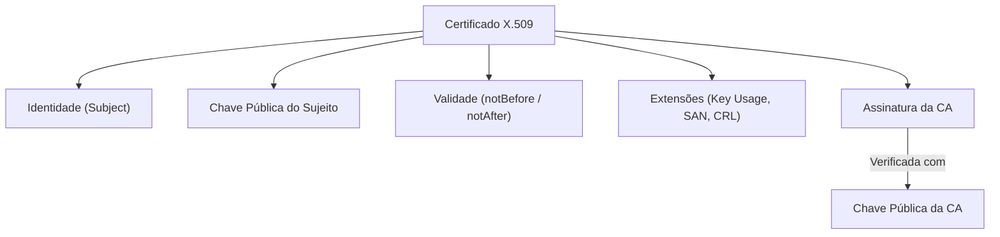
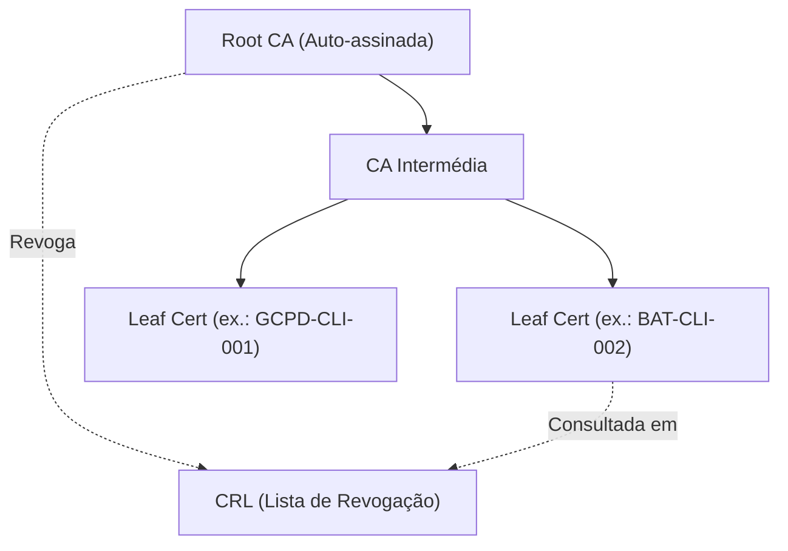

> [!info] Definição
> O **X.509** é o padrão que define a estrutura dos **certificados de chave pública**. Um certificado X.509 é um documento assinado por uma Autoridade de Certificação (CA) que liga uma **identidade** (nome, organização, dispositivo) a uma **chave pública**. É a base da PKI, do TLS e do [[mTLS]].

## Como Funciona?

O X.509 não é um algoritmo criptográfico: é um **formato** e um conjunto de regras. A segurança vem de quem assina o certificado e de como a cadeia é validada.

### 1. Estrutura do Certificado

| Campo | Conteúdo |
|---|---|
| **Versão / Número de Série** | Identifica o formato e o certificado dentro da CA. |
| **Algoritmo de Assinatura** | Algoritmo usado pela CA para assinar: [[RSA\|RSA-PSS]] na raiz, [[Ed25519]] nas folhas. |
| **Emissor (Issuer)** | A CA que emitiu o certificado. |
| **Validade** | Datas `notBefore` e `notAfter` em que o certificado é aceite. |
| **Sujeito (Subject)** | A identidade certificada (ex.: `BAT-CLI-002`). |
| **Chave Pública** | A chave pública do sujeito e o algoritmo associado. |
| **Extensões** | Restrições e usos: `Key Usage`, `Extended Key Usage`, `SAN`, pontos de CRL. |
| **Assinatura da CA** | Assinatura digital de todos os campos anteriores. |

### 2. Cadeia de Confiança (PKI)

Os certificados organizam-se em hierarquia: a **Root CA** assina os certificados intermédios ou diretamente as folhas (_leaf certificates_). Validar um certificado é percorrer esta cadeia até uma raiz em que se confia.

### 3. Validação e Revogação

Um certificado só é aceite se: a assinatura da CA for válida, as datas estiverem dentro da validade, o sujeito corresponder ao esperado, as extensões permitirem o uso pretendido e o certificado **não constar da CRL** (ou ser confirmado por OCSP). Uma chave comprometida é revogada, sem necessidade de reemitir toda a hierarquia.

## Comparativo e Vantagens

|   |   |
|---|---|
|**Característica**|**Detalhe**|
|**Padrão Aberto**|Formato amplamente suportado em TLS, S/MIME, VPNs e assinatura de código.|
|**Identidade Verificável**|Liga explicitamente um nome/ID a uma chave pública.|
|**Revogação**|A CRL permite cortar um certificado comprometido sem alterar os restantes.|
|**Custo**|Exige uma PKI: emissão, renovação, revogação e proteção da raiz.|

## Relação com as Outras Tecnologias

- **[[mTLS]]:** o handshake mútuo assenta em certificados X.509 — cada lado apresenta o seu e valida o do outro.
- **[[Ed25519]] e [[RSA]]:** são os algoritmos que geram os pares de chaves e as assinaturas dentro do certificado.
- **[[WireGuard]]:** não usa X.509; autentica os pares diretamente por chaves públicas. É por isso que, no BatEvidence, `WireGuard` e `mTLS` cobrem camadas diferentes.
- **PKI / CRL:** o X.509 define o certificado; a PKI define quem o emite e a CRL quem o revoga.

## Ligações no [[Bat (couf couf) Evidence A Wayne]]

- **Persona do Alfred:** emite, renova e revoga certificados `X.509/[[Ed25519]]/[[RSA|RSA-PSS]]`, operando a Root CA e a CRL.
- **Cadeia de Certificados (PKI):** a hierarquia `Root CA → Leaf Cert` (Nightwing, Comissário Gordon) e a validação do estado na CRL são a aplicação direta do modelo X.509.
- **Autenticação mTLS:** o nó `Autenticação mTLS / [[WireGuard]]` e o `Gateway ([[WireGuard]]/mTLS)` usam estes certificados para autenticar as partes.
- **Notas do documento:** o RSA é descrito como preferido onde já existe infraestrutura X.509 ou se exige uma raiz de confiança conservadora.
- **Cenário 2 e quórum:** a identidade certificada é o que garante que cada fração de Shamir pertence a um membro autorizado.

## Casos de Uso (Exemplos Práticos)

- **HTTPS / TLS:** certificados de servidores e de clientes.
- **[[mTLS]]:** autenticação mútua entre serviços e dispositivos.
- **Assinatura de código e documentos:** validade e autoria verificáveis.
- **PKI institucional:** emissão de identidades para agentes e parceiros (ex.: GCPD).

_Referências Relacionadas:_ [[Ed25519]], [[RSA]], [[mTLS]], [[WireGuard]], [[Criptografia de Curva Elíptica (ECC)]], [[Bat (couf couf) Evidence A Wayne]]
