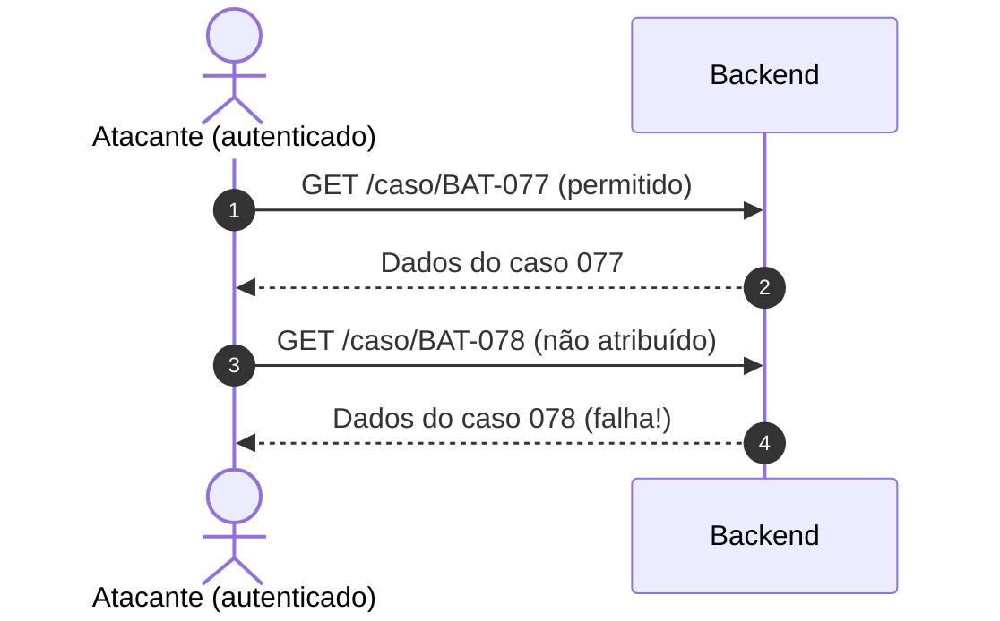

> [!info] Definição
> **IDOR** (_Insecure Direct Object Reference_, ou "referência direta insegura a objetos") é uma falha em que o sistema expõe um **identificador interno** de um objeto — um número de caso, um nome de ficheiro, um URI — e **não verifica se o utilizador tem permissão para o aceder**. O atacante limita-se a trocar o identificador e aceder a dados que não lhe pertencem.

## Em linguagem simples

Imagina um hotel em que a receção te dá a chave do quarto **101**, mas as portas não verificam se és hóspede desse quarto. Basta tentares a porta **102**, **103**, **104**… e vais entrando em quartos alheios. O problema não é a fechadura: é ninguém confirmar **de quem é** o quarto que estás a abrir.

## Como o ataque funciona

1. O utilizador legítimo vê um identificador válido, por exemplo `caso/BAT-077`.
2. O atacante altera o identificador para `caso/BAT-078`, `BAT-079`, etc.
3. O servidor devolve os dados **sem confirmar** se aquele utilizador está atribuído ao caso.
4. Como os identificadores costumam ser sequenciais, o atacante consegue **enumerar** e recolher tudo.

## Exemplo no BatEvidence

O Nightwing está autenticado e tem acesso apenas aos casos que lhe foram atribuídos. Se o backend só verificar "**está autenticado?**" e não "**está atribuído a este caso?**", ele pode pedir `BAT-078` e ler provas de outra investigação.

O mesmo risco existe no armazenamento: se o WORM entregar o ficheiro a quem apresentar o `URI_Localizador` sem validar o pedido, conhecer o URI equivale a ter acesso.

## Porque é perigoso

- Quebra a **confidencialidade** (leitura de provas alheias).
- Permite **enumeração** e descoberta da estrutura interna do sistema.
- Pode levar a **escalada de privilégios** se o objeto acedido permitir ações adicionais.

## Como o BatEvidence se protege

- **Autorização por objeto e por caso:** cada pedido valida a atribuição do utilizador ao caso (RF11), não apenas a autenticação.
- **Negação por omissão:** sem regra explícita que autorize, o acesso é negado (RNS19).
- **Identificadores não sequenciais:** UUIDv7 reduz a enumeração, mas **não substitui** a verificação de autorização.
- **WORM cego:** o armazenamento só entrega o binário ao backend, que já validou o pedido; nunca diretamente ao cliente.
- **Auditoria:** cada acesso negado ou anómalo gera evento assinado (RF14/RNS20).

## Como testar

- **TC-RF11-02** em [[Intregavel 4]] — pedir um caso não atribuído iterando IDs e confirmar negação consistente.
- Vetores **v8/v9** em [[Ataques e Vetores]].

_Referências Relacionadas:_ [[Requesitos]], [[Intregavel 4]], [[Ataques e Vetores]], [[Escalada de Privilégios]], [[Movimento Lateral]], [[Bat (couf couf) Evidence A Wayne]]
