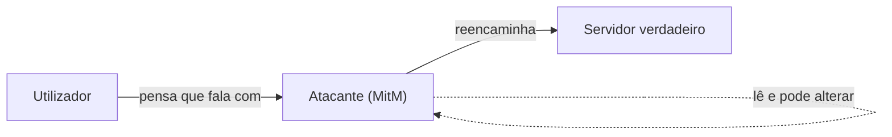

> [!info] Definição
> Um **ataque Man-in-the-Middle** (MitM, "homem no meio") ocorre quando o atacante se **coloca entre duas partes** que pensam estar a falar diretamente. Ele pode **ler**, **guardar** e até **alterar** a comunicação sem que nenhum dos lados perceba.

## Em linguagem simples

É como um carteiro que abre as cartas, tira cópias e volta a selá-las antes de entregar. As duas pessoas continuam a escrever uma à outra, mas alguém no meio lê tudo — e pode trocar o conteúdo.

## Como o ataque funciona

1. O atacante ganha posição na rede: Wi-Fi falso, ARP spoofing, router comprometido, link satélite inseguro.
2. A vítima liga-se e pensa estar a falar com o servidor verdadeiro.
3. O atacante faz de intermediário: recebe, pode ler e reencaminha.
4. Se não houver autenticação forte, a vítima não deteta a diferença.

## Exemplo no BatEvidence

Um agente no terreno liga-se por satélite para depositar uma prova. Se o canal não fosse autenticado, um atacante no caminho poderia intercetar o depósito, ler metadados ou substituir a resposta do servidor.

## Porque é perigoso

- Quebra a **confidencialidade** (leitura do conteúdo).
- Quebra a **integridade** (alteração de mensagens).
- Permite **substituição de chaves** e **replay**, servindo de base a outros ataques.

## Como o BatEvidence se protege

- **[[WireGuard]] no exterior:** túnel cifrado com Noise, Curve25519 e ChaCha20-Poly1305 (RNS01).
- **[[mTLS]] no interior:** ambos os lados apresentam certificado [[X.509]] válido (RNS14).
- **Validação da cadeia e da CRL:** um certificado falso ou revogado é rejeitado (RF18).
- **Envelope E2EE:** mesmo que o túnel seja comprometido, a resposta só é legível com a chave efémera do cliente (RNS13/RF15).
- **Assinatura [[Ed25519]]** do pedido: impede alteração silenciosa do *transcript*.

## Como testar

- **TC-RNS01-01**, **TC-RNS14-01** e **TC-RF11-01** em [[Intregavel 4]].
- Vetores **v2/v3** em [[Ataques e Vetores]].

_Referências Relacionadas:_ [[Requesitos]], [[Intregavel 4]], [[Ataques e Vetores]], [[Ataque de Repetição (Replay)]], [[Substituição de Chave (Key Substitution)]], [[Ataque de Downgrade]], [[WireGuard]], [[mTLS]]
