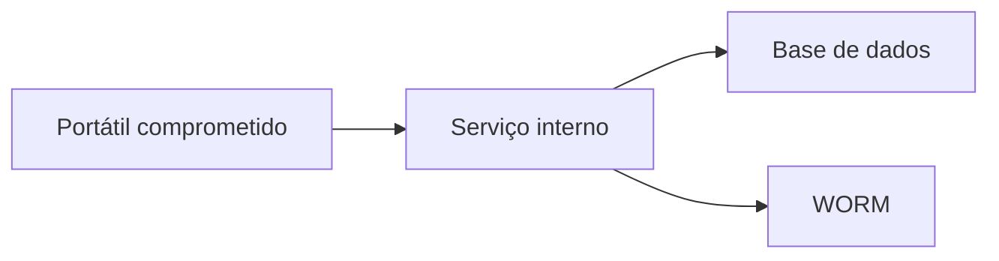

> [!info] Definição
> **Movimento lateral** é quando um atacante que já **comprometeu um ponto** da rede usa esse ponto para **entrar noutros** sistemas. Em vez de atacar diretamente o alvo principal, avança passo a passo, aproveitando credenciais e confiança entre máquinas.

## Em linguagem simples

É como entrar num escritório, roubar o cartão de acesso de um funcionário e usá-lo para abrir as salas vizinhas — e depois a sala do servidor. O atacante não arrombou a porta principal; foi **passando de porta em porta**.

## Como o ataque funciona

1. Compromete um equipamento periférico (portátil de campo, servidor de quarentena, *jump host*).
2. Recolhe credenciais, certificados, *tokens* e ligações de confiança.
3. Usa essas credenciais para aceder a outro serviço interno.
4. Repete até chegar a dados ou funções de maior valor.

## Exemplo no BatEvidence

Um portátil de campo infetado liga-se à VPN. Se a rede interna não estivesse segmentada e os serviços confiassem uns nos outros sem mTLS, o atacante poderia saltar do gateway para o backend e do backend para o WORM.

## Porque é perigoso

- Transforma uma falha pequena numa **compromisso total**.
- Permite alcançar sistemas que nunca estavam expostos à Internet.
- Dificulta a deteção, porque o tráfego parece interno e legítimo.

## Como o BatEvidence se protege

- **Segmentação e firewalls físicas (RNS18):** o externo nunca alcança a BD nem o WORM.
- **[[mTLS]] entre serviços (RNS14):** cada serviço tem de provar a sua identidade.
- **Menor privilégio (RNS19):** uma conta comprometida não dá acesso a tudo.
- **Quarentena isolada (RNS12):** o buffer exterior é um compartimento separado.
- **Auditoria (RF14/RNS20):** acessos anómalos entre serviços ficam registados.

## Como testar

- **TC-RNS18-01** e **TC-RNS19-01** em [[Intregavel 4]] — a partir da quarentena, tentar alcançar BD/WORM e confirmar bloqueio.
- Vetores **v3/v4** em [[Ataques e Vetores]].

_Referências Relacionadas:_ [[Requesitos]], [[Intregavel 4]], [[Ataques e Vetores]], [[Escalada de Privilégios]], [[Exfiltração de Dados e Chaves]], [[mTLS]], [[WireGuard]]
