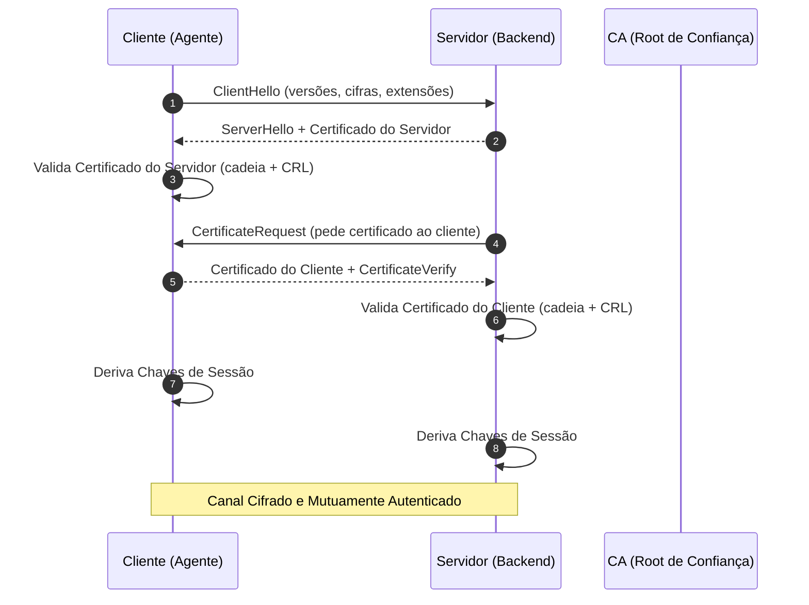

> [!info] Definição
> O **mTLS** (_mutual TLS_, ou TLS mútuo) é uma variante do **TLS** em que **ambas as partes** do canal se autenticam com certificados **[[X.509]]**: o servidor prova a sua identidade ao cliente e o cliente prova a sua ao servidor. No TLS habitual só o servidor apresenta certificado; no mTLS o cliente também apresenta o seu, e cada lado valida a cadeia de confiança do outro.

## Como Funciona?

O mTLS reutiliza o handshake do TLS, mas acrescenta a **autenticação do cliente**. Cada lado tem um par de chaves e um certificado emitido por uma autoridade de certificação (CA) em que ambos confiam. O ciclo divide-se em 3 fases principais.

### 1. Handshake e Troca de Certificados

### 2. Validação da Cadeia de Confiança

Cada certificado tem de encadear até uma **Root CA** de confiança. O recetor verifica a assinatura da CA, o período de validade, o nome/identificador e o estado de revogação na **CRL** (ou por OCSP). Se qualquer passo falhar, o handshake é abortado.

### 3. Sessão Autenticada

Depois do handshake, o canal fica cifrado e ambas as partes sabem **quem** está do outro lado. As chaves de sessão são efémeras, pelo que a autenticação não protege apenas a cifra, mas também liga a sessão à identidade certificada.

## Comparativo e Vantagens

|   |   |
|---|---|
|**Característica**|**Detalhe**|
|**Autenticação Mútua**|Servidor e cliente apresentam certificados; nenhum lado é anónimo.|
|**Base Existente**|Reutiliza TLS e [[X.509]], sem protocolos novos.|
|**Revogação**|Uma chave comprometida é bloqueada pela CRL, sem alterar o resto da infraestrutura.|
|**Custo**|Exige gestão de certificados para todos os clientes e uma PKI funcional.|

## Relação com as Outras Tecnologias

- **[[WireGuard]]:** protege o **túnel de rede** (VPN) para operações externas/terreno; o mTLS autentica as partes **ao nível da aplicação** para comunicações internas. No BatEvidence: WireGuard no gateway externo, mTLS entre serviços internos.
- **[[Ed25519]] e [[RSA]]:** são os algoritmos de assinatura usados nos certificados [[X.509]] e nas provas de posse de chave do handshake — `RSA-4096` na raiz e `Ed25519` nas folhas.
- **[[X.509]] / PKI:** o mTLS não define a hierarquia de certificados; consome-a. É a [[Bat (couf couf) Evidence A Wayne|Cadeia de Certificados]] do BatEvidence que emite e revoga os certificados usados no handshake.
## Casos de Uso (Exemplos Práticos)

- **APIs internas:** serviços que só aceitam clientes com certificado válido.
- **Comunicações de campo:** dispositivos móveis que se autenticam perante o backend.
- **Zero Trust:** cada pedido transporta identidade verificável, sem confiar apenas na rede.
- **Integração institucional:** parceiros externos (como o GCPD) autenticados por certificado próprio.

_Referências Relacionadas:_ [[Ed25519]], [[RSA]], [[WireGuard]], [[X.509]], [[Criptografia de Curva Elíptica (ECC)]], [[Bat (couf couf) Evidence A Wayne]]
