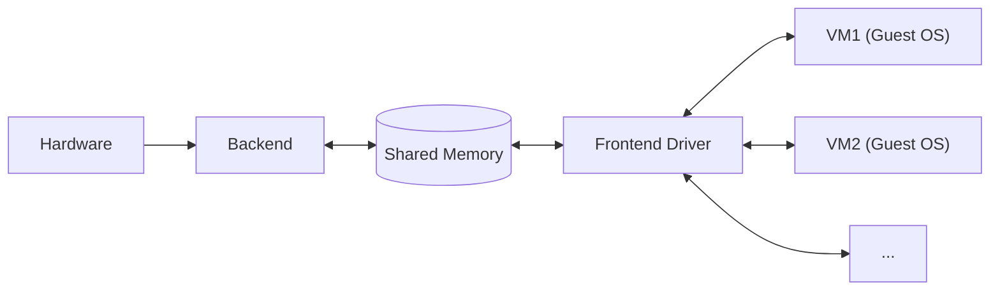

# 1. Virtualização Assistida por _Hardware_

> 🐰 “Going deep into the rabbit hole”

Para que a virtualização seja possível, processadores como os da arquitetura **x86** incluem um modo de funcionamento especial e um conjunto de instruções específicas, designadas por **virtualização assistida por hardware**.

Neste modelo, o _hypervisor_ e o sistema operativo convidado (_guest_ OS) operam em modos distintos. Todas as instruções sensíveis executadas pelo sistema operativo convidado ou pelas suas aplicações são intercetadas e geridas pelo _hypervisor_, garantindo assim o isolamento e o controlo adequado das máquinas virtuais.

A mudança de modo e a preservação dos estados do processador durante estas transições são realizadas diretamente pelo hardware, tornando o processo mais eficiente.

- No caso da arquitetura **x86**, tanto a **Intel** como a **AMD** desenvolveram tecnologias proprietárias para este tipo de virtualização assistida por hardware.

A **virtualização assistida por hardware** surgiu como uma solução para simplificar o processo de virtualização, uma vez que tanto a virtualização total como a paravirtualização exigem implementações complexas e custosas em termos de desempenho.

**Verificar Capacidade de Virtualização do Hardware**

No macOS, especificamente em hardware intel-_based_, é possível utilizar o comando `sysctl machdep.cpu.features` para verificar as **capacidades do CPU** atual, que informações relativas ao seu suporte à virtualização assistida por hardware:

```
MacBook-Air:~ mMcFly $ sysctl machdep.cpu.featuresmachdep.cpu.features: FPU VME DE PSE TSC MSR PAE MCE CX8 APIC SEP MTRR PGE MCA CMOV PAT PSE36 CLFSH DS ACPI MMX FXSR SSE SSE2 SS HTT TM PBE SSE3 PCLMULQDQ DTES64 MON DSCPL VMX EST TM2 SSSE3 FMA CX16 TPR PDCM SSE4.1 SSE4.2 x2APIC MOVBE POPCNT AES PCID XSAVE OSXSAVE SEGLIM64 TSCTMR AVX1.0 RDRAND F16C
```

> - The CPU flag for `VT-x` capability is “vmx”;
> - VMX stands for Virtual Machine Extensions, which adds 13 new instructions: `VMPTRLD`, `VMPTRST`, `VMCLEAR`, `VMREAD`, `VMWRITE`, `VMCALL`, `VMLAUNCH`, `VMRESUME`, `VMXOFF`, `VMXON`, `INVEPT`, `INVVPID`, and `VMFUNC`;
> - These instructions permit entering and exiting a virtual execution mode where the guest OS perceives itself as running with full privilege (ring 0), but the host OS remains protected.
> - In Linux, this can be checked via `cat /proc/cpuinfo`;

**O comando anteriormente apresentado lista as funcionalidades detetadas pelo sistema**, permitindo confirmar, por exemplo, se o processador suporta Intel `VT-x` (indicada pela flag `VMX`) ou outras extensões relevantes para a execução de máquinas virtuais em ambientes virtualizados.

## 1.1. Princípios de Funcionamento

**Relembrar**: Podemos observar na Figura 1 os níveis de privilégios do processador.

As empresas Intel e AMD introduziram um **novo nível de privilégio** nos processadores x86, designado por **_Ring_ -1,**. Tradicionalmente, os sistemas operativos executam-se no _Ring 0_ (_supervisor mode_/_kernel mode_), enquanto que as aplicações funcionam em níveis superiores (_Ring_ 3 - _user mode_). Com a proposta de execução em _Ring_ -1, o _hypervisor_ passa a executar-se no Ring -1, o que lhe confere um nível de controlo ainda mais baixo que o do próprio sistema operativo.

- Esta abordagem elimina a necessidade de modificar os sistemas operativos convidados, permitindo que funcionem de forma nativa dentro das máquinas máquinas.

Em _Ring_ -1 todas as instruções privilegiadas e sensíveis executadas pelas máquinas virtuais são automaticamente intercetadas pelo _hypervisor_, sem necessidade de recorrer a técnicas complexas, como, por exemplo, a tradução binária (_binary translation_).

|                                                                                                                                                                                                                      |                                                                                                                                                                                                                                                                         |
| -------------------------------------------------------------------------------------------------------------------------------------------------------------------------------------------------------------------- | ----------------------------------------------------------------------------------------------------------------------------------------------------------------------------------------------------------------------------------------------------------------------- |
| \|Ring\|Designação\|<br>\|---\|---\|<br>\|Ring -1\|_Hypervisor Mode_ / _Virtualization Mode_\|<br>\|Ring 0\|_Kernel Mode_ / _Supervisor Mode_\|<br>\|(...)\|(...)\|<br>\|Ring 3\|_User Mode_ / _Unsupervisor Mode_\| |   <br>Fig 1. Níveis de privilégios do processador - Com inclusão do Ring -1.  <br>Adaptada a partir de [https://www.eecs.harvard.edu/~cs161/notes/virtualization.pdf](https://www.eecs.harvard.edu/~cs161/notes/virtualization.pdf) |

Os sistemas operativos e processadores modernos permitem a execução simultânea de vários processos. No entanto, sem mecanismos de proteção integrados no processador, todas as instruções provenientes desses diferentes processos poderiam aceder diretamente ao hardware, o que levaria inevitavelmente a uma falha do sistema.

Para evitar esse problema, todos os processadores dispõem, pelo menos, de **dois modos de funcionamento**:

- o ==**modo utilizador**== (_user mode_);
- e o ==**modo supervisor**== (_supervisor mode / kernel mode_).

A **separação dos modos garante** um **controlo** rigoroso do acesso ao **hardware** crítico, impedindo que processos comuns interfiram com recursos sensíveis do sistema.

## 1.2. Evolução Histórica
**A virtualização baseada em software surgiu no final da década de 1990**, quando os processadores ainda não possuíam mecanismos nativos para este fim. Com o avanço da tecnologia, a partir de cerca de 2006, foi introduzida a virtualização assistida por hardware, que passou a contar com suporte direto a nível de CPU, GPU e chipsets, tornando o processo muito mais eficiente e seguro.

No ==**caso dos processadores (CPU)**==, destacam-se várias tecnologias:

- o modo Virtual 8086,
- a `AMD-V` (virtualização da AMD),
- a Intel `VT-x` e `VT-i`, a `VIA VT`,
- e ainda mecanismos de virtualização de interrupções, como o AMD `AVIC` e a Intel `APICv`.

Relativamente às ==**placas gráficas (GPUs)**==, e no caso da Intel, esta desenvolveu a _Graphics Virtualization Technology_ (GVT), que inclui três variantes destinadas a diferentes níveis de partilha e desempenho gráfico em ambientes virtuais: **GVT-d**; **GVT-g**; e **GVT-s**.

A Intel _Graphics Virtualization Technology_ é um conjunto de tecnologias desenhadas para permitir que as placas gráficas integradas da Intel (GPUs) sejam partilhadas ou atribuídas diretamente a máquinas virtuais, consoante o tipo de utilização pretendida.

Cada variante, GVT-d, GVT-g e GVT-s, oferece um nível diferente de isolamento, desempenho e partilha de recursos gráficos entre o _host_ e as máquinas virtuais.

Por fim, nos ==_**chipsets**_==, surgiram também importantes inovações, nomeadamente:

- **Virtualização da Unidade de Gestão de Memória** (_I/O Memory Management Unit Virtualization_) → Utilização das tecnologias `AMD-Vi` e `Intel-VT-d`.
- **Virtualização de Rede** (_Network Virtualization_) → Utilização da tecnologia `VT-c`.
- **PCI-SIG SIngle Root I/O Virtualization (SR-IOV)** → Permite que um único dispositivo físico PCI _Express_ (PCIe), ligado a uma única _root port_, seja apresentado ao _hypervisor_ e ao sistema operativo convidado como se fosse vários dispositivos físicos distintos – Esta trata-se de uma solução de I/O _virtualization_ que possibilita a partilha eficiente de um único hardware físico entre múltiplas máquinas virtuais, e assim assegurando o isolamento e o desempenho de cada instância.

## 1.3. Suporte de Virtualização Assistida por Hardware no Linux

O **_Kernel-based Virtual Machine_ (KVM)** é uma infraestrutura de virtualização integrada no kernel do Linux. Este sistema suporta tanto a **virtualização assistida por hardware**, através das tecnologias, Intel `VT-x` e `AMD-V`, como a **paravirtualização**, utilizando o framework `VirtIO`.

Outro exemplo relevante é o **Xen**, um _hypervisor_ amplamente utilizado que é compatível com várias arquiteturas de hardware, incluindo IA-32, x86-64, Itanium e PowerPC 970.

A framework `VirtIO` fornece dispositivos paravirtuais que otimizam a comunicação entre o _guest_ OS e o _hypervisor_, incluindo uma placa Ethernet paravirtual, um controlador de I/O de disco, um dispositivo de ajusto dinâmico da memória utilizada pelo _guest_ e uma _interface_ gráfica VGA compatível com drivers VMware.

  
Fig 2. Suporte de hardware da Intel para virtualização do processador, memória e dispositivos de I/O.

==**A Figura 2 ilustra o suporte de hardware**== da Intel para virtualização de três componentes fundamentais de um sistema informático: o processador, a memória e os dispositivos de entrada/saída (I/O). O objetivo é demonstrar como o hardware trabalha em conjunto com o _hypervisor_ para permitir que múltiplas máquinas virtuais funcionem de forma independente e eficiente sobre o mesmo hardware físico.

Podemos observar na Figura 2:

- Na secção superior da figura, observam-se várias máquinas virtuais (VM₀, VM₁, VM₂, …, VMₙ), cada uma a correr o seu próprio sistema operativo (OS) e as suas respetivas aplicações.

Todas utilizam os recursos físicos da máquina anfitriã, mas fazem-no de modo isolado, graças à atuação do _hypervisor_ e às tecnologias de virtualização suportadas por hardware.

- Na secção inferior da figura, observa-se a seguinte divisão:
    1. **Processador**: A virtualização do CPU é assegurada pelas tecnologias `VT-x` e `VT-i`, que permitem que instruções privilegiadas dos sistemas operativos convidados sejam executadas de forma controlada, sem comprometer o sistema anfitrião.
    2. **Memória**: A tecnologia _Extended Page Tables_ (EPT) permite a tradução dos endereços de memória entre o _guest_ OS e o hardware físico, reduzindo a sobrecarga de desempenho associada à virtualização da memória.
    3. **Dispositivos de I/O**: Inclui várias funcionalidades:
        - **DMA** e **mapeamento de interrupções** → garante um acesso seguro e eficiente aos dispositivos do hardware.
        - `VT-d` e `VT-c` → Permitem a virtualização direta de dispositivos de entrada/saída e de rede, respetivamente, possibilitando que diferentes máquinas virtuais partilhem os mesmos recursos físicos, como interfaces de rede e armazenamento.

**Em conjunto, as tecnologias discutidas permitem que o _hypervisor_ ofereça um ambiente virtualizado com isolamento, segurança e desempenho próximos do hardware nativo.**

# 2. Virtualização do CPU
Na virtualização do processador, as instruções não privilegiadas das máquinas virtuais são executadas diretamente no hardware físico do anfitrião, o que garante uma maior eficiência e reduz a sobrecarga de processamento associada ao _hypervisor_.

As **instruções críticas** são classificadas em **três categorias** principais:

1. Instruções Privilegiadas (_Privileged Instructions_)
2. Instruções Sensíveis ao Controlo (_Control-sensitive Instructions_)
3. Instruções Sensíveis ao Comportamento (_Behavior-sensitive Instructions_)

- As **Instruções Privilegiadas** só podem ser executadas em modo privilegiado; se forem executadas fora desse modo, são intercetadas (_trapped_) pelo _hypervisor_, que decide como proceder.
- As **Instruções Sensíveis ao Controlo** são aquelas que tentam alterar a configuração dos recursos utilizados, como registos de controlo ou parâmetros do sistema.
- Por fim, as **Instruções Sensíveis ao Comportamento** têm diferentes comportamentos consoante o estado ou configuração atual dos recursos, que podem incluir operações de leitura e escrita (_load and store operations_) sobre a memória virtual.

Uma arquitetura de CPU é considerada virtualizável quando permite que as instruções privilegiadas e não privilegiadas de uma máquina virtual sejam executadas em modo de utilizador, enquanto o _hypervisor_ funciona em modo de supervisor (ou _kernel mode_).

A **separação em instruções privilegiadas e não privilegiadas é fundamental** para garantir que o _hypervisor_ tenha controlo total sobre o acesso ao hardware e sobre as operações executadas pelas máquinas virtuais. Quando uma instrução privilegiada, incluindo as sensíveis ao controlo e sensíveis ao comportamento, é executada por uma VM, ela é intercetada pelo _hypervisor_. O _hypervisor_, por sua vez, gere a execução dessa instrução de forma segura, assegurando que nenhuma máquina virtual interfira com o funcionamento das outras nem com o sistema anfitrião. ==**Assim, o _hypervisor_ atua como mediador centralizado entre o hardware e as várias máquinas virtuais, garantindo a correção, a estabilidade e o isolamento de todo o sistema virtualizado.**==

## 2.1. Limitações da Virtualização do CPU

**Nem todas as arquiteturas de processador (CPU) são naturalmente virtualizáveis**. Por exemplo:

- As arquiteturas baseadas em RISC (_Reduced Instruction Set Computer_) possuem uma estrutura mais simples e consistente, o que facilita a virtualização.
- Em contraste, as arquiteturas x86 não foram originalmente concebidas com a virtualização em mente. Como consequência, quando estas instruções são executadas num ambiente virtualizado, não podem ser intercetadas pelo _hypervisor_, o que dificulta a implementação de uma virtualização completa apenas por software – ==Foi precisamente essa limitação que levou ao desenvolvimento posterior das tecnologias de virtualização assistida por hardware==, como a Intel `VT-x` e o `AMD-V`, que resolvem este problema ao permitir que as instruções sejam corretamente geridas pelo _hypervisor_.

## 2.2. Princípios de Funcionamento da Virtualização do CPU

A Figura 3 ilustra o **funcionamento da virtualização do CPU assistida por hardware da Intel**, onde é demonstrado como o _hypervisor_ e as máquinas virtuais interagem com o processador físico através das tecnologias Intel `VT-x` ou `VT-i`.

  
Fig 3. Suporte de hardware da Intel para virtualização do processador com Intel VT-x ou VT-i.

Podemos observar na Figura 3:

- Na **secção superior** da figura, observam-se as máquinas virtuais (VM₀ e VM₀), cada uma com o seu sistema operativo convidado (neste exemplo, o Windows XP) e as respetivas aplicações. As aplicações executam-se em _Ring_ 3 (_user mode_), enquanto o sistema operativo funciona em _Ring_ 0 (_kernel model_). Em sistemas não virtualizados, estas seriam as camadas mais privilegiadas. No entanto, na virtualização assistida por hardware, **é introduzido um nível adicional de privilégio**, **o _Ring_ -1**, reservado ao _hypervisor_.
- Na **secção inferior** da figura, o processador físico com VT-x é mostrado como a base de toda a arquitetura. O CPU₀ com suporte VT-x fornece os mecanismos necessários para estas transições e para a execução segura das instruções das VMs, permitindo que o _hypervisor_ mantenha o controlo total do hardware sem comprometer o desempenho.

O _hypervisor_ atua no modo _VMX root mode_, **que corresponde precisamente ao _Ring_ -1**. É aqui que são geridos os mecanismos de virtualização de memória e I/O, bem como o controlo do estado das VMs.

Cada VM interage com o processador físico através de uma estrutura designada por _**VM Control Structure**_ (VMCS), que contém toda a informação necessária para a execução da VM, que pode incluir configurações, estados de CPU, e regras de transição.

Podemos ainda observar na Figura 3 as ==**transições entre o _hypervisor_ e as máquinas virtuais**== são geridas por três operações principais:

- **VM _Entry_**, que ocorre quando a execução passa do _hypervisor_ para a VM.
- **VM _Exit_**, que ocorre quando uma instrução sensível ou um evento requer que o controlo volte ao _hypervisor_.
- **VMCS _Configuration_**, responsável por armazenar e restaurar o estado da VM e do CPU durante estas transições.

**Resumo**  
A tecnologia Intel `VT-x` permite que as máquinas virtuais operem como se tivessem acesso direto ao hardware, enquanto o _hypervisor_, em _Ring_ -1, assegura a gestão eficiente e o isolamento entre as máquinas virtuais mediante mecanismos de controlo e transição implementados diretamente no processador.

# 3. Virtualização da Memória

==**Revisões Sobre os Espaços de Endereços Tradicionais**==

Nos espaços de endereços tradicionais, a **memória virtual** funciona como uma **camada de abstração** que separa os endereços utilizados pelos programas (endereços virtuais) dos endereços reais na memória física (RAM).

A **tradução entre endereços virtuais e físicos** é feita pela _Memory Management Unit_ (MMU) com o apoio de uma tabela de páginas (ou _Page Table_), que indica onde cada página de memória virtual está localizada – na RAM ou em disco.

  
Fig 4. Exemplo tradução de endereços virtuais para físicos.

  

Na Figura 4 podemos observar um exemplo de uma tradução de um endereço virtual para um endereço físico. Antes de discutir o exemplo prático, é importante compreender os parâmetros do sistema de memória virtual em análise:

- Memória Virtual com endereços de 32 bits ( V=32V=32 bits).
- Memória Física de 256 MB de RAM ( 2M≈2562M≈256 MB onde M=28M=28 bits).
- Páginas de 4KB (2P≈42P≈4 KB, onde P=12P=12 bits).

Ao observar a Figura 4, é possível compreender o processo de tradução de um endereço lógico (ou virtual) para um endereço físico:

1. Um processo tenta aceder ao endereço lógico 37450.
2. A MMU (Memory Management Unit) identifica que este endereço pertence à página virtual 9 e ao offset 586.
3. Ao consultar a _Page Table_, a MMU verifica que a página virtual 9 está mapeada para a página física 115 – Assim, o endereço físico final é calculado combinando a página física 115 com o mesmo offset 586, resultando no valor 471626.

Desta forma, o sistema consegue aceder ao endereço correto na memória física, sem que o processo necessite de conhecer o seu endereço real.

## 3.1. Conceitos de Virtualização da Memória

A **virtualização da memória** funciona de forma semelhante ao sistema de memória virtual utilizado pelos sistemas operativos modernos (veja-se secção anterior). Num sistema tradicional, o sistema operativo gere a correspondência entre endereços de memória virtual e endereços de memória física (ou de máquina) através das tabelas de páginas (ou _page tables_), realizando um processo de mapeamento em apenas uma etapa: ==da memória virtual para a memória física==.

Os processadores **x86 modernos** incluem uma **unidade de gestão de memória** (MMU) e um _buffer_ de **memória intermédia de tradução** (_Translation Lookaside Buffer_ - TLB), que aceleram este processo ao armazenar temporariamente as traduções mais utilizadas, aumentando o desempenho da gestão de memória virtual.

Contudo, **num ambiente de execução virtualizada**, o processo torna-se mais complexo. A memória física do sistema (RAM) é partilhada entre várias máquinas virtuais, sendo dinamicamente alocada a cada uma conforme necessário. Assim, o _hypervisor_ necessita de gerir uma camada adicional de tradução para que cada VM acredite que possui acesso direto à sua própria memória física, quando na realidade essa memória é apenas uma porção da RAM total do sistema anfitrião.

## 3.2. Processos de Mapeamento de Memória Virtual em Duas Etapas

Na **virtualização da memória**, o processo de tradução entre endereços requer **duas etapas de mapeamento**, geridas de forma distinta pelo sistema operativo convidado (_guest_ OS) e pelo _hypervisor_.

==**Primeira Etapa – Memória Virtual para Memória Física**==  
(_virtual memory → physical memory_)

O sistema operativo convidado mantém o mapeamento entre os endereços de memória virtual das aplicações e os endereços da sua memória física virtualizada.

Este processo é idêntico ao de um sistema operativo tradicional e é transparente para o _guest_ OS, que acredita estar a gerir diretamente a sua própria memória física.

==**Segunda Etapa – Memória da Máquina Virtual para Memória Física do _Host_**==  
(_physical memory_ → _Machine memory_)

O _hypervisor_ é responsável por traduzir a memória física da máquina virtual (aquela que o _guest_ OS pensa ser real) para os endereços de memória física efetiva do hardware (ou também designada por _machine memory_). É nesta camada que o _hypervisor_ controla o acesso à RAM real, garantindo isolamento, segurança e partilha eficiente dos recursos entre as várias máquinas virtuais.

O processo de virtualização da memória virtual, em particular o processo de mapeamento em duas etapas/fases, depende da virtualização da MMU (_Memory Management Unit_), que permite ao _hypervisor_ realizar esta tradução em duas fases sem que o _guest_ OS se aperceba, mantendo assim a compatibilidade total com sistemas operativos não modificados.

## 3.3. _Shadow Page Tables_ e _Nested Page Tables_

Na virtualização da memória, cada tabela de páginas (ou _page table_) mantida por um sistema operativo convidado tem uma tabela equivalente gerida pelo _hypervisor_ (VMM). Esta cópia é designada por ==_**shadow page table**_==, pois reflete, ou “sombra”, as tabelas de páginas originais do _guest_ OS, mas contém os endereços reais da _machine memory_ ou da memória física efetiva do hardware.

```
Aplicação (Guest)
     ↓
Guest Page Table
     ↓
Shadow Page Table (Hypervisor)
     ↓
Memória Física Real
```

Para aumentar a eficiência do processo de virtualização da memória, foi introduzido o conceito de ==_**nested page tables**_==, que acrescenta uma **camada adicional** de **tradução de endereços**.

A _Memory Management Unit_ (MMU) continua a executar a tradução tradicional entre endereços virtuais e endereços físicos, de acordo com o mapeamento definido pelo sistema operativo convidado. **No entanto, com as nested page tables, ocorre uma segunda tradução, efetuada pelo _hypervisor_, que converte os endereços físicos do guest OS em endereços físicos reais da máquina.**

Os sistemas operativos modernos mantêm um conjunto de tabelas de páginas para cada processo em execução. Isso significa que o _hypervisor_ tem de criar e gerir múltiplas _shadow page tables_ correspondentes, o que pode aumentar significativamente a utilização de memória e introduzir um elevado _overhead_ de desempenho devido à complexidade das atualizações e sincronizações necessárias entre as tabelas do guest e as do _hypervisor_.

==**Exemplos de Utilização destas Tecnologias**==

A VMware utiliza as _shadow page tables_ para efetuar a tradução entre endereços de memória virtual e endereços de memória de máquina, permitindo que as máquinas virtuais acedam de forma controlada à RAM física do sistema anfitrião. Para **otimizar este processo** e evitar o custo das duas etapas de tradução em cada acesso à memória, os processadores modernos recorrem ao **_Translation Lookaside Buffer_ (TLB)**.

**TLB**: Componente de hardware que armazena temporariamente as traduções mais recentes de endereços virtuais para endereços de máquina. Desta forma, o TLB permite acessos diretos e rápidos à memória física sem existir a necessidade de consultar repetidamente as tabelas de páginas (ou _page tables_).

Desde 2007, os processadores AMD introduziram suporte de hardware para virtualização de memória, tratando-se de uma tecnologia _Nested Paging_ conhecida por **_Rapid Virtualization Indexing_ (RVI)**.

**RVI**: Permite que o hardware realize automaticamente as duas etapas de tradução de endereços, reduzindo drasticamente a carga sobre o _hypervisor_ e melhorando o desempenho global da virtualização de memória.

## 3.4. Tipos de Virtualização da Memória

### 3.4.1. Exemplo 1 (Virtualização da Memória Baseada em Software – Abordagem Clássica)

A Figura 5 ilustra o processo de **mapeamento de memória em dois níveis** utilizado na virtualização da memória, mostrando como os endereços de memória são traduzidos desde o **espaço virtual das aplicações** até à **memória física real** da máquina anfitriã (machine memory).

  
Fig 5. Processo de mapeamento de memória em dois níveis num ambiente virtualizado, onde o sistema operativo convidado realiza a tradução entre memória virtual (VA) e memória física da VM (PA), e o hypervisor efetua a segunda tradução entre essa memória física e a memória real da máquina (MA), garantindo isolamento e gestão eficiente dos recursos.

Neste exemplo, são representadas duas máquinas virtuais (VM11 e VM22), cada uma contendo dois processos. Cada processo utiliza o seu próprio espaço de endereçamento virtual (Virtual Address – VA memory), o qual é por sua vez gerido pelo sistema operativo convidado (_guest_ OS) dentro da respetiva máquina.

O processo de tradução de endereços ocorre em duas etapas principais:

- **Primeira etapa** - Virtual → Physical (VA → PA): Cada guest OS realiza o mapeamento entre os endereços de memória virtual (VA) utilizados pelas aplicações e os endereços de memória física (PA) da VM.
- **Segunda etapa** — Physical → Machine (PA → MA): O _hypervisor_, que controla toda a memória real do sistema anfitrião, traduz os endereços físicos das VMs (PA) para os endereços de memória da máquina (MA), ou seja, para a RAM física efetiva.

**Resumo**  
A Figura 5 demonstra a arquitetura hierárquica da gestão de memória num ambiente virtualizado clássico, onde cada VM mantém as suas próprias tabelas de páginas (virtual → física), enquanto o _hypervisor_ gere a correspondência global (física → máquina) para assegurar isolamento, segurança e eficiência.

### 3.4.2. Exemplo 2 (Virtualização da Memória Assistida por Hardware

A Figura 6, ilustra o exemplo de funcionamento da virtualização da memória utilizando a **tecnologia _Extended Page Tables_ (EPT) da Intel**, que é uma forma **de virtualização da memória assistida por hardware.**

O EPT simplifica e acelera o processo de tradução de endereços em ambientes virtualizados, eliminando grande parte da sobrecarga associada às _shadow page tables_ geridas apenas por software.

  
Fig 6. Virtualização da memória assistida por hardware media a tecnologia _Extended Page Tables (EPT)_.

Podemos observar na Figura 6:

- Na **secção superior** da figura, encontra-se um processo em execução dentro _guest_ OS. Esse processo utiliza endereços de memória virtual (GVA – _Guest Virtual Address_), que o _guest_ OS traduz para endereços físicos do convidado (GPA – _Guest Physical Address_) através do seu próprio conjunto de tabelas de páginas (níveis L4L4, L3L3, L2L2 e L1L1).

Este processo é idêntico ao de um sistema operativo não virtualizado, com a diferença de que, num ambiente virtualizado, os endereços físicos do convidado não correspondem aos endereços na memória real do hardware.

- Na **secção inferior** da figura, observa-se o _hypervisor_, que utiliza o _Memory Management Unit_ (EPT MMU) para realizar uma **segunda tradução**: Do endereço físico do convidado (GPA) para o endereço físico real do anfitrião (HPA – _Host Physical Address_). Esta tradução é feita automaticamente pelo hardware, mediante as tabelas EPT que o _hypervisor_ configura e gere.

==Resumidamente==, o EPT cria um processo de tradução em duas etapas totalmente suportadas por hardware, onde:

1. O _Guest_ OS traduz de GVA para GPA (endereços virtuais → endereços físicos da dentro da máquina virtual).
2. O EPT, controlado pelo _hypervisor_, traduz de GPA para HPA (endereços físicos da máquina virtual → endereços reais da máquina).

Em conjunto, estas camadas permitem que cada máquina virtual tenha uma visão isolada e coerente da sua memória, enquanto o _hypervisor_ mantém o controlo total da RAM física. **O uso de EPT melhora significativamente o desempenho e reduz a complexidade da virtualização da memória ao transferir a gestão da tradução para o próprio processador.**

**Exemplo 1 _vs._ Exemplo 2**  

- Figura 5 → **Virtualização de memória clássica, baseada em software e _shadow page tables_**:  
    Implementação lenta e complexa.
- Figura 6 → **Virtualização de memória assistida por hardware com EPT**:  
    Implementação mais rápida, onde existe a automatização da tradução de endereços no processador, melhorando drasticamente o desempenho e a eficiência do sistema.

# 4. Virtualização da Entrada/Saída (I/O Virtualization)
A virtualização de I/O (_Input/Output_) consiste na gestão e encaminhamento dos pedidos de entrada e saída entre os dispositivos virtuais utilizados pelas máquinas virtuais e o hardware físico partilhado do sistema anfitrião.

O **objetivo** é permitir que várias VMs acedam simultaneamente aos mesmos dispositivos físicos, como placas de rede, controladores de disco ou GPUs.

Existem **quatro abordagens principais** para implementar a virtualização de I/O:

1. **Emulação completa** (_Full Device Emulation_): O _hypervisor_ emula totalmente o comportamento de um dispositivo físico, permitindo que o sistema operativo convidado utilize drivers padrão sem precisar de modificações.
2. **Paravirtualização** (_Para-virtualization_): O dispositivo virtual comunica diretamente com o _hypervisor_ através de drivers especialmente adaptados (como o `VirtIO`), o que reduz a sobrecarga e melhora o desempenho.
3. **Acesso direto** (_Direct I/O_): A máquina virtual acede diretamente ao dispositivo físico, com intervenção mínima do _hypervisor_, obtendo assim desempenho quase nativo, mas com menor flexibilidade e isolamento
4. _**Self-Virtualized I/O (SV-IO)**_: Abordagem mais recente para melhorar o desempenho e a eficiência da virtualização de I/O

Estas técnicas representam diferentes compromissos entre desempenho, compatibilidade e segurança, e são frequentemente combinadas em ambientes de virtualização modernos.

## 4.1. Emulação Completa em _I/O Virtualization_

A **emulação completa de dispositivos** foi a primeira abordagem desenvolvida para a virtualização de entrada/saída (I/O). Neste método, o _hypervisor_ emula em software o comportamento de dispositivos reais amplamente reconhecidos pelos sistemas operativos, como placas de rede, controladores de disco ou interfaces PCI.

- Todas as funções do dispositivo físico ou da infraestrutura do barramento, incluindo enumeração, identificação, gestão de interrupções e acesso via _Direct Memory Access_ (DMA), são replicadas em software dentro do _hypervisor_.
    - Este componente emulado atua como um dispositivo virtual, permitindo que o sistema operativo convidado (_guest_ OS) acredite estar a comunicar com hardware real.
- Quando o _guest_ OS realiza um pedido de acesso a um dispositivo I/O, a chamada é intercetada pelo _hypervisor_, que processa a requisição e interage com o hardware físico real em nome da máquina virtual.

Embora esta abordagem garanta elevada compatibilidade, permitindo que os sistemas operativos e drivers funcionem sem modificações, ela apresenta uma sobrecarga de desempenho significativa, pois cada operação de I/O depende de múltiplas camadas de tradução e emulação em software.

  
Fig 7. Virtualização da memória assistida por hardware.

A Figura 7 **ilustra** o ==funcionamento da emulação completa de dispositivos no contexto da _I/O Virtualization_==, mostrando as várias camadas que se encontram entre o sistema operativo convidado e o dispositivo físico real.

Na **secção superior** da figura podemos observar a existência de um _guest OS_ que utiliza os seus _drivers_ de dispositivo (_guest device drivers_) como se estivesse a interagir diretamente com hardware real. No entanto, o que o sistema operativo vê é, na verdade, um dispositivo virtual (_i.e.,_ uma representação em software criada pelo _hypervisor_).

Na **secção intermédia** da figura, designada por _Virtualization Layer_, encontra-se a camada responsável por todo o processo de emulação. Esta camada desempenha várias funções, nomeadamente:

- **Emula o dispositivo virtual**, reproduzindo o comportamento de um dispositivo físico reconhecido pelo _guest_ OS.
- **Remapeia os endereços de I/O** entre o sistema operativo convidado e o hardware real.
- **Multiplexa e controla o acesso ao dispositivo físico**, permitindo que vários dispositivos virtuais (de diferentes VMs) partilhem o mesmo hardware de forma coordenada.
- Pode ainda existir **funcionalidades adicionais**, como discos com _copy-on-write_ (COW), onde apenas as alterações são registadas, poupando recursos e espaço.

Por fim, na **secção inferior base** da figura encontra-se o dispositivo físico real, que pode ser diferente do dispositivo que o _guest_ OS acredita estar a utilizar. Por exemplo, o _hypervisor_ pode emular uma placa de rede Intel genérica, mesmo que o hardware físico seja de outro fabricante.

**Resumo**  
A Figura 7 demonstra como o _hypervisor_ atua como intermediário entre o _guest_ OS e o hardware físico, convertendo pedidos de I/O do sistema convidado em operações reais de hardware.

Este método oferece máxima compatibilidade, pois o _guest_ OS não necessita de modificações, **mas implica uma sobrecarga significativa em desempenho, já que todas as operações passam pela camada de emulação em software.**

## 4.2. Paravirtualização em I/O _Virtualization_



Na virtualização de I/O, é possível que um único dispositivo físico seja partilhado por várias máquinas virtuais em execução simultânea. No entanto, como a emulação por software é significativamente mais lenta do que o próprio hardware, surgiu **uma alternativa mais eficiente**: ==A paravirtualização de I/O, também conhecida como modelo de driver dividido (_split driver model_).==

Esta abordagem é, por exemplo, utilizada no _hypervisor_ Xen e baseia-se na cooperação entre **dois componentes principais:**

- _**Frontend driver**_: executado nas VMs comuns (_Domain_ U), é responsável por gerir os pedidos de I/O provenientes do sistema operativo convidado.
- _**Backend driver**_: executado no Domain 0 (a instância privilegiada do Xen), encarrega-se de aceder diretamente aos dispositivos físicos reais e de multiplexar (combinar e gerir) o tráfego de I/O de várias máquinas virtuais.

Ambos os drivers comunicam entre si através de uma zona de memória partilhada, o que reduz a necessidade de emulação completa e melhora o desempenho geral do sistema.

**Resumo**  
A paravirtualização de I/O oferece maior desempenho em comparação com a emulação total de dispositivos, pois elimina muitas camadas de tradução em software.

No entanto, este método apresenta também um maior consumo de CPU, uma vez que a comunicação entre os drivers (_frontend_ e _backend_) requer processamento adicional por parte do _hypervisor_. Além disso, o sistema operativo necessita de ser modificado, ao contrário do que acontece na emulação completa.

## 4.3. _Direct_ I/O em I/O _Virtualization_

A virtualização de I/O com acesso direto (ou _Direct I/O Virtualization_) permite que uma máquina virtual aceda diretamente aos dispositivos físicos do sistema, sem passar por camadas intermédias de emulação ou paravirtualização.

**Esta abordagem oferece desempenho muito próximo do nativo**, uma vez que elimina quase toda a sobrecarga associada à mediação do _hypervisor_ e reduz significativamente o consumo de CPU.

Apesar das vantagens discutidas, as implementações de acesso direto têm sido tradicionalmente limitadas, sendo mais comuns em sistemas de _mainframe_ e focadas em operações de rede, onde o desempenho é crítico.

Esta técnica apresenta também riscos e desafios de segurança. Quando um dispositivo físico é reatribuído (por exemplo, durante a migração de cargas de trabalho), ele pode permanecer num estado inconsistente, com operações _Direct Memory Access_ ainda ativas sobre regiões de memória arbitrárias, o que pode provocar falhas de funcionamento ou até quedas do sistema.

Para **resolver estas limitações** e eliminar a dependência da emulação em software, surgiram as tecnologias de virtualização de I/O assistida por hardware, como a Intel `VT-d` (_Virtualization Technology for Directed_ I/O). Esta tecnologia permite ao _hypervisor_ remapear as transferências DMA e as interrupções geradas pelos dispositivos, garantindo que cada VM apenas acede às áreas de memória que lhe são atribuídas.

> A arquitetura do Intel VT-d foi desenhada para oferecer flexibilidade e segurança, suportando múltiplos modelos de utilização, desde sistemas operativos convidados não modificados até sistemas especializados ou conscientes da virtualização.

## 4.4. _Self-Virtualized_ I/O (SV-IO) em I/O _Virtualization_

Uma **abordagem mais recente** para melhorar o **desempenho e a eficiência da virtualização de I/O** é o conceito de _**Self-Virtualized I/O**_ (SV-IO).

A ideia central desta técnica/abordagem é explorar os recursos de processamento paralelos dos processadores multicore, delegando neles as tarefas associadas à virtualização dos dispositivos de entrada/saída.

No modelo SV-IO, todas as operações relacionadas com a virtualização de um dispositivo I/O são encapsuladas dentro do próprio SV-IO, reduzindo a carga de trabalho do _hypervisor_. Este sistema fornece às máquinas virtuais dispositivos virtuais e uma API de acesso própria, enquanto oferece ao _hypervisor_ uma API de gestão para monitorizar e controlar esses dispositivos.

Em suma, o Self-Virtualized I/O representa uma evolução da virtualização tradicional de I/O, ao descentralizar as tarefas de virtualização e aproveitar o paralelismo do hardware multicore, resultando em maior desempenho, menor latência e melhor escalabilidade em sistemas com múltiplas VMs e dispositivos virtuais.

# 5. Virtualização em Processadores Multicore

Os **processadores multicore** oferecem maior desempenho ao integrarem vários núcleos de processamento num único chip, permitindo a execução paralela de múltiplas tarefas. Contudo, **virtualizar um processador multicore é um desafio** significativamente mais complexo do que virtualizar um processador com um único núcleo (_uni-core processor_).

As **principais dificuldades da virtualização em ambientes multicore** podem ser resumidas em dois pontos:

1. **Paralelização das aplicações**: para que todas as capacidades do processador multicore sejam plenamente utilizadas, as aplicações necessitam de ser paralelizadas, ou seja, o seu código deve ser estruturado de forma a distribuir o trabalho entre vários núcleos. Nem todas as aplicações estão preparadas para isso, o que limita o ganho de desempenho.
    
    - No excerto de código em C++ apresentado, observam-se duas _threads_ que somam intervalos de valores diferentes e no fim é feito um _merge_ dos resultados.
    
    ```
    #include <thread>#include <iostream>int main() {    const int N = 10000000;    long long a = 0, b = 0;    // Cada thread soma metade do intervalo    std::thread t1([&]{ for (int i = 1; i <= N/2;     ++i) a += i; });    std::thread t2([&]{ for (int i = N/2+1; i <= N;   ++i) b += i; });    t1.join();    t2.join();    std::cout << "Soma total = " << (a + b) << "\n";}
    ```
    
2. **Gestão e atribuição de tarefas aos núcleos**: o software do sistema (incluindo o _hypervisor_) deve atribuir explicitamente as tarefas a cada núcleo, coordenando a execução entre múltiplas máquinas virtuais e processos.
    - Esta atribuição é um **problema de elevada complexidade**, pois requer mecanismos de sincronização, balanceamento de carga e controlo de concorrência para evitar conflitos e garantir a utilização eficiente dos recursos.

**Resumo**  
Embora os processadores multicore tragam um enorme potencial de desempenho, a virtualização nestes ambientes **exige soluções mais sofisticadas de planeamento e gestão de tarefas**, tanto ao nível do sistema operativo como do _hypervisor_.

## 5.1. Núcleos Físicos _vs._ Núcleos Virtuais

A virtualização em processadores multicore levanta a questão da relação entre os núcleos físicos do processador e os núcleos virtuais (VCPUs) visíveis para o _hypervisor_ e os sistemas operativos convidados.

Wells _et al._ propuseram um método de virtualização multicore destinado a oferecer aos projetistas de hardware uma abstração dos detalhes de baixo nível dos núcleos físicos, simplificando o modo como o software interage com o hardware.

Esta técnica visa reduzir a complexidade e a ineficiência associadas à gestão de recursos de hardware por parte do software. O seu funcionamento situa-se abaixo do nível da ISA (_Instruction Set Architecture_), isto é, entre o hardware e o conjunto de instruções, e não requer modificações no sistema operativo nem no _hypervisor_.

O ==**princípio base do método= proposto por Wells _et. al._**== é o de permitir que as _Virtual CPUs_ (VCPUs) possam mover-se dinamicamente entre diferentes núcleos físicos consoante a disponibilidade e as necessidades de execução. Quando não existe um núcleo físico adequado ou disponível, a VCPU pode ser temporariamente suspensa, retomando a execução assim que houver capacidade livre. A Figura 8 ilustra precisamente este comportamento e o método proposto por Wells _et. al._.

  
Fig 8. Método de virtualização multicore que expõe quatro processadores virtuais (VCPUs - V0, V1, V2 e V3) ao software, apesar de existirem apenas três núcleos físicos (C0, C1 e C2).

Na Figura 8 podemos observar que um núcleo virtual (VCPU – representados por V0V0, V1V1, (…) e V3V3) é mapeado e remapeado entre diferentes núcleos físicos do processador (C0C0 - C4C4), garantindo melhor utilização dos recursos, isolamento entre VMs e maior flexibilidade na alocação dinâmica de carga de trabalho.

**Resumo**  
Cada núcleo virtual (VCPU) pode ser mapeado dinamicamente para um núcleo físico diferente conforme a disponibilidade. Por exemplo:

- V0V0 pode estar a ser executado em C1C1,
- V1V1 em C0C0,
- V2V2 em C2C2,
- enquanto V3V3 está temporariamente suspenso (“_Paused_”), à espera que um núcleo físico fique livre.

Então, a Figura 8 demonstra como um sistema de virtualização multicore pode expor quatro VCPUs ao software, mesmo possuindo apenas três núcleos físicos. O mecanismo realiza a migração dinâmica e suspensão temporária de VCPUs, garantindo uma utilização otimizada do hardware e uma visão simplificada e coerente dos recursos para o software.

## 5.2. Hierarquia Física e Virtual

A ==**hierarquia física**== de um processador corresponde à estrutura de hardware que define como os dados são armazenados e acedidos dentro de um processador. É composta por vários níveis, nomeadamente:

- registos internos,
- _caches_ L1L1, L2L2 e L3L3,
- e memória principal (RAM).

Nos processadores multicore, esta hierarquia de memória determina também como as caches são partilhadas ou dedicadas entre os núcleos e como é assegurada a coerência dos dados, isto é, a garantia de que todos os núcleos visualizam a mesma informação atualizada. Esta estrutura é física e fixa, estando definida no próprio hardware e não podendo ser alterada durante a execução dos programas.

A ideia da ==**hierarquia virtual**== resulta da evolução dos processadores modernos, que passaram a integrar dezenas ou mesmo centenas de núcleos. Tradicionalmente, os sistemas utilizavam o modelo de time-sharing, no qual várias tarefas competem por um número limitado de núcleos, alternando entre si em pequenos intervalos de tempo.

**Com o aumento do número de núcleos, tornou-se possível adotar um modelo distinto —- o modelo de _space-sharing_:**

- Neste modelo, as tarefas são distribuídas por grupos de núcleos dedicados, podendo ser single-threaded ou multithreaded, e mantêm-se nesses núcleos por períodos mais longos. Esta abordagem reduz a sobrecarga de comutação de contexto e melhora o desempenho global do sistema.

Foi neste contexto que **Marty e Hill propuseram o conceito de _Virtual Hierarchies_** ou níveis de hierarquias que se caraterizam como sendo uma camada lógica que se sobrepõe à hierarquia física do processador. O objetivo é adaptar dinamicamente a utilização dos núcleos e das _caches_ às necessidades de diferentes _workloads_, permitindo uma execução mais eficiente e um isolamento de desempenho entre aplicações.

**No Nível 1 desta proposta**, a hierarquia virtual introduz o conceito e a motivação, explicando a necessidade de aproveitar o grande número de núcleos disponíveis nos processadores modernos para uma gestão de recursos baseada em _space-sharing_.

Neste primeiro nível existe um foco na ideia de distribuir grupos de núcleos de forma dedicada a diferentes _workloads_, reduzindo a sobrecarga do _time-sharing_ e aumentando a eficiência global do sistema.

**No Nível 2 desta proposta**, a hierarquia virtual explica a implementação prática do conceito, mostrando como a hierarquia de _cache_ pode ser virtualizada e ajustada dinamicamente.

Neste segundo nível o objetivo é melhorar o desempenho, o isolamento e a eficiência do sistema, adaptando a organização das _caches_ e dos domínios de coerência às necessidades específicas das aplicações em execução.

==**Princípios de Funcionamento da Hierarquia Virtual**==

Em termos de funcionamento, o primeiro nível da hierarquia virtual tem três funções essenciais:

1. **Colocar os blocos de dados próximos dos núcleos** que deles necessitam, reduzindo o tempo de acesso.
2. **Criar domínios de _cache_ partilhada** entre grupos de núcleos que cooperam.
3. **Definir pontos de coerência** que garantem comunicação rápida e dados consistentes.

Quando ocorre uma falha de cache (cache miss), o sistema tenta localizar o bloco em falta dentro deste primeiro nível virtual. Caso não o encontre, o pedido segue para o nível seguinte (L2L2) ou para a memória principal, seguindo o processo tradicional. Esta hierarquia virtual também permite isolar _workloads_ independentes, evitando interferências entre aplicações distintas.

A Figure 9 ilustra o **conceito de virtualização em processadores multicore no |âmbito da Hierarquia Virtual** e da partilha espacial (_space-sharing_) de recursos. Esta figura demonstra como um processador multicore (CMP) pode ser organizado em vários _clusters_ virtuais, cada um composto por grupos de núcleos, para executar _workloads_ diferentes de forma isolada e eficiente.

  
Fig 9. Consolidação de servidores CMP baseada em space-sharing, onde múltiplos núcleos físicos são agrupados em clusters virtuais e coordenados por uma hierarquia virtual superior, permitindo a execução simultânea de diferentes workloads de forma isolada, eficiente e adaptável.

**Servidores CMP**: Servidores com processadores que integra múltiplos núcleos de execução ou _cores_.

Na ==secção superior== da figura, observa-se a estrutura de coordenação e gestão superior que forma a chamada hierarquia virtual. Esta camada lógica sobrepõe-se à hierarquia física. Por fim, na ==secção inferior== da figura, observam-se os núcleos físicos do processador, agrupados em blocos lógicos (ou _clusters_ virtuais).

- Cada cluster é atribuído a uma máquina virtual (VM) ou a um conjunto de threads pertencentes a uma aplicação específica. Este tipo de organização reflete o princípio do _space-sharing_, em que o processador deixa de alternar tarefas em poucos núcleos (_time-sharing_) e passa a dedicar subconjuntos de núcleos a workloads distintos durante períodos mais longos.
- Cada cluster virtual pode, portanto, funcionar como um mini-servidor lógico, executando a sua carga de trabalho de forma independente – Isto melhora o isolamento entre aplicações, reduz a concorrência direta pelos mesmos recursos e permite uma utilização mais equilibrada do hardware.