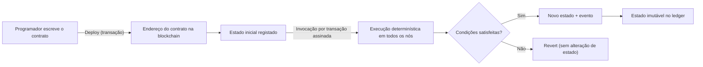

Um **smart contract** (contrato inteligente) é um programa armazenado numa blockchain que executa automaticamente um conjunto de regras quando determinadas condições se verificam. O código e o estado do contrato ficam registados na cadeia, pelo que qualquer alteração é pública, verificável e difícil de reverter.

O termo foi popularizado por Nick Szabo em 1994, mas só se tornou prático com blockchains programáveis como o Ethereum (2015). A ideia central é substituir a confiança numa entidade intermediária pela confiança nas regras inscritas no código.

## Como funciona?

Um smart contract é composto por **código**, **estado** (variáveis guardadas na cadeia) e **funções** que podem ser invocadas por transações. Uma invocação não "chama" um servidor: é uma transação assinada que todos os nós executam de forma determinística, chegando todos ao mesmo resultado.

1. **Deploy:** o bytecode é publicado numa transação; o contrato passa a ter um endereço próprio.
2. **Invocação:** um utilizador envia uma transação que chama uma função, com parâmetros e assinatura.
3. **Execução:** os nós executam o código em ambiente isolado (por exemplo, a EVM) e emitem o mesmo resultado.
4. **Estado e eventos:** se a execução termina com sucesso, o novo estado é gravado e os eventos ficam registados; se falhar, tudo é revertido (*revert*), como se nada tivesse acontecido.

## Propriedades essenciais

| Propriedade | Significado |
|---|---|
| **Determinismo** | O mesmo código e o mesmo estado produzem sempre o mesmo resultado, em todos os nós. |
| **Imutabilidade** | Depois do deploy, o código não pode ser alterado; correções exigem um novo contrato ou mecanismos de atualização explícitos. |
| **Atomicidade** | Uma transação executa por completo ou não executa nada. |
| **Transparência** | Código e estado são visíveis e auditáveis por qualquer participante. |
| **Autonomia** | Executa sem intervenção humana quando as condições estão codificadas. |
| **Custo (gas)** | Cada operação consome recursos pagos, o que limita ciclos e desencoraja abusos. |

## O que os distingue de um contrato tradicional

Um contrato jurídico depende de interpretação e de um tribunal para ser executado. Um smart contract executa **mecanicamente**: se a condição estiver no código, o resultado é aplicado. Isso dá previsibilidade, mas também significa que **um erro no código é uma regra errada**, e não uma cláusula discutível.

| | Contrato tradicional | Smart contract |
|---|---|---|
| Execução | Humana / judicial | Automática pelo código |
| Confiança | Instituições e intermediários | Código e consenso da rede |
| Alteração | Renegociação | Imutável (ou via upgrade controlado) |
| Ambiguidade | Interpretável | Nenhuma: o código é a regra |
| Custo inicial | Redação e acompanhamento jurídico | Desenvolvimento, auditoria e gas |

## Limitações

- **O oráculo:** o contrato não vê o mundo exterior. Para saber um preço, uma data ou um resultado, precisa de um **oráculo** — e o oráculo é um ponto de confiança que reintroduz o problema que se queria eliminar.
- **Bugs são permanentes:** o caso The DAO (2016) mostrou que uma falha pode drenar fundos e forçar uma divisão da rede.
- **Privacidade:** tudo o que fica na cadeia é público; dados sensíveis têm de ser cifrados ou mantidos fora dela (*off-chain*).
- **Custo e limites:** executar código na cadeia é caro e limitado; lógica pesada fica fora, com apenas hashes/provas na cadeia.
- **Enquadramento legal:** o contrato pode não ser reconhecido como contrato jurídico; a ligação entre código e direito continua a exigir interpretação humana.

## Onde aparecem no [[Bat (couf couf) Evidence A Wayne]]

No sistema de provas forenses, o smart contract é usado como **guardião do ciclo de vida do caso**, e não para guardar provas:

- **Abertura:** o Bloco 0 (Genesis) cria a sub-cadeia do caso, com ID, metadados e assinatura.
- **Depósito:** novos blocos só são aceites se o caso estiver no estado "Aberto" — o contrato verifica a assinatura e o encadeamento antes de gravar.
- **Encerramento:** o Bloco Final grava a flag "Encerrado" e o contrato executa `LOCK`, congelando o caso. A partir daí, nenhuma prova extra é aceite.
- **Ancoragem off-chain:** o contrato guarda apenas hashes e ponteiros URI; o conteúdo das provas permanece no armazenamento WORM.

Aqui a imutabilidade é uma vantagem jurídica: o estado do caso não pode ser reescrito depois do fecho, o que reforça a cadeia de custódia.

## Exemplos de utilização

- **Tokens e criptomoedas:** regras de emissão e transferência (ERC-20, ERC-721).
- **Finanças descentralizadas (DeFi):** empréstimos, trocas e liquidação automática.
- **Cadeia de custódia e registos:** ancoragem de hashes, auditoria e controlo de acesso.
- **Governação:** votações e execução automática de decisões.
- **Escrow:** libertação de fundos quando as condições codificadas se verificam.

## Resumo

Um smart contract é **código que detém estado e executa regras de forma determinística e imutável numa blockchain**. Resolve o problema da confiança na execução, mas desloca o risco para o código, para os oráculos e para a incapacidade de corrigir erros depois do deploy. É uma peça de [[Blockchein]] e complementa estruturas de verificação como as [[Merkel Trees]].

_Referências Relacionadas:_ [[Blockchein]], [[Merkel Trees]], [[Bat (couf couf) Evidence A Wayne]]
